# C2 - Containers (L'Intérieur de la Boîte Noire)

Le niveau "Containers" décompose le backend Volontariapp en ses principales briques d'infrastructure et d'exécution. 

L'architecture est fondamentalement basée sur un modèle de **Microservices Hautement Découplés** combiné à une approche **Event-Driven**. Pour garantir la résilience, chaque domaine (ex: User, Event, Post) possède sa propre pile d'exécution isolée, mais partage un bus de messagerie commun.

## Le Paradigme : "Isolé" vs "Partagé"

Une des règles d'or de l'architecture Volontariapp est la distinction entre ce qui appartient en propre à un domaine (Isolé) et ce qui sert de liant à la plateforme (Partagé).

### 1. Le Périmètre Isolé (L'Anatomie Type d'un Domaine)
À l'exception de quelques cas particuliers, tous les domaines métiers standards possèdent une pile d'exécution standardisée et **totalement isolée** (ils ont leur propre dépôt Git, leur propre processus Node.js, et ne partagent pas leur mémoire ni leur base de données). Six domaines suivent ce modèle : `user`, `event`, `post`, `social`, `storage` et `ranking`. Pour un domaine `<d>`, la pile comprend :
- **Le Microservice API (`ms-<d>`)** : Expose des contrats gRPC, exécute la logique métier.
- **La Base de Données (PostgreSQL)** : Chaque domaine possède sa propre base relationnelle.
- **L'Outbox Runner (`outbox-<d>`, dépôt `outbox-runners`)** : Un daemon Lean Node.js qui extrait les événements métier persistés de la base de données.
- **Les Workers (`worker-<d>`, dépôt `workers-runners`)** : Exécutent les tâches asynchrones lourdes spécifiques au domaine.
- **Les Post-Processors (`post-processor-<d>`, dépôt `post-processors-runner`)** : Consomment les Redis Streams pour finaliser les Sagas ou le nettoyage.

**Les Exceptions (Domaines Spécifiques) :**
- **Le Domaine Social (`ms-social`)** : Possède exactement la même structure (Postgres, Outbox, Workers, Post-Processors), mais intègre **en plus** une base de données **Neo4j** propre pour les algorithmes de graphe (abonnements, participations, recommandations).
- **Le Domaine Storage (`ms-storage`)** : Même structure standard, avec en plus un stockage objet **S3** (MinIO) et un scanner antivirus **ClamAV** (`clamd`). `ms-storage` est le seul propriétaire des fichiers : les autres domaines ne manipulent que des `file_id`. Le client envoie les octets directement sur S3 via une URL signée, dans un bucket privé de quarantaine ; `worker-storage` exécute le scan, puis le fichier est publié. Détail : [Stockage de fichiers](../stockage-fichiers/README.md).
- **Le Domaine Ranking (`ms-ranking`)** : Même structure standard. Il calcule en arrière-plan un classement personnalisé des événements et des posts (score structurel, scoreur sémantique optionnel **Jev** de TypeSafe AI, activable par `RANKING_JEV_ENABLED`). Le chemin de lecture ne fait aucun appel sortant : tous les appels vers les autres services sont faits par `worker-ranking`. Détail : [Classement personnalisé](../matching/README.md).
- **Le Domaine WebSocket (`ws-service`)** : Possède sa propre base PostgreSQL et son `outbox-ws`. En revanche, il n'a **pas** de Workers et pas de Post-Processors externes. Il possède un **Redis Dédié** (`db_redis_ws`) en plus du Redis partagé, exclusivement pour gérer le state de ses sessions éphémères.

### 2. Le Périmètre Partagé
Ces composants sont l'infrastructure commune qui permet aux domaines de communiquer sans couplage fort :
- **Redis (Shared)** : Le courtier de messages principal. Il est le seul élément d'infrastructure de données partagé. Il héberge les files d'attente **BullMQ** (pour les Workers) et les **Redis Streams** (pour l'Event-Driven / Post-Processors).
- **Le code métier (`domain_npm`)** : Hébergé dans le monorepo `npm-packages`, il garantit que tous les services isolés d'un même domaine parlent le même langage métier (Entités, Value Objects). Les domaines publiés sont `domain-user`, `domain-event`, `domain-post`, `domain-social`, `domain-storage` et `domain-ranking`.
- **L'observabilité** : Chaque service exporte ses traces via OpenTelemetry (collecteur OTel) vers Datadog ; Jaeger est disponible en local. Les logs passent par `@volontariapp/logger`, qui masque les données personnelles et injecte les identifiants de trace.

## Diagramme des Containers (C2)

```mermaid
flowchart TD
    user(["Client Mobile (nativapp)"])

    subgraph backend ["Backend Volontariapp"]

        api_gateway["API Gateway (NestJS)"]

        subgraph ws_domain ["Domaine WebSocket (Exception)"]
            ws_service["WS Service (Socket.io)"]
            outbox_ws["Outbox Runner"]
            db_pg_ws[("PostgreSQL")]
            db_redis_ws[("Redis (Dedicated WS)")]
        end

        subgraph domain_std ["Domaines Standards (user, event, post, ranking)"]
            ms_std["Microservice API (gRPC)"]
            outbox_std["Outbox Runner"]
            worker_std["Workers"]
            pp_std["Post-Processors"]
            db_pg_std[("PostgreSQL")]
        end

        subgraph domain_social ["Domaine Social (Exception)"]
            ms_social["Microservice API (gRPC)"]
            outbox_social["Outbox Runner"]
            worker_social["Workers"]
            pp_social["Post-Processors"]
            db_pg_social[("PostgreSQL")]
            db_neo4j[("Neo4j")]
        end

        subgraph domain_storage ["Domaine Storage (Exception)"]
            ms_storage["Microservice API (gRPC)"]
            outbox_storage["Outbox Runner"]
            worker_storage["Workers (scan)"]
            pp_storage["Post-Processors"]
            db_pg_storage[("PostgreSQL")]
            s3[("S3 / MinIO")]
            clamd["ClamAV"]
        end

        subgraph shared_infra ["Infrastructure Partagée"]
            db_redis[("Redis (Shared Pub/Sub & Queues)")]
        end

        %% --- Alignement forcé vers le bas ---
        db_pg_ws ~~~ db_redis
        db_pg_std ~~~ db_redis
        db_neo4j ~~~ db_redis
        db_pg_storage ~~~ db_redis
    end

    jev["Jev (TypeSafe AI, scoreur sémantique)"]

    %% --- 1. Trafic Entrant ---
    user -- "HTTPS & WSS" --> api_gateway
    user -- "Upload direct (URL signée)" --> s3

    %% --- 2. Routage Interne (Gateway) ---
    api_gateway -- "WSS (Proxy)" --> ws_service
    api_gateway -- "gRPC" --> ms_std
    api_gateway -- "gRPC" --> ms_social
    api_gateway -- "gRPC" --> ms_storage

    %% --- 3. Persistance Isolée (Top-Down) ---
    ws_service -- "Transaction ACID" --> db_pg_ws
    ws_service -- "Stockage Sessions" --> db_redis_ws
    ms_std -- "Transaction ACID" --> db_pg_std
    ms_social -- "Transaction ACID" --> db_pg_social
    ms_social -- "Cypher Queries" --> db_neo4j
    ms_storage -- "Transaction ACID" --> db_pg_storage
    worker_storage -- "Lecture / scan" --> s3
    worker_storage -- "Scan" --> clamd
    worker_std -- "Scoring sémantique (ranking)" --> jev

    %% --- 4. Outbox Polling (Local) ---
    outbox_ws -. "Poll Events" .-> db_pg_ws
    outbox_std -. "Poll Jobs | Events" .-> db_pg_std
    outbox_social -. "Poll Jobs | Events" .-> db_pg_social
    outbox_storage -. "Poll Jobs | Events" .-> db_pg_storage

    %% --- 5. Bus de Messages Partagé (Redis) ---
    outbox_ws -- "Push Events" --> db_redis
    outbox_std -- "Push Jobs | Events" --> db_redis
    outbox_social -- "Push Jobs | Events" --> db_redis
    outbox_storage -- "Push Jobs | Events" --> db_redis

    ws_service -- "Consomme Streams" --> db_redis
    worker_std -- "Pull Jobs" --> db_redis
    pp_std -- "Consomme Streams" --> db_redis
    worker_social -- "Pull Jobs" --> db_redis
    pp_social -- "Consomme Streams" --> db_redis
    worker_storage -- "Pull Jobs" --> db_redis
    pp_storage -- "Consomme Streams" --> db_redis
```

## Le Rôle de l'API Gateway : Gardien du Temple

L'**API Gateway** est le seul composant exposé sur Internet (via l'Ingress Kubernetes). 
Son rôle est de protéger le système interne en gérant deux flux principaux :

### 1. La Communication Synchrone (HTTP -> gRPC)
1. Il intercepte le Token JWT (fourni par Auth0, Firebase ou un provider interne).
2. Il valide l'authentification et génère un **Token Interne** signé, injecté dans les headers gRPC.
3. Il route la requête vers le bon Microservice (`ms-user`, `ms-event`, etc.) via **gRPC**.

### 2. Le Proxy WebSocket (WS -> WS)
Le `ws-service` n'est pas exposé directement sur Internet. 
1. L'API Gateway intercepte les requêtes d'upgrade WebSocket (vers `/socket.io`).
2. Il valide le Token d'accès (JWT).
3. S'il est valide, il génère un **Token Interne** qu'il injecte dans les headers de la requête proxy (`x-internal-token`).
4. Il transfère (proxy) la connexion TCP vers le `ws-service`.

> [!NOTE]
> Le `ws-service` délègue ainsi la complexité de l'authentification OAuth à la Gateway. Il n'a plus qu'à vérifier cryptographiquement le "Token Interne" (extrêmement rapide, sans appel BDD) pour autoriser le client et tracker sa socket. Les appels gRPC fonctionnent sur le même principe.

---

## Matrice Réseau & Ports Internes Standards

La communication interne entre pods respecte une cartographie de ports stricte, renforcée par des Network Policies :

| Service / Composant | Protocole | Port Interne | Description & Rôle |
| :--- | :--- | :--- | :--- |
| **Traefik Ingress** | HTTP / HTTPS | `80` / `443` | Reverse proxy d'entrée unique (TLS Cloudflare). |
| **API Gateway** | HTTP / WSS | `3000` | Port d'écoute du pod Gateway (en amont de Traefik). |
| **Microservices Métiers** | gRPC | `3000` | Communication RPC binaire inter-services (Protobuf). |
| **Bases PostgreSQL** | TCP / SQL | `5432` | 1 instance/base dédiée et isolée par microservice. |
| **Neo4j (ms-social)** | Bolt | `7687` | Port de connexion binaire Cypher pour le graphe social. |
| **Redis (Partagé & WS)** | Redis Protocol | `6379` | Broker Streams, files BullMQ et adaptateur Pub/Sub. |
| **mcp-meta-indexer** | HTTP (SSE) | `3000` | Serveur MCP distant sur le cluster pour les agents IA. |

### Ports de développement local

En local (`ci-tools/docker-compose.yml` et fichiers `config/default.config.json`), chaque service garde un port HTTP de santé (`/health`) et un port gRPC distincts :

| Service | HTTP `/health` | gRPC | PostgreSQL (docker-compose) |
| :--- | :--- | :--- | :--- |
| `ms-user` | `3001` | `5001` | `5432` |
| `ms-post` | `3002` | `5002` | `5433` |
| `ms-event` | `3003` | `5003` | `5434` |
| `ms-social` | `3004` | `5004` | `5435` (Neo4j Bolt `7687`) |
| `ws-service` | `3005` | non applicable (WebSocket) | `5436` (Redis dédié `6380`) |
| `ms-storage` | `3006` | `5006` | `5437` |
| `ms-ranking` | `3007` | `5007` | `5438` |

Dans le cluster, les services gRPC sont exposés par un `Service` ClusterIP sur le port `80` (ex. `ms-ranking:80`, utilisé par `MS_RANKING_URL`) ; la matrice ci-dessus décrit la cartographie interne.

---

## Dimensionnement & Quotas Kubernetes des Pods

Afin de garantir une allocation prédictive des ressources sur le cluster K3s et d'empêcher tout épuisement de mémoire (OOMKilled) :

| Type de Composant | CPU Requests | CPU Limits | Memory Requests | Memory Limits |
| :--- | :--- | :--- | :--- | :--- |
| **API Gateway** | `50m` | `200m` | `64Mi` | `128Mi` |
| **Microservices gRPC** | `100m` | `500m` | `128Mi` | `256Mi` |
| **Runners (Outbox / Workers)** | `50m` | `200m` | `64Mi` | `128Mi` |
| **Serveur mcp-meta-indexer** | `50m` | `200m` | `128Mi` | `256Mi` |

---

## Sécurité & Moindre Privilège : Le Token Interne (`INTERNAL TOKEN`)

Pour interdire formellement tout contournement de l'API Gateway et garantir la propagation sécurisée de l'identité :
1. **Zéro accès externe direct :** Aucun microservice (`ms-user`, `ms-event`, etc.) n'est accessible depuis l'extérieur du cluster. Seule l'API Gateway possède une route Ingress.
2. **Génération du Token Interne :** Dès qu'une requête HTTP/REST ou WSS arrive à la Gateway, celle-ci valide le jeton de session JWT (Auth0/Firebase/interne) et génère un jeton interne chiffré et signé (`INTERNAL_TOKEN`).
3. **Contenu du Jeton :** Il intègre l'identifiant utilisateur vérifié (`userId`), ses rôles, ses permissions fines et un identifiant de corrélation (`correlationId`).
4. **Validation côté Microservice :** Les microservices gRPC vérifient cryptographiquement ce jeton dans leurs interceptors NestJS. **Toute requête gRPC dépourvue d'un `INTERNAL_TOKEN` valide est rejetée immédiatement** avec un statut gRPC `UNAUTHENTICATED`.

> [!TIP]
> La communication entre l'API Gateway et les Microservices est **synchrone** et ultra-rapide (gRPC). Cependant, dès qu'un Microservice reçoit la requête, il ne fait qu'une validation métier rapide et une insertion en base de données, avant de répondre immédiatement au Gateway. Tout le reste du travail "lourd" est délégué à la tuyauterie asynchrone détaillée dans le niveau **C3**.
