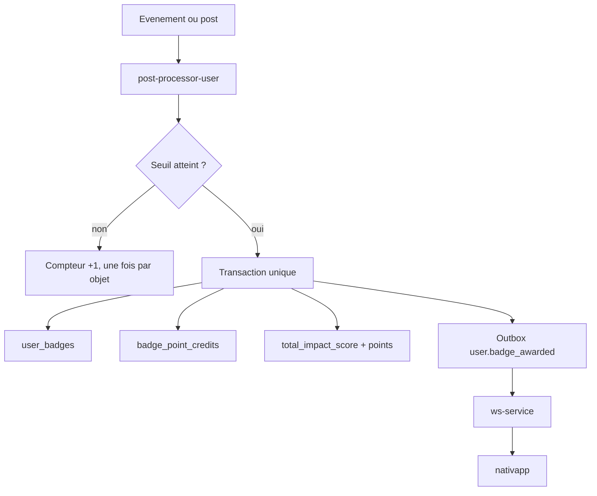

# 11 - Points de badges et suivi de progression

Chaque badge reçu rapporte des points, et l'utilisateur peut suivre l'avancement vers chaque badge. Ce document décrit ce qui a été construit, comment le mettre en production et ce qui reste ouvert.

> [!NOTE]
> **Statut au 2026-11-06 : backend livré et déployé, points éteints en production.**
> - Déployés : contrats, packages partagés, migration et route gRPC de `ms-user`, crédit des points et compteurs dans `post-processor-user`, script de rattrapage.
> - En revue : route REST de l'API Gateway (`api-gateway#107`, E2E vert) et écran de progression de `nativapp` (`nativapp#110`).
> - À faire par l'exploitation : rattrapage des compteurs, contrôle de quelques comptes, puis `BADGE_POINTS_ENABLED=true`.

## 1. Décisions

| # | Décision | Raison |
| :--- | :--- | :--- |
| B1 | Chaque badge rapporte des points, crédités **une seule fois** à l'attribution. | Un badge est un acquis (décision 2 du [README](README.md)) : les points suivent la même règle. |
| B2 | Barème = barème de base x 10 (section 2). | Demande du Lead Dev. |
| B3 | Les points alimentent `users.total_impact_score`, le même compteur que les points d'événements. | Une seule notion de « points » (glossaire de [scoring](../scoring/README.md)). |
| B4 | Table séparée `badge_point_credits`, clé `(user_id, badge_id)`. | `impact_score_credits` a pour clé `(event_id, user_id)` et ne peut pas porter un crédit de badge. |
| B5 | La progression se lit dans `badge_progress` (compteurs), pas par des requêtes à la volée sur les autres services. | Décision 4 du [README](README.md) : les compteurs vivent dans `ms-user`. |
| B6 | « Débloqué » vient de `user_badges`, jamais d'un calcul sur les compteurs. | Un badge est un acquis, les compteurs peuvent être en retard d'une passe. |
| B7 | Pas de rétroactivité : les badges déjà possédés ne rapportent aucun point. Le rattrapage ne remplit que les compteurs. | Cohérent avec la décision 7 de [scoring](../scoring/02-probleme-et-principes.md). |
| B8 | Les seuils de rang d'impact de `nativapp` ne sont **pas** recalibrés. | Décision du Lead Dev, à reprendre plus tard (section 9). |
| B9 | Un like sur son propre post n'est pas compté. | Anti-abus : les points rendent le badge monnayable. |
| B10 | Un like (ou un souhait) est compté une fois par couple `(objet, utilisateur)`, jamais décrémenté. | `post.liked` ne porte aucun identifiant de like : un unlike puis un like ne doit pas recompter. |
| B11 | L'auteur d'un post est résolu dans `post-processor-user` par `PostService.GetPost` (cache Redis), pas dans l'événement. | `likePost` vit dans `npm-packages` (`domain-social`) : enrichir `post.liked` aurait imposé un nouveau tour de la règle du STOP. |
| B12 | Les points sont derrière `BADGE_POINTS_ENABLED`, **éteint par défaut**. | Mise en production progressive et retour arrière sans toucher aux tables. |

## 2. Barème

Les valeurs sont dans le catalogue de `@volontariapp/shared` (`BADGE_CATALOG`, `BADGE_POINTS_VERSION = 1`), source unique des seuils et des points.

| Slug | Exigence | Points |
| :--- | :--- | :---: |
| `EVENT_PARTICIPATION_TIER_1` | 1 événement terminé | **100** |
| `EVENT_PARTICIPATION_TIER_2` | 5 événements terminés | **250** |
| `EVENT_PARTICIPATION_TIER_3` | 10 événements terminés | **500** |
| `EVENT_PARTICIPATION_TIER_4` | 20 événements terminés | **1000** |
| `EVENT_SOCIAL_TIER_1` | 1 événement socio | **150** |
| `EVENT_SOCIAL_TIER_2` | 5 événements socio | **400** |
| `EVENT_ECOLOGY_TIER_1` | 1 événement éco | **150** |
| `EVENT_ECOLOGY_TIER_2` | 5 événements éco | **400** |
| `EVENT_HYBRID_ECO_SOCIAL_TIER_1` | 5 socio et 5 éco | **600** |
| `EVENT_HOST_COUNT_1` | 1 événement créé | **200** |
| `COMMUNITY_POST_COUNT_1` | 1 post | **100** |
| `SOCIAL_LIKE_COUNT_10` | 10 posts aimés (d'autrui) | **100** |
| `EVENT_WISHLIST_COUNT_10` | 10 événements en favoris | **100** |

Total des 13 badges : 4 050 points.

> [!WARNING]
> Ordre de grandeur : un événement d'une heure à 5 présents rapporte environ 100 points par participant, un week-end plein à 200 présents environ 800 ([scoring/04](../scoring/04-exemples-et-simulations.md)). Le palier `EVENT_PARTICIPATION_TIER_4` (1000) vaut donc à peu près un événement plein : les badges pèsent plus lourd que les événements eux-mêmes, ce qui change l'échelle du total d'impact (B8).

## 3. Modèle de données (`ms-user`)

| Objet | Rôle |
| :--- | :--- |
| `badges.points` (nullable) | Points du badge, rempli par la migration pour les 13 slugs du seed. Le catalogue de `shared` sert de repli si la colonne est vide. |
| `badge_point_credits (user_id, badge_id)` | Registre des crédits, un par badge et par utilisateur. Colonnes `points`, `formula_version`, `created_at`. |
| `badge_progress_dedup (user_id, metric, ref_id)` | Un objet n'est compté qu'une fois : post aimé, événement mis en favori. |
| `badge_progress (user_id, metric)` | Compteurs de progression. |

Compteurs (`BADGE_METRICS` de `shared`) : `EVENTS_FINISHED_TOTAL`, `EVENTS_FINISHED_SOCIAL`, `EVENTS_FINISHED_ECOLOGY`, `SOCIAL_LIKES_GIVEN`, `SOCIAL_WISHES`. Les métriques `EVENTS_CREATED` et `POSTS_CREATED` sont déclarées dans le catalogue mais **ne sont pas alimentées** : leur cible est 1, l'état débloqué suffit.

La migration `AddBadgePointsAndProgressDedup1793970000000` est en phase Expand (colonne nullable, deux tables). Elle a été écrite dans `domain-user` (`npm-packages#299`) puis copiée à l'identique dans `ms-user` (`ms-user#88`), voir le playbook `volontariapp-db-migration`.

**Calcul de la progression** (`computeBadgeProgress`, fonction pure de `shared`) :

```text
current_i = min(compteur(metric_i), target_i)
percent   = floor(100 x somme(current_i) / somme(target_i))
unlocked  = le badge figure dans user_badges           (jamais déduit des compteurs)
```

Pour un badge débloqué, `percent` vaut 100 quelle que soit la valeur des compteurs. Les consommateurs doivent se fier à `unlocked` et `percent`, pas à `requirements[].current`, qui peut valoir 0 pour un badge débloqué dont le compteur n'est pas alimenté (hébergement, premier post).

## 4. Contrats

| Contrat | Où | Contenu |
| :--- | :--- | :--- |
| `Badge.points` (`int32 = 8`) | `proto-registry` | Points du badge. |
| `BadgeProgress`, `BadgeRequirementProgress` | `proto-registry` | `slug, name, description, points, unlocked, awarded_at, percent, requirements[], icon_file_id` ; `metric, current, target`. |
| RPC `BadgeService.GetMyBadgeProgress` | `proto-registry` | Sans paramètre : l'utilisateur vient du token interne. |
| `IBadgePayload.points?` | `messaging` | Présent dans `user.badge_awarded` seulement si les points ont été crédités. |
| `IPostLikedPayload.postAuthorId?` | `messaging` | Publié mais **inutilisé** (B11). À retirer lors d'un prochain passage sur `messaging`. |
| `BadgeProgressWeb`, `GetMyBadgeProgressWebResponse` | `contracts` | Types REST de la gateway (`awardedAt` en `Date`). |
| `GET /api/v1/users/me/badges/progress` | `api-gateway` | Route authentifiée, contrôleur `BadgeProgressQueryController`. |

## 5. Flux



Dans la transaction d'attribution : insertion `user_badges` (idempotente), puis, si le flag est actif, crédit des points (idempotent par `(user, badge)`), puis la ligne d'outbox. Le cache Redis `badges:owned:<user>` est écrit **après** le commit (correctif : écrit dans la transaction, un rollback laissait le badge « possédé » sans qu'il ait été attribué).

Likes et souhaits : le compteur s'incrémente seulement si la ligne de `badge_progress_dedup` est nouvelle. Pour un like, l'auteur du post est résolu par `GetPost` : post introuvable, le like n'est pas compté ; auteur égal au liker, non compté ; `ms-post` indisponible, l'erreur remonte et le message du flux est rejoué.

## 6. Livraison

| Étape | Dépôt | PR | État |
| :--- | :--- | :--- | :--- |
| Contrats gRPC | `proto-registry` | `6392b84` (push direct) | sur `main` |
| Catalogue, modèles, migration, payloads | `npm-packages` | #299 | publiée |
| Types Web de la gateway | `npm-packages` | #300 | publiée |
| Migration, `GetMyBadgeProgress` | `ms-user` | #88 | déployée |
| Points, compteurs, auto-likes, correctif Redis | `post-processors-runner` | #70 | déployée, flag éteint |
| Script de rattrapage | `post-processors-runner` | #71 | déployée |
| `MS_POST_URL` du post-processor | `deploy` | #40 | fusionnée |
| `BADGE_POINTS_ENABLED=true` dans la pile E2E | `ci-tools` | #75 | fusionnée |
| Route REST, scénario E2E | `api-gateway` | #107 | en revue, CI verte |
| Écran de progression | `nativapp` | #110 | en revue |

La séparation entre `proto-registry`, `npm-packages` et les consommateurs suit la règle du STOP (`AGENTS.md`, section 1).

## 7. Mise en production

1. `ms-user` déployé (la migration crée les tables), puis `post-processor-user` déployé avec le flag éteint.
2. `MS_POST_URL` présent sur le déploiement du post-processor (`deploy#40`).
3. Rattrapage des compteurs de likes et de souhaits, depuis le pod :

```bash
k -n prod exec deploy/post-processor-user -- node dist/scripts/backfill-badge-counters.js --dry-run
k -n prod exec deploy/post-processor-user -- node dist/scripts/backfill-badge-counters.js --user=<uuid>
k -n prod exec deploy/post-processor-user -- node dist/scripts/backfill-badge-counters.js
```

Le script lit les posts aimés et les événements souhaités dans `ms-social`, écarte les likes sur ses propres posts et sur les posts supprimés, remplit `badge_progress_dedup` puis fixe `badge_progress` au nombre de lignes (jamais en dessous de la valeur existante). Il est idempotent et n'attribue aucun badge ni aucun point. Code de sortie 1 si un utilisateur a échoué : relancer.
4. Contrôler quelques comptes (`GET /users/me/badges/progress`), puis passer `BADGE_POINTS_ENABLED=true` dans `deploy`. Le retour arrière consiste à remettre le flag à `false` : les crédits déjà faits restent, aucune table n'est modifiée.

Le script s'exécute dans le conteneur de l'application (320 Mi de mémoire, 50m CPU) : surveiller `RESTARTS` et éviter un moment de forte charge.

## 8. Tests

- Unitaires : `shared` (catalogue, `computeBadgeProgress`), `ms-user` (service, transformer, contrôleur), `post-processor-user` (compteurs, dédup, auto-like, post inconnu, points activés ou non, double crédit, rollback sans écriture Redis, client `ms-post`, rattrapage), `api-gateway` (contrôleur, DTO, routage HTTP), `nativapp` (catalogue, composants, écran, API, handler du socket).
- Migration validée (exécution, retour arrière, ré-exécution) sur un Postgres jetable avec la chaîne complète de `ms-user`, puis le rattrapage sur la même base.
- E2E (`api-gateway/e2e/scenarios/badge-scenarios.e2e.spec.ts`) : un volontaire débloque 11 badges sur 13 avec l'état en cours vérifié à chaque palier (8 puis 9 likes sur 10, 4 puis 5 événements, hybride à 40, 50 et 60 %), chaque badge annoncé une fois sur le socket avec ses points, route anonyme refusée. Les cas « non compté » (propre post, post inconnu de `ms-post`, like, unlike, like) utilisent un second utilisateur comme repère plutôt qu'une pause fixe.
- Non couverts en E2E : `EVENT_HOST_COUNT_1` (la pile E2E coupe le géocodage, le saga de création d'événement ne se termine pas, `it.todo`) et `EVENT_PARTICIPATION_TIER_4` (20 événements, laissé à 50 % volontairement).

## 9. Limites connues et suites

| Sujet | Détail |
| :--- | :--- |
| Rangs d'impact | Non recalibrés (B8). Les badges ajoutent jusqu'à 4 050 points au total : les seuils de rang de `nativapp` sont à revoir avant d'activer le flag à grande échelle. |
| Compteurs des anciens utilisateurs | Démarrent à 0 jusqu'au rattrapage ; ils perdent donc leur progression vers les badges de likes et de souhaits tant qu'il n'a pas tourné. |
| Rattrapage incomplet | `EVENTS_CREATED` et `POSTS_CREATED` ne sont pas rattrapés (non alimentés). |
| Souhaits | Le compteur mesure les événements distincts mis en favori, plus la taille actuelle de la liste (un souhait retiré reste compté). |
| Modale `nativapp` | Montre le premier badge reconnu d'un lot et ses propres points ; les autres sont sur l'écran des badges. |
| Champ `postAuthorId` | Inutilisé (B11). |
| Écriture inter-services | `post-processor-user` écrit directement dans les tables de `ms-user` : pattern existant, non modifié ici. |

Incident rencontré pendant le déploiement : le nœud k3s a atteint 100 % d'inodes (pas d'octets) à cause des images accumulées, ce qui bloquait le déploiement. Voir les leçons de la skill `volontariapp-deploy-gitops`.
