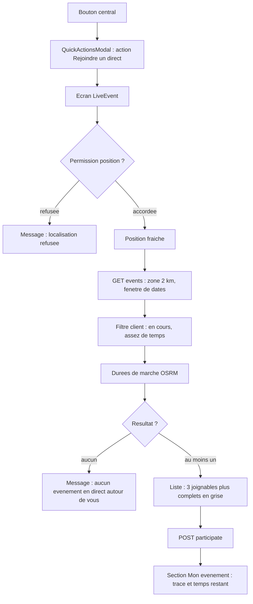

# 03 - nativapp

Périmètre : tout ce qui change dans `nativapp`. Avant toute tâche front, lire les huit skills exigées par `nativapp/CLAUDE.md` (`rn-architecture`, `rn-clean-code`, `rn-data-fetching`, `rn-forms`, `rn-styling`, `rn-verification`, `react-doctor`, `rn-stability`). Mocks dans `*.mock.ts`, factories dans `*.factory.ts`, `jest.spyOn` avec `restoreAllMocks()`, aucun `any`, aucun `as unknown as`.

## 1. Parcours



## 2. Fichiers

Les chemins suivent les conventions existantes (`src/api/event/hooks/use-*.ts`, `*.utils.ts`, écrans exportés par `@/screens`).

| Action | Fichier | Rôle |
| :--- | :--- | :--- |
| Créer | `src/api/event/live-events.utils.ts` | Constantes, distance à vol d'oiseau, filtre et séparation joignables / complets (fonctions pures) |
| Créer | `src/services/routing.service.ts` | Client OSRM piéton : durées (une requête), tracé (une requête), file d'attente, cache, repli |
| Créer | `src/hooks/use-current-position.ts` | Position fraîche **à la demande** (`refresh()`), états de permission |
| Créer | `src/api/event/hooks/use-nearest-live-events.ts` | Orchestration : position, recherche, filtre, durées, séparation |
| Créer | `src/screens/event/LiveEventScreen.tsx` et `src/screens/event/hooks/use-live-event-screen.ts` | Écran commun et sa logique |
| Créer | `src/components/event/live/` : `LiveCandidateCard.tsx`, `LiveFullEventsSection.tsx`, `LiveMyEventSection.tsx`, `LiveRouteMap.tsx` | Composants de l'écran |
| Créer | `src/api/event/hooks/use-has-live-participation.ts` | `hasLiveParticipation` : participations **et** événements organisés (D20) en direct selon D1 ; lu depuis le cache React Query de ManageHub (`use-get-participated-events`, `use-get-my-events`), requête lancée seulement quand la modale s'ouvre, jamais au montage de l'app |
| Modifier | `src/navigation/components/QuickActionsModal.tsx` | Props `onSelectLive` et `hasLiveParticipation` ; troisième action |
| Modifier | `src/navigation/MainAppNavigator.tsx` | Handler `navigation.navigate('LiveEvent')` ; passe `hasLiveParticipation` (hook ci-dessus) |
| Modifier | `src/navigation/stacks/MainStack.tsx` | Route `LiveEvent: undefined` dans `MainStackParamList` et dans le navigateur ; ajouter la portée (`ParticipatedScope`) aux paramètres de `MainTabs` pour le bouton "Mes évts" (aujourd'hui seul `initialTab`, `:17-19`) |
| Modifier | `src/screens/index.ts` | Export de `LiveEventScreen` |
| Modifier (tests existants) | `src/navigation/components/__tests__/QuickActionsModal.test.tsx`, `src/navigation/__tests__/MainAppNavigator.test.tsx` | Les nouvelles props obligatoires les cassent : à mettre à jour dans le même lot |
| Palier 4 | `src/hooks/use-live-sharing.ts`, `src/hooks/use-live-organizer-positions.ts`, `src/api/live/live.api.ts` | Partage de position et carte de l'organisateur |
| Palier 4, modifier | `src/context/NotificationContext.tsx` (accès au socket, réabonnement après reconnexion), `src/screens/event/EventManagementScreen.tsx` et `src/components/event/EventParticipantsTab.tsx` (carte de l'organisateur), `app.json` (texte de permission, lignes 37-40) | Branchements du palier 4 |

## 3. Types et constantes

```ts
// src/api/event/live-events.utils.ts
export const LIVE_SEARCH_RADIUS_M = 2000;
export const LIVE_SEARCH_LIMIT = 30; // la gateway écrête au-delà de 100 (ADR-Pagination section 3)
export const LIVE_START_LOOKBACK_MS = 24 * 60 * 60 * 1000;
export const LIVE_MIN_USEFUL_PRESENCE_MS = 15 * 60 * 1000; // décision Q5
export const LIVE_MAX_WALK_S = 30 * 60; // décision Q4
export const LIVE_MAX_JOINABLE = 3;
export const LIVE_MAX_FULL_SHOWN = 2; // décision Q6
export const LIVE_MAX_ROUTING_CANDIDATES = 8;
export const WALKING_SPEED_MPS = 1.25; // repli, mesuré le 2026-11-07
// palier 4
export const LIVE_ARRIVAL_RADIUS_M = 50; // calculé par le client sur sa position brute (D17)
export const LIVE_POSITION_STALE_MS = 120 * 1000; // l'organisateur retire un point plus vieux

/** D19 : une capacité <= 0 signifie sans limite. */
export function isEventFull(event: Pick<AppEvent, 'maxParticipants' | 'currentParticipants'>): boolean {
  return event.maxParticipants > 0 && event.currentParticipants >= event.maxParticipants;
}

export type LiveCandidateAvailability = 'JOINABLE' | 'FULL';

export interface LiveEventCandidate {
  event: AppEvent;
  distanceMeters: number;
  walkSeconds: number;
  availability: LiveCandidateAvailability;
  /** true quand OSRM est indisponible : durée estimée à vol d'oiseau. */
  isEstimated: boolean;
}

export interface LiveEventsResult {
  joinable: LiveEventCandidate[]; // trié par walkSeconds croissant, LIVE_MAX_JOINABLE au plus
  full: LiveEventCandidate[]; // LIVE_MAX_FULL_SHOWN au plus
}

export type LiveScreenStatus =
  | 'locating'
  | 'searching'
  | 'ready'
  | 'empty'
  | 'permission_denied'
  | 'error';
```

```ts
// src/services/routing.service.ts
export interface Coordinates { latitude: number; longitude: number }

export interface WalkingRoute {
  distanceMeters: number;
  durationSeconds: number;
  geometry: Coordinates[]; // pour <Polyline>
}

export interface WalkingDurations {
  /** Même ordre que les destinations ; null si OSRM n'a pas pu router cette destination. */
  durationsSeconds: (number | null)[];
}

export interface RoutingService {
  fetchWalkingDurations(origin: Coordinates, destinations: Coordinates[], signal?: AbortSignal): Promise<WalkingDurations>;
  fetchWalkingRoute(origin: Coordinates, destination: Coordinates, signal?: AbortSignal): Promise<WalkingRoute>;
}
```

## 4. Requête de recherche

Route : `GET /events`, via `eventApi.getEvents` et `useGetEvents` (le hook existant est une `useInfiniteQuery` ; pour ce besoin une page suffit, donc créer un hook dédié `use-nearest-live-events` qui appelle `eventApi.getEvents` avec `page: 1`).

| Paramètre | Valeur | Raison |
| :--- | :--- | :--- |
| `area` | centre : position fraîche ; `radiusMeters`: 2000 | D2 |
| `statuses` | `[EVENT_STATE_PUBLISHED, EVENT_STATE_IN_PROGRESS]` | aucun job ne passe à `IN_PROGRESS` : un événement en cours est souvent encore `PUBLISHED` |
| `startDateFrom` | maintenant moins 24 h (ISO 8601) | écarter les événements anciens restés `PUBLISHED` |
| `startDateTo` | maintenant (ISO 8601) | l'événement a commencé |
| `endAtFrom` | maintenant (ISO 8601), **après le palier 3 seulement** | supprime la troncature ; avant, le filtre de fin est fait côté client |
| `onlyAvailable` | `false` | il n'accepte que `PUBLISHED` et ne filtre pas la capacité |
| `excludeBlockedUsers` | `true` | sécurité : événements des utilisateurs bloqués masqués |
| `excludeParticipatedByMe`, `excludeCreatedByMe` | `true` | ces événements sont dans "Mon événement" |
| `page`, `limit` | `1`, `30` | la gateway écrête au-delà de 100 |

Sérialisation : passer l'objet tel quel dans `params` (axios), comme Explore (`explore-search.utils.ts:26-37`) ; `statuses` contient les valeurs numériques de l'enum. La gateway ignore un paramètre inconnu (`ValidationPipe` sans `whitelist`, `api-gateway/src/main.ts:71`) : envoyer `endAtFrom` avant le déploiement de LE-07 est sans effet, pas une erreur.

**Limite connue :** avec `startDateTo = maintenant`, un événement que l'organisateur a démarré **avant** son heure de début n'est pas trouvé. Rare ; accepté.

**Horloge :** `maintenant` vient du téléphone. Un téléphone décalé décale la fenêtre ; accepté. Les fonctions pures reçoivent `now` en paramètre (testable).

## 5. Règle de sélection

Pure, testée, dans `live-events.utils.ts`.

1. Garder `isEventLive(event, now)` **et** `endAt > now` (garde-fou : `isEventLive` compte aussi un `IN_PROGRESS` dont la fin est dépassée) **et** un état différent de `CANCELLED` et `FINISHED` (`isEventLive` ne regarde pas l'état dans la plage horaire) **et** `location` définie. Exporter cette règle (`isEventJoinableLive`) : `use-has-live-participation` l'utilise aussi.
2. Trier par distance à vol d'oiseau croissante, garder `LIVE_MAX_ROUTING_CANDIDATES`.
3. Obtenir les durées de marche d'OSRM (une requête pour tous les candidats). En cas d'échec : `distance / WALKING_SPEED_MPS`, `isEstimated = true`.
4. Écarter si `walkSeconds > LIVE_MAX_WALK_S`.
5. Écarter si `endAt - now < walkSeconds * 1000 + LIVE_MIN_USEFUL_PRESENCE_MS`.
6. `availability = FULL` si `isEventFull(event)` (D19 : `maxParticipants > 0` et `currentParticipants >= maxParticipants`), sinon `JOINABLE`.
7. Trier chaque groupe par `walkSeconds`, tronquer à `LIVE_MAX_JOINABLE` et `LIVE_MAX_FULL_SHOWN`.

## 6. Écrans

```text
Bouton central : actions rapides

+------------------------------------------+
| ACTIONS RAPIDES                      x   |
| Que souhaitez-vous faire ?               |
|                                          |
| [+]  Créer                               |
|      Organiser un événement ou un post   |
|                                          |
| [=]  Gérer                               |
|      Mes événements, participations      |
|                                          |
| [>]  Rejoindre un direct                 |
|      Événement en cours autour de vous   |
+------------------------------------------+
```

Si `hasLiveParticipation` (participation **ou** organisation d'un événement en direct, D20) : titre "Mon événement en direct", sous-titre "Voir le trajet, le temps restant". La carte est ancrée en bas : l'ajout d'une ligne ne déplace pas le bouton (à vérifier sur la mise en page actuelle de `QuickActionsModal`). Pour un organisateur, la section "Mon événement" montre son événement sans bouton "Trajet" ni bascule de partage.

```text
Écran LiveEvent (racine de MainStack, plein écran, sans barre d'onglets)

+------------------------------------------+
| <  Événements en direct                  |
+------------------------------------------+
| MON ÉVÉNEMENT (si je participe)          |
|  Nettoyage des berges        EN COURS    |
|  Fin dans 1 h 20 - 42 participants       |
|  [ Trajet ]  [ Détail ]  [ Mes évts ]    |
+------------------------------------------+
| AUTOUR DE MOI (2 km à pied)              |
|  1. Collecte alimentaire    8 min  12/20 |
|  2. Atelier vélo           14 min   9/10 |
|  3. Cueillette urbaine     19 min   3/15 |
|                                          |
| Autres événements (complets)             |
|  -  Marche solidaire       11 min  25/25 |
+------------------------------------------+
```

Les noms et chiffres sont fictifs. Réutilisations : `isEventLive` et `getEventStatusConfig` (badge "En cours"), `useUserSocialActions` (`participate`), `AppMap` et `EventMapPrevue`, `use-get-participated-events` et `use-get-my-events` pour la section "Mon événement". Le bouton "Mes évts" ouvre `ManageHub` (onglet participations) ; filtrer sur la portée "en direct" demande d'ajouter la portée aux paramètres de navigation (aujourd'hui `MainStackParamList.MainTabs` n'accepte que `initialTab`).

États (`LiveScreenStatus`) : `locating`, `searching`, `ready`, `empty` ("Aucun événement en direct autour de vous"), `permission_denied` (même présentation que `ExploreScreen`), `error` (bouton "Réessayer").

## 7. Service de trajet (OSRM)

| Point | Valeur |
| :--- | :--- |
| Hôte | `https://routing.openstreetmap.de/routed-foot` (jamais `router.project-osrm.org` : il calcule en voiture) |
| Coordonnées | ordre **longitude,latitude** dans l'URL **et dans la géométrie GeoJSON renvoyée** : convertir chaque `[lng, lat]` en `{ latitude, longitude }` pour `<Polyline>` (test dédié) |
| Durées | un appel au service `table` avec `sources=0&annotations=duration` (vérifié par curl le 2026-11-07 : `durations [[0, 1005.5, 2381.2]]`) ; une durée `null` signifie destination non routable ; repli : un appel `route` par candidat, espacés |
| Tracé | un appel `route` avec `overview=full&geometries=geojson` (vérifié par curl : `LineString` de 118 points) pour le seul candidat choisi |
| Cadence | une requête à la fois, 1,1 s au minimum entre deux requêtes (limite publique : 1 par seconde) |
| En-tête | `User-Agent` identifiant l'application (exigé par la politique d'usage ; **à vérifier** que React Native l'envoie tel quel) |
| Cache | 60 s par couple (origine arrondie à 4 décimales, destination) |
| Échec | repli à vol d'oiseau (`WALKING_SPEED_MPS`), `isEstimated = true`, indication "estimé" dans l'interface |

## 8. Partage de position (palier 4)

Côté personne qui partage :

- bascule "Partager ma position avec l'organisateur" sur la carte de l'événement suivi, **désactivée par défaut**, avec le texte de consentement : "Partager ma position avec l'organisateur jusqu'à mon arrivée. Position approximative (environ 100 m), visible de l'organisateur seul, jamais conservée." ;
- activation : `PUT /live/events/:eventId/sharing` puis, en cas de succès, `Location.watchPositionAsync` avec un intervalle de 30 s (Q7) ;
- **arrivée détectée par le client** (D17) : à chaque lecture, la distance entre la position **brute** et l'événement est calculée localement ; à `LIVE_ARRIVAL_RADIUS_M` ou moins, le client arrête le partage avec la raison `ARRIVED`. La position brute n'est jamais envoyée ni journalisée ;
- sinon la position est **arrondie à 3 décimales** (environ 111 m en latitude, 73 m en longitude à Paris) avant envoi, puis émise par `socket.emit('live.position', { eventId, latitude, longitude })` sur le socket obtenu par `socketService.getSocket()` (le service n'a pas d'`emit`) ;
- arrêt automatique : arrivée, réception de `live.sharing_stopped`, passage de l'app en arrière-plan (`AppState`), départ de l'événement, fin de l'événement, retrait de la permission (échec de `watchPositionAsync`), démontage de l'écran. L'arrêt appelle `DELETE /live/events/:eventId/sharing?reason=<ARRIVED|STOPPED|LEFT>` ; au retour au premier plan, l'utilisateur réactive lui-même le partage ;
- reconnexion du socket (rafraîchissement du jeton après `connect_error`) : les hooks du partage se réabonnent au nouveau socket ;
- un seul appareil connecté à la fois (`ws-service` ferme l'ancien socket) : le partage d'un autre appareil s'arrête ; l'interface l'indique ;
- permission **foreground uniquement** (déjà utilisée) : aucune permission d'arrière-plan. Réécrire le texte de `app.json:37-40` pour mentionner le partage avec l'organisateur ; retirer `locationAlwaysAndWhenInUsePermission` si `app.config.js` ne le réutilise pas (à vérifier dans le lot) ;
- aucun `console.log` ni journal contenant une position (le dépôt journalise souvent des payloads, par exemple `event.api.ts:113`).

Côté organisateur : dans `EventManagementScreen` (onglet participants, `EventParticipantsTab`), une carte affiche les positions reçues via `live.positions_updated` quand l'événement est en direct. La carte démarre vide et se remplit à chaque mise à jour (au plus 30 s de délai pour le premier point). **Un point plus vieux que `LIVE_POSITION_STALE_MS` est retiré** (app tuée, réseau coupé) ; `live.sharing_stopped` retire le point aussitôt.

Branchement : un hook dédié (`use-live-organizer-positions`) enregistre ses handlers sur le socket. Ne pas agrandir `useNotificationHandlers.ts` (fichier déjà très long, un seul gros effet).

## 9. Tests

- `live-events.utils.test.ts` : chaque étape de la règle de sélection, cas limites (`endAt` manquant, `IN_PROGRESS` expiré, `CANCELLED` et `FINISHED` dans la plage horaire, complet exactement à la capacité, capacité 0, aucun candidat, tous écartés par la marche). `now` injecté.
- `routing.service.test.ts` : parsing de la réponse OSRM, conversion `[lng, lat]`, durée `null`, file d'attente et cadence, cache, repli sur erreur réseau et sur code OSRM différent de `Ok`.
- `use-nearest-live-events.test.tsx` : états du hook avec React Query de test, annulation au démontage.
- `use-has-live-participation.test.tsx` : participation en direct, organisation en direct, événement annulé dans la plage, aucune requête tant que la modale est fermée.
- `LiveEventScreen` : un test par état de `LiveScreenStatus`.
- `QuickActionsModal` : libellé selon `hasLiveParticipation`, appel de `onSelectLive` ; mettre à jour `QuickActionsModal.test.tsx` et `MainAppNavigator.test.tsx` existants.
- Palier 4 : arrivée locale (aucun envoi sous le rayon), arrondi, arrêt sur arrière-plan et sur retrait de permission, réabonnement après reconnexion, purge des points périmés chez l'organisateur.
- Mocks dans `*.mock.ts` (`expo-location`, socket, `react-native-maps` si `jest.setup.js` ne le simule pas déjà : à vérifier, c'est le premier `Polyline` du dépôt).
- Pas de test E2E en local : pousser et lire le job CI `e2e`.

## 10. Critères d'acceptation

- Sans événement en cours dans 2 km : message "Aucun événement en direct autour de vous".
- Avec trois événements joignables et un complet : trois cartes triées par temps de marche, et le complet dans la section grisée, sans bouton de participation.
- Un événement qui finit avant l'arrivée plus 15 min n'apparaît pas.
- OSRM coupé : la liste s'affiche avec la mention "estimé".
- Permission refusée : message, aucune requête envoyée.
- Participer met à jour le compteur et fait apparaître l'événement dans "Mon événement".
- Un événement annulé ou terminé dans sa plage horaire n'apparaît nulle part dans le direct.
