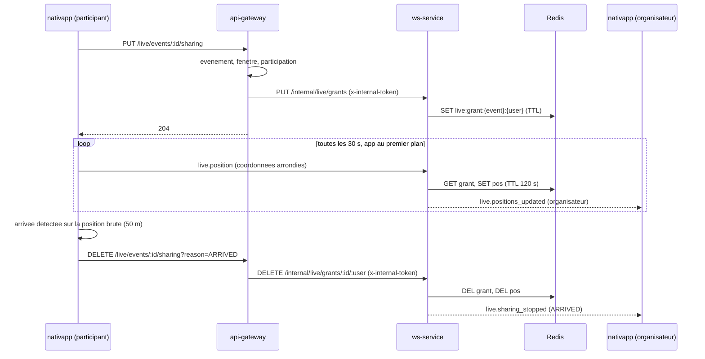

# 04 - Contrats et back-end

Ce qui change hors de `nativapp`. **Le palier 1 et le palier 2 ne demandent rien ici** (sauf le seed de démo, LE-04). Tout le reste concerne les paliers 3 et 4.

> [!CAUTION]
> Règle du STOP (`AGENTS.md` section 1). Après une modification de `proto-registry` ou de `npm-packages` : build et tests locaux, changeset, **arrêt**, la PR est poussée, la CI publie, **ensuite seulement** les consommateurs (`ms-event`, `api-gateway`, `ws-service`, `nativapp`) sont modifiés. Aucun `any` ni cast de contournement.

## 1. Vue d'ensemble

| Dépôt | Palier | Changement |
| :--- | :--- | :--- |
| `proto-registry` | P3 | `optional string end_at_from = 14;` dans `SearchEventsQuery` |
| `npm-packages` (PR automatique) | P3 | Régénération de `contracts` et `contracts-nest` |
| `npm-packages` (PR manuelle) | P3 et P4 | `contracts` (type de requête REST), `domain-event` (filtre), `messaging` (types WebSocket du direct) |
| `ms-event` | P3 | Transmettre `endAtFrom` |
| `api-gateway` | P1 | Seed d'événements en cours |
| `api-gateway` | P3 | Champ `endAtFrom` du DTO |
| `api-gateway` | P4 | `PUT` et `DELETE /live/events/:eventId/sharing` |
| `ws-service` | P4 | Endpoint interne d'autorisation, handler `live.position`, Redis |
| `deploy` | : | **Aucun changement prévu** (voir section 9) |
| Migrations SQL | : | Aucune |

## 2. `proto-registry` : un champ

Skill : `volontariapp-proto-contract-evolution`. Fichier : `proto-registry/proto/volontariapp/event/event.query.proto`.

```proto
message SearchEventsQuery {
  // ... champs 1 à 13 inchangés ...
  // Events whose end is at or after this instant (ISO 8601), the counterpart of
  // `start_date_from`, used to list events that are still running.
  optional string end_at_from = 14;
}
```

Compatibilité : ajout d'un champ optionnel avec un numéro neuf, donc compatible. Vérifier `buf lint` et `buf breaking --against '.git#branch=main'`, puis **STOP**. À la fusion sur `main`, la CI ouvre la PR automatique dans `npm-packages` (régénération de `contracts` et `contracts-nest`).

## 3. `npm-packages` : au plus deux PR

| PR | Origine | Contenu | Paquets bumpés |
| :--- | :--- | :--- | :--- |
| A | automatique (CI de `proto-registry`) | Régénération `contracts`, `contracts-nest` | `contracts`, `contracts-nest` |
| B | manuelle | voir ci-dessous | `contracts`, `domain-event`, `messaging` |

**Ordre de fusion : A d'abord, B ensuite**, rebasée sur A après sa fusion : les deux modifient `@volontariapp/contracts`, donc deux bumps concurrents sinon. A est un bump `patch` de `contracts` et `contracts-nest` produit par le robot (`ci-tools/.github/actions/create-bump-pr/action.yml:41-69`) ; ajouter B sur la branche du robot est impossible (`changeset version` y a déjà tourné).

**Développement en parallèle** : B se code pendant LE-01, dans sa propre session (D21). `yarn changeset add` tôt ; **`yarn changeset version` seulement après le rebase sur A fusionnée**, une seule fois (la CI vérifie que `CHANGELOG.md` contient la version de `package.json`). Le champ de `SearchEventsWebQuery` est dans `src/gateway/`, que la CI de `proto-registry` ne touche jamais : aucun conflit de fichier avec A, seulement de version.

Contenu de B (skill `volontariapp-shared-npm-package-change`) :

1. **`contracts` (écrit à la main)** : `npm-packages/packages/contracts/src/gateway/event/request/search-events.request.ts`, ajouter à `SearchEventsWebQuery` : `endAtFrom?: string; // ISO 8601`.
2. **`domain-event`** :
   - `SearchAdvancedVO` : ajouter `endAtFrom` comme **dernier paramètre optionnel** du constructeur (la construction actuelle est positionnelle, `event.query.controller.ts:83-104`) pour ne casser aucun appelant ;
   - `postgres-event.repository.ts` (`searchAdvanced`), à côté de `startDateFrom` (lignes 409-415) :
     ```ts
     if (params.endAtFrom) {
       query.andWhere('event.endAt >= :endAtFrom', { endAtFrom: params.endAtFrom });
     }
     ```
   - tests unitaires (filtre appliqué, absent, combiné à `area` et `statuses`). Vérifier le plan d'exécution (`EXPLAIN`) sur une base de test : le volume est faible, un index sur `endAt` n'est a priori pas nécessaire (**à confirmer**).
3. **`messaging`** : voir section 5.

Après la publication par la CI : levée du verrou (`AGENTS.md` section 1, conditions : fusion, job `Definitive Release` vert, `npm view` répond pour **chaque** paquet bumpé), puis `yarn up` chez les consommateurs.

## 4. `ms-event` et `api-gateway` : `endAtFrom`

- `ms-event` : `SearchEventsQueryDTO` (`ms-event/src/modules/event/dto/request/query/search-events.query.dto.ts`) reçoit `endAtFrom` avec les mêmes validateurs que `startDateFrom` ; le contrôleur (`event.query.controller.ts`, à côté de la ligne 98) convertit en `Date` et le passe au `SearchAdvancedVO`. Tests : contrôleur et DTO.
- `api-gateway` : `SearchEventsRequestDTO` reçoit `endAtFrom` avec `@ApiProperty({ example: '2023-01-01T00:00:00Z', required: false })`, **`@IsOptional()` et `@IsISO8601()`** (`startDateFrom`, ligne 45, n'a aucun validateur : ne pas copier ce manque), et `toQuery()` le transmet (à côté de la ligne 100). Tests du DTO : valeur valide transmise, valeur invalide refusée en 400, absente inchangée. Skill : `volontariapp-api-gateway`.

## 5. `messaging` : types WebSocket du direct (palier 4)

Dans `npm-packages/packages/messaging/src/websockets/`, nouveau dossier `live/` sur le modèle de `events/`, `users/`, `posts/`, `storage/` ; l'index (`websockets/index.ts`) agrège l'enum et le registre.

```ts
// websockets/live/types.ts
export enum LiveWebsocketMessagingType {
  LIVE_POSITIONS_UPDATED = 'live.positions_updated',
  LIVE_SHARING_STOPPED = 'live.sharing_stopped',
}

// Messages envoyés par le CLIENT (nouveau : le registre actuel est serveur vers client)
export enum LiveClientMessageType {
  LIVE_POSITION = 'live.position',
}
```

```ts
// websockets/live/payload.ts
export type LiveSharingStopReason =
  | 'ARRIVED' // détectée par le client (D17), ou repli serveur à 150 m
  | 'STOPPED' // arrêt volontaire, arrière-plan, démontage, permission retirée
  | 'EVENT_ENDED'
  | 'LEFT' // l'utilisateur quitte l'événement (unparticipate)
  | 'REVOKED'
  | 'EXPIRED';

/** Client vers serveur. Les coordonnées sont déjà arrondies par le client ; le serveur arrondit encore. */
export interface ILivePositionClientPayload {
  eventId: string;
  latitude: number;
  longitude: number;
}

export interface ILiveParticipantPosition {
  userId: string;
  latitude: number; // arrondi à 3 décimales par le serveur
  longitude: number; // arrondi à 3 décimales par le serveur
  updatedAt: string; // ISO 8601
}

/** Serveur vers l'organisateur. */
export interface ILivePositionsUpdatedWebsocketPayload {
  eventId: string;
  positions: ILiveParticipantPosition[];
}

/** Serveur vers la personne qui partage, et vers l'organisateur. */
export interface ILiveSharingStoppedWebsocketPayload {
  eventId: string;
  userId: string;
  reason: LiveSharingStopReason;
}

/** Gateway vers ws-service (appel HTTP interne), jamais vu du client. */
export interface ILiveGrantRequest {
  eventId: string;
  userId: string;
  organizerId: string;
  eventLatitude: number;
  eventLongitude: number;
  expiresAt: string; // ISO 8601, fin de l'événement plus 15 min, plafonné à 8 h (revérifié par ws-service)
}

/** Gateway vers ws-service, corps du DELETE interne. */
export interface ILiveRevokeRequest {
  eventId: string;
  userId: string;
  reason: Extract<LiveSharingStopReason, 'ARRIVED' | 'STOPPED' | 'LEFT'>;
}
```

Registre : ajouter les deux entrées serveur vers client à `WebsocketEventRegistry`, fusionner `LiveWebsocketMessagingType` dans `WebsocketMessagingType`, exporter les types. Les messages clients ne sont **pas** dans `WebsocketEventRegistry` (qui décrit ce que `notifyUser` envoie) : ils ont leur propre registre `LiveClientMessageRegistry`.

## 6. `api-gateway`

### 6.1 Seed d'événements en cours (palier 1, LE-04)

Le seed tire aujourd'hui des événements passés ou futurs (`event-seed.service.ts:95-106`). Ajouter un petit nombre d'événements **en cours**, avec l'horloge injectée (testable) :

| Profil | `startAt` | `endAt` | Usage dans la démo ([06](06-risques-et-verifications.md) section 4) |
| :--- | :--- | :--- | :--- |
| Normal (N-2 événements) | maintenant moins 10 à 60 min | maintenant plus une durée configurable, 180 min par défaut | Candidats joignables |
| Fin proche (1) | maintenant moins 30 min | maintenant plus 15 à 20 min | Doit être écarté (marche plus 15 min) |
| Complet (1) | maintenant moins 30 min | comme "Normal" | Rempli par des participations seedées jusqu'à `maxParticipants` |

Adresses prises dans la liste existante, regroupées dans un même quartier pour tenir dans 2 km. Ils restent `PUBLISHED` (état à la création, `event.transformer.ts:54`), ce qui correspond au comportement réel. Le géocodage est asynchrone (`worker-event`) : le seed attend que chaque événement ait une `location` avant de rendre la main, ou le documente. La démo est **périmée à la fin de la durée choisie** : relancer le seed avant chaque démo. Le point d'entrée (`system-seed.service.ts`) et son paramétrage n'ont pas été lus : à lire avant d'écrire le lot. Nombre configurable, zéro par défaut hors démo. Le formulaire de l'app permet aussi de créer un événement en cours ([01](01-etat-des-lieux.md) section 1).

### 6.2 Autorisation du partage (palier 4, LE-09)

```text
PUT    /live/events/:eventId/sharing   -> 204   (utilisateur authentifié)
DELETE /live/events/:eventId/sharing   -> 204
```

Contrôles du `PUT`, dans cet ordre :

1. Charger l'événement (`getEvent` gRPC, avec les métadonnées internes). `organizerId`, coordonnées et dates viennent **de cet événement**, jamais de la requête du client.
2. Refuser si l'état est `CANCELLED` ou `FINISHED`, ou si `maintenant` est hors de [`startAt` moins 30 min, `endAt`].
3. Refuser si l'appelant est l'organisateur (400 : personne à qui montrer sa position).
4. Vérifier que l'appelant participe : parcourir **ses propres participations** (`getUserParticipateEvent` avec `fetchAllPages`, le motif de `event-social-filter.service.ts:105-110`) et chercher `eventId`. Il n'existe pas de RPC booléen ([01](01-etat-des-lieux.md) section 3). Si l'échelle l'exige un jour, ajouter un RPC `IsEventParticipant` (cycle de contrats supplémentaire, hors périmètre).
5. Appeler `ws-service` : `PUT {msWsUrl}/internal/live/grants` avec le corps `ILiveGrantRequest` et l'en-tête `x-internal-token` signé **pour l'appelant** (`JwtService.signInternal({ id, role })`, même mécanique que `ws-proxy.middleware.ts:122-125`) : `ws-service` exige `token.id === userId` (D18). `expiresAt = min(endAt + 15 min, maintenant + 8 h)`.

Un événement introuvable et un événement non autorisé renvoient la même réponse (même code, même message) pour ne pas révéler l'existence d'un `eventId`. Codes d'erreur : réutiliser ceux de `@volontariapp/errors-nest` ; si un code nouveau est nécessaire, il entre dans la PR B (`npm-packages`), sinon c'est un bump de plus.

`DELETE /live/events/:eventId/sharing?reason=ARRIVED|STOPPED|LEFT` (défaut `STOPPED`) : appelle `DELETE {msWsUrl}/internal/live/grants/:eventId/:userId` avec la raison et le même jeton lié à l'appelant. Journaliser **sans coordonnées**.

Fichiers : nouveau module `live` (contrôleur, service, client HTTP vers `msWsUrl`, DTO Swagger), déclaré dans le module racine. Le client HTTP de la gateway (`@nestjs/axios` ou autre) est à vérifier dans `api-gateway/package.json` avant d'écrire le lot.

### 6.3 Contrôle de capacité (optionnel, LE-12, décision Q3)

Dans `participateSelf` (`participation.command-controller.ts:28`), avant l'appel gRPC : lire l'événement et le compteur enrichi, répondre 409 si `maxParticipants > 0` et `currentParticipants >= maxParticipants` (D19). Une course entre deux demandes simultanées reste possible : seul un contrôle dans `ms-social` serait strict, et il demande que `ms-social` connaisse la capacité (hors périmètre).

## 7. `ws-service` (palier 4, LE-08)

Nouveau module `live` dans `ws-service/src/` (`LiveModule`, déclaré dans `app.module.ts`), avec son propre `LiveGateway` socket.io plutôt qu'un ajout dans `AppGateway`. Le worktree part de `origin/main` (le checkout local de `ws-service` peut être sur une branche de fonction).

**Endpoint interne** (nouveau contrôleur HTTP sous `/internal/live`, jamais sous `/socket.io`), protégé par un garde (D18) qui :
1. vérifie `x-internal-token` avec `JwtService.verifyInternal` (déjà utilisé à `app.gateway.ts:55`) ;
2. exige `token.id === userId` (corps du `PUT`, chemin du `DELETE`) : un jeton interne valide seul ne suffit pas, il porte une identité utilisateur et 21 sources peuvent joindre `ws-service` ;
3. refuse un `expiresAt` passé ou au-delà de maintenant plus 8 h.

| Méthode | Chemin | Effet |
| :--- | :--- | :--- |
| `PUT` | `/internal/live/grants` | Écrit `live:grant:{eventId}:{userId}` (valeur : organisateur, coordonnées de l'événement, expiration ; TTL jusqu'à `expiresAt`) |
| `DELETE` | `/internal/live/grants/:eventId/:userId` | Supprime l'autorisation et la dernière position ; notifie `live.sharing_stopped` avec la raison reçue (`ARRIVED`, `STOPPED` ou `LEFT`) à l'organisateur |

**Handler entrant** : `@SubscribeMessage('live.position')` dans `LiveGateway`.

```text
reçoit { eventId, latitude, longitude } ; userId = client.data.userId
0. userId absent (message reçu avant la fin de handleConnection) -> ignorer ; fin
   payload invalide (types, bornes) -> ignorer ; fin
1. autorisation = GET live:grant:{eventId}:{userId}
   absente  -> notifyUser(userId, live.sharing_stopped, REVOKED) ; fin
2. cadence : si la dernière mise à jour date de moins de 10 s -> ignorer
3. arrondir latitude et longitude à 3 décimales
4. SET live:pos:{eventId}:{userId} (valeur arrondie, TTL 120 s)
5. repli d'arrivée (D17) : si distance(position arrondie, événement) <= 150 m
     -> supprimer autorisation et position
     -> notifyUser(userId, live.sharing_stopped, ARRIVED)
     -> notifyUser(organizerId, live.sharing_stopped, ARRIVED)
   sinon
     -> notifyUser(organizerId, live.positions_updated, { eventId, positions: [position arrondie] })
```

Constantes : rayon d'arrivée de repli 150 m (l'arrivée normale est détectée par le client à 50 m), TTL de position 120 s, cadence minimale 10 s, 3 décimales, plafond d'autorisation 8 h.

Limites connues : l'authentification du socket n'a lieu qu'à la connexion, donc un jeton d'accès qui expire n'arrête pas le partage (le TTL de l'autorisation le borne) ; un blocage ou une suppression de compte entre l'organisateur et le participant ne révoque pas une autorisation en cours (TTL également).

Redis : réutiliser le `NestRedisProvider` déjà injecté dans `SocketManagerService` ; les clés sont locales à `ws-service` (la gateway n'accède pas à Redis), donc aucune constante partagée dans `shared`. **Pas de room par événement en V1** : l'organisateur reçoit par sa room utilisateur (`notifyUser`).

Messages et journaux : **ne jamais journaliser une latitude ou une longitude**. `@volontariapp/logger` ne masque pas ces clés aujourd'hui (`masking.ts:4-22`, V5 réglé) : passer `masking: { keys: ['latitude', 'longitude'] }` au `Logger` créé dans `ws-service/src/main.ts` (option supportée, `logger.ts:11-12`), sans changement de paquet. Ne jamais ajouter `lat` seul (recherche par sous-chaîne : il masquerait `relation`, `template`). Le masquage porte sur les clés : une coordonnée interpolée dans une chaîne n'est pas masquée, donc interdite.



## 8. Sécurité et vie privée

| Sujet | Règle |
| :--- | :--- |
| Consentement | Désactivé par défaut, par événement, texte explicite, retrait à tout moment (`DELETE`) |
| Finalité | Aider l'organisateur à savoir où est un participant qui arrive. Aucun autre usage |
| Minimisation | Arrondi à environ 100 m côté client **et** côté serveur ; une seule position par utilisateur et par événement. **Protection faible à elle seule** : une suite de points à 100 m sur un trajet vers un lieu connu révèle la trajectoire, et le passage d'une cellule à l'autre trahit la position exacte. La protection réelle repose sur l'audience unique, le consentement et la durée |
| Durée | Autorisation jusqu'à la fin de l'événement plus 15 min (8 h au plus, revérifié par `ws-service`) ; position 120 s ; arrêt à l'arrivée |
| Persistance | **Aucune en base SQL.** Redis avec TTL uniquement ; Redis n'est pas chiffré au repos, ce qui n'est acceptable que grâce au TTL de 120 s |
| Audience | L'organisateur seul, lu dans l'événement par la gateway, jamais dans la requête du client. Jamais les autres participants (ADR-6) |
| Journaux | Jamais de coordonnées ; identifiants seulement ; masquage des clés dans `ws-service` ; aucun `console.log` de position dans `nativapp`. La gateway ne journalise pas l'URL de `GET /events`, qui porte la position exacte : à garder ainsi |
| Authentification | Handshake `ws-service` (jeton) ; appel interne gateway vers `ws-service` avec jeton interne signé pour l'appelant et lié à `userId` (D18) |
| Énumération | Événement introuvable et refus d'autorisation : même réponse |
| Abus | Cadence minimale 10 s côté serveur ; autorisation obligatoire pour toute position ; payload validé (types, bornes) |
| Référence | `AGENTS.md` section 6 (données personnelles, moindre privilège, traçabilité) |

## 9. Réseau (`deploy`)

La gateway ne peut pas joindre Redis en production (`api-gateway.yaml:18-47`) mais peut joindre `ws-service` sur tout port (`api-gateway.yaml:32-34`), qui accepte l'entrée depuis la gateway (`ws-service.yaml:14-47`). La sortie de `ws-service` vers Redis est autorisée (`ws-service.yaml:66-81`, V6 réglé le 2026-11-07). **Aucun changement de `deploy`.**

## 10. Observabilité

- Journaliser les actions (activation, arrêt et raison, refus d'autorisation) avec identifiants d'événement et d'utilisateur, jamais de coordonnées.
- Compter les arrêts par raison (`ARRIVED`, `EXPIRED`, `REVOKED`, `LEFT`) : signal utile pour juger si le partage est utilisé.
