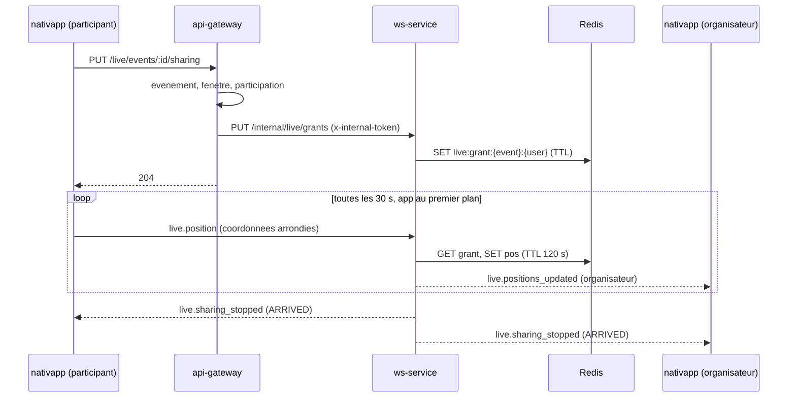

# 04 - Contrats et back-end

Ce qui change hors de `nativapp`. **Le palier 1 et le palier 2 ne demandent rien ici** (sauf le seed de démo, LE-04). Tout le reste concerne les paliers 3 et 4.

> [!CAUTION]
> Règle du STOP (`AGENTS.md` section 1). Après une modification de `proto-registry` ou de `npm-packages` : build et tests locaux, changeset, **arrêt**, la PR est poussée, la CI publie, **ensuite seulement** les consommateurs (`ms-event`, `api-gateway`, `ws-service`, `nativapp`) sont modifiés. Aucun `any` ni cast de contournement.

## 1. Vue d'ensemble

| Dépôt | Palier | Changement |
| :--- | :--- | :--- |
| `proto-registry` | P3 | `optional string end_at_from = 14;` dans `SearchEventsQuery` |
| `npm-packages` (PR automatique) | P3 | Régénération de `contracts` et `contracts-nest` |
| `npm-packages` (PR manuelle) | P3 et P4 | `contracts` (type de requête REST), `domain-event` (filtre), `messaging` (types WebSocket du direct) |
| `ms-event` | P3 | Transmettre `endAtFrom` |
| `api-gateway` | P1 | Seed d'événements en cours |
| `api-gateway` | P3 | Champ `endAtFrom` du DTO |
| `api-gateway` | P4 | `PUT` et `DELETE /live/events/:eventId/sharing` |
| `ws-service` | P4 | Endpoint interne d'autorisation, handler `live.position`, Redis |
| `deploy` | : | **Aucun changement prévu** (voir section 9) |
| Migrations SQL | : | Aucune |

## 2. `proto-registry` : un champ

Skill : `volontariapp-proto-contract-evolution`. Fichier : `proto-registry/proto/volontariapp/event/event.query.proto`.

```proto
message SearchEventsQuery {
  // ... champs 1 à 13 inchangés ...
  // Events whose end is at or after this instant (ISO 8601), the counterpart of
  // `start_date_from`, used to list events that are still running.
  optional string end_at_from = 14;
}
```

Compatibilité : ajout d'un champ optionnel avec un numéro neuf, donc compatible. Vérifier `buf lint` et `buf breaking --against '.git#branch=main'`, puis **STOP**. À la fusion sur `main`, la CI ouvre la PR automatique dans `npm-packages` (régénération de `contracts` et `contracts-nest`).

## 3. `npm-packages` : au plus deux PR

| PR | Origine | Contenu | Paquets bumpés |
| :--- | :--- | :--- | :--- |
| A | automatique (CI de `proto-registry`) | Régénération `contracts`, `contracts-nest` | `contracts`, `contracts-nest` |
| B | manuelle | voir ci-dessous | `contracts`, `domain-event`, `messaging` |

**Ordre : A d'abord, B ensuite**, rebasée sur A après sa fusion : les deux modifient `@volontariapp/contracts`, donc deux bumps concurrents sinon. Une seule branche, un seul changeset pour B (`yarn changeset add` puis `yarn changeset version`, une fois par branche : la CI vérifie que `CHANGELOG.md` contient la version de `package.json`).

Contenu de B (skill `volontariapp-shared-npm-package-change`) :

1. **`contracts` (écrit à la main)** : `npm-packages/packages/contracts/src/gateway/event/request/search-events.request.ts`, ajouter à `SearchEventsWebQuery` : `endAtFrom?: string; // ISO 8601`.
2. **`domain-event`** :
   - `SearchAdvancedVO` : ajouter `endAtFrom` comme **dernier paramètre optionnel** du constructeur (la construction actuelle est positionnelle, `event.query.controller.ts:83-104`) pour ne casser aucun appelant ;
   - `postgres-event.repository.ts` (`searchAdvanced`), à côté de `startDateFrom` (lignes 409-415) :
     ```ts
     if (params.endAtFrom) {
       query.andWhere('event.endAt >= :endAtFrom', { endAtFrom: params.endAtFrom });
     }
     ```
   - tests unitaires (filtre appliqué, absent, combiné à `area` et `statuses`). Vérifier le plan d'exécution (`EXPLAIN`) sur une base de test : le volume est faible, un index sur `endAt` n'est a priori pas nécessaire (**à confirmer**).
3. **`messaging`** : voir section 5.

Après la publication par la CI : levée du verrou (`AGENTS.md` section 1, conditions : fusion, job `Definitive Release` vert, `npm view` répond pour **chaque** paquet bumpé), puis `yarn up` chez les consommateurs.

## 4. `ms-event` et `api-gateway` : `endAtFrom`

- `ms-event` : `SearchEventsQueryDTO` (`ms-event/src/modules/event/dto/request/query/search-events.query.dto.ts`) reçoit `endAtFrom` avec les mêmes validateurs que `startDateFrom` ; le contrôleur (`event.query.controller.ts`, à côté de la ligne 98) convertit en `Date` et le passe au `SearchAdvancedVO`. Tests : contrôleur et DTO.
- `api-gateway` : `SearchEventsRequestDTO` reçoit `endAtFrom` (mêmes décorateurs que `startDateFrom`, ligne 45) et `toQuery()` le transmet (ligne 100). Tests du DTO. Skill : `volontariapp-api-gateway`.

## 5. `messaging` : types WebSocket du direct (palier 4)

Dans `npm-packages/packages/messaging/src/websockets/`, nouveau dossier `live/` sur le modèle de `events/`, `users/`, `posts/`, `storage/` ; l'index (`websockets/index.ts`) agrège l'enum et le registre.

```ts
// websockets/live/types.ts
export enum LiveWebsocketMessagingType {
  LIVE_POSITIONS_UPDATED = 'live.positions_updated',
  LIVE_SHARING_STOPPED = 'live.sharing_stopped',
}

// Messages envoyés par le CLIENT (nouveau : le registre actuel est serveur vers client)
export enum LiveClientMessageType {
  LIVE_POSITION = 'live.position',
}
```

```ts
// websockets/live/payload.ts
export type LiveSharingStopReason =
  | 'ARRIVED'
  | 'EVENT_ENDED'
  | 'LEFT'
  | 'REVOKED'
  | 'EXPIRED';

/** Client vers serveur. Les coordonnées sont déjà arrondies par le client ; le serveur arrondit encore. */
export interface ILivePositionClientPayload {
  eventId: string;
  latitude: number;
  longitude: number;
}

export interface ILiveParticipantPosition {
  userId: string;
  latitude: number; // arrondi à 3 décimales par le serveur
  longitude: number; // arrondi à 3 décimales par le serveur
  updatedAt: string; // ISO 8601
}

/** Serveur vers l'organisateur. */
export interface ILivePositionsUpdatedWebsocketPayload {
  eventId: string;
  positions: ILiveParticipantPosition[];
}

/** Serveur vers la personne qui partage, et vers l'organisateur. */
export interface ILiveSharingStoppedWebsocketPayload {
  eventId: string;
  userId: string;
  reason: LiveSharingStopReason;
}

/** Gateway vers ws-service (appel HTTP interne), jamais vu du client. */
export interface ILiveGrantRequest {
  eventId: string;
  userId: string;
  organizerId: string;
  eventLatitude: number;
  eventLongitude: number;
  expiresAt: string; // ISO 8601, fin de l'événement plus 15 min, plafonné à 8 h
}
```

Registre : ajouter les deux entrées serveur vers client à `WebsocketEventRegistry`, fusionner `LiveWebsocketMessagingType` dans `WebsocketMessagingType`, exporter les types. Les messages clients ne sont **pas** dans `WebsocketEventRegistry` (qui décrit ce que `notifyUser` envoie) : ils ont leur propre registre `LiveClientMessageRegistry`.

## 6. `api-gateway`

### 6.1 Seed d'événements en cours (palier 1, LE-04)

Le seed tire aujourd'hui des événements passés ou futurs (`event-seed.service.ts:94-106`). Ajouter un petit nombre d'événements **en cours** : `startAt = maintenant moins une durée tirée entre 10 et 60 min`, `endAt = maintenant plus une durée tirée entre 60 et 180 min`, adresse prise dans la liste existante. Ils ne passent pas à `IN_PROGRESS` : ils restent `PUBLISHED`, ce qui correspond au comportement réel de la plateforme. Le point d'entrée du seed (`system-seed.service.ts`) et son paramétrage n'ont pas été lus : à lire avant d'écrire le lot. Prévoir un nombre configurable, et zéro par défaut hors démo.

### 6.2 Autorisation du partage (palier 4, LE-09)

```text
PUT    /live/events/:eventId/sharing   -> 204   (utilisateur authentifié)
DELETE /live/events/:eventId/sharing   -> 204
```

Contrôles du `PUT`, dans cet ordre :

1. Charger l'événement (`getEvent` gRPC, avec les métadonnées internes).
2. Refuser si l'état est `CANCELLED` ou `FINISHED`, ou si `maintenant` est hors de [`startAt` moins 30 min, `endAt`].
3. Refuser si l'appelant est l'organisateur (400 : personne à qui montrer sa position).
4. Vérifier que l'appelant participe : parcourir `GetEventParticipants` avec l'utilitaire existant `fetchAllPages` (`api-gateway/src/common/pagination/fetch-all-pages.helper.ts`). Il n'existe pas de RPC booléen ([01](01-etat-des-lieux.md) section 3) ; pour des événements de quelques dizaines de personnes, une page suffit. Si l'échelle l'exige un jour, ajouter un RPC `IsEventParticipant` (cycle de contrats supplémentaire, hors périmètre).
5. Appeler `ws-service` : `PUT {msWsUrl}/internal/live/grants` avec le corps `ILiveGrantRequest` et l'en-tête `x-internal-token` produit par `JwtService.signInternal` (même mécanique que `ws-proxy.middleware.ts:122-125`). `expiresAt = min(endAt + 15 min, maintenant + 8 h)`.

`DELETE` : appelle `DELETE {msWsUrl}/internal/live/grants/:eventId/:userId`. Journaliser **sans coordonnées**.

### 6.3 Contrôle de capacité (optionnel, LE-12, décision Q3)

Dans `participateSelf` (`participation.command-controller.ts:28`), avant l'appel gRPC : lire l'événement et le compteur enrichi, répondre 409 si `currentParticipants >= maxParticipants`. Une course entre deux demandes simultanées reste possible : seul un contrôle dans `ms-social` serait strict, et il demande que `ms-social` connaisse la capacité (hors périmètre).

## 7. `ws-service` (palier 4, LE-08)

Nouveau module `live` dans `ws-service/src/`.

**Endpoint interne** (nouveau contrôleur HTTP, protégé par un garde qui vérifie `x-internal-token` avec `JwtService.verifyInternal`, déjà utilisé à `app.gateway.ts:55`) :

| Méthode | Chemin | Effet |
| :--- | :--- | :--- |
| `PUT` | `/internal/live/grants` | Écrit `live:grant:{eventId}:{userId}` (valeur : organisateur, coordonnées de l'événement, expiration ; TTL jusqu'à `expiresAt`) |
| `DELETE` | `/internal/live/grants/:eventId/:userId` | Supprime l'autorisation et la dernière position ; notifie `live.sharing_stopped` raison `LEFT` |

**Handler entrant** : `@SubscribeMessage('live.position')` dans le gateway socket.io (aujourd'hui `AppGateway` n'a que des hooks de connexion).

```text
reçoit { eventId, latitude, longitude } ; userId = client.data.userId (posé à la connexion)
1. autorisation = GET live:grant:{eventId}:{userId}
   absente  -> notifyUser(userId, live.sharing_stopped, REVOKED) ; fin
2. cadence : si la dernière mise à jour date de moins de 10 s -> ignorer
3. arrondir latitude et longitude à 3 décimales
4. SET live:pos:{eventId}:{userId} (valeur arrondie, TTL 120 s)
5. si distance(position, événement) <= 50 m
     -> supprimer autorisation et position
     -> notifyUser(userId, live.sharing_stopped, ARRIVED)
     -> notifyUser(organizerId, live.sharing_stopped, ARRIVED)
   sinon
     -> notifyUser(organizerId, live.positions_updated, { eventId, positions: [position arrondie] })
```

Constantes : rayon d'arrivée 50 m, TTL de position 120 s, cadence minimale 10 s, 3 décimales, plafond d'autorisation 8 h.

Redis : réutiliser le `NestRedisProvider` déjà injecté dans `SocketManagerService` ; les clés sont locales à `ws-service` (la gateway n'accède pas à Redis), donc aucune constante partagée dans `shared`. **Pas de room par événement en V1** : l'organisateur reçoit par sa room utilisateur (`notifyUser`).

Messages et journaux : **ne jamais journaliser une latitude ou une longitude**. Vérifier que `@volontariapp/logger` masque ces clés (skill `volontariapp-logger`) ; sinon les ajouter à la configuration de masquage ([06](06-risques-et-verifications.md) V5).



## 8. Sécurité et vie privée

| Sujet | Règle |
| :--- | :--- |
| Consentement | Désactivé par défaut, par événement, texte explicite, retrait à tout moment (`DELETE`) |
| Finalité | Aider l'organisateur à savoir où est un participant qui arrive. Aucun autre usage |
| Minimisation | Arrondi à environ 100 m côté client **et** côté serveur ; une seule position par utilisateur et par événement |
| Durée | Autorisation jusqu'à la fin de l'événement plus 15 min (8 h au plus) ; position 120 s ; arrêt à l'arrivée |
| Persistance | **Aucune en base SQL.** Redis avec TTL uniquement |
| Audience | L'organisateur seul. Jamais les autres participants (ADR-6) |
| Journaux | Jamais de coordonnées ; identifiants seulement |
| Authentification | Handshake `ws-service` (jeton), appel interne gateway vers `ws-service` avec jeton interne signé |
| Abus | Cadence minimale 10 s côté serveur ; autorisation obligatoire pour toute position |
| Référence | `AGENTS.md` section 6 (données personnelles, moindre privilège, traçabilité) |

## 9. Réseau (`deploy`)

La gateway ne peut pas joindre Redis en production (`api-gateway.yaml:18-47`) mais peut joindre `ws-service`, qui accepte l'entrée depuis la gateway (`ws-service.yaml`). L'appel gateway vers `ws-service` ne demande donc **aucun changement de `deploy`**. `ws-service` utilise déjà Redis (`socket-manager.service.ts`), donc la sortie vers Redis existe (**inférence** : la suite du fichier de politique n'a pas été lue, à confirmer, [06](06-risques-et-verifications.md) V6). Si cette confirmation échoue, un lot `deploy` s'ajoute (skill `volontariapp-deploy-gitops`).

## 10. Observabilité

- Journaliser les actions (activation, arrêt et raison, refus d'autorisation) avec identifiants d'événement et d'utilisateur, jamais de coordonnées.
- Compter les arrêts par raison (`ARRIVED`, `EXPIRED`, `REVOKED`, `LEFT`) : signal utile pour juger si le partage est utilisé.
