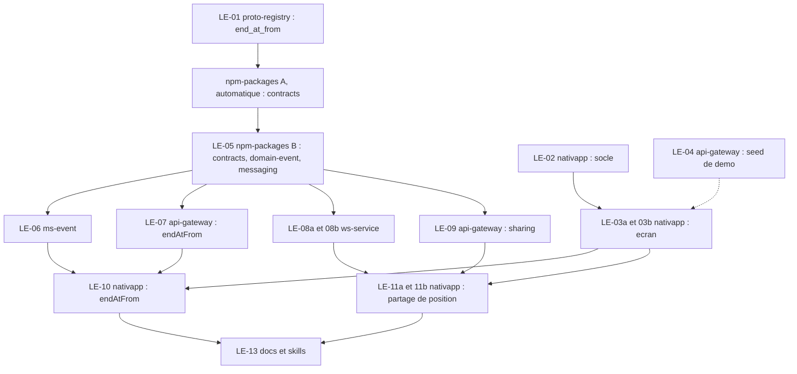

# 05 - Plan de PR et lots

Objectif : un ordre de PR propre, peu de PR dans `npm-packages`, et des lots assez précis pour être confiés à des sous-agents qui travaillent en parallèle. Les estimations d'heures sont des estimations de l'assistant, à valider. Un lot tient en 3 heures au plus ; une PR peut regrouper plusieurs lots.

## 1. Règles qui s'appliquent à tout

1. **Règle du STOP** (`AGENTS.md` section 1) : après `proto-registry` ou `npm-packages` : build, tests, changeset, arrêt, PR poussée, publication par la CI, puis seulement les consommateurs. Pas de `any`, pas de cast de contournement.
2. **Le verrou est posé par session, et un sous-agent partage celui de sa session** (vérifié le 2026-11-07 : le marqueur est `$STATE_DIR/$SESSION`, `stop-rule-guard.sh:22-24` ; un sous-agent porte le `session_id` de sa session, et un sous-agent qui n'avait édité que `nativapp` a été refusé parce que sa session avait édité `npm-packages`). Dès qu'un fichier de `proto-registry` ou `npm-packages` est édité dans une session, les éditions de `ms-*`, `api-gateway`, `ws-service`, `nativapp` sont refusées pour toute la session, sous-agents compris. Après une édition de `proto-registry`, `npm-packages/packages/contracts*` est aussi verrouillé. **Conséquences (D21) :** l'orchestrateur et ses sous-agents ne touchent jamais l'amont ; LE-01 et LE-05 tournent **chacun dans un processus `claude -p` séparé** (LE-05 édite `contracts/src/gateway`, refusé dans une session qui a édité `proto-registry`). agy n'a aucun hook : ne jamais lui confier un lot amont.
3. **Levée du verrou** : après la publication par la CI, par le Lead Dev (`! .claude/hooks/stop-rule-guard.sh release`) ou par l'orchestrateur mandaté, aux trois conditions de `AGENTS.md` section 1 (PR `npm-packages` fusionnée et job `Definitive Release` vert ; `npm view @volontariapp/<paquet>@<version> version --prefer-online` répond pour **chaque** paquet bumpé ; levée rapportée avec les versions vérifiées). **`release` lève le verrou de toutes les sessions** (`stop-rule-guard.sh:14-17`) : ne le lancer que quand aucune session "contrats" n'est en cours.
4. **Un worktree par lot** (`.worktrees/<nom>/`, déjà ignoré par git). Le dépôt d'un fichier se lit sur son remote `origin`.
5. **Tests d'abord** (skill `tdd`), mocks et factories dans des fichiers séparés.
6. **Pas d'E2E en local** : pousser et lire le job CI `e2e`.
7. **Avant de terminer un lot** : `python3 .agents/skills/volontariapp-skill-evolution/scripts/evolve.py plan`, puis relire les skills listées.
8. **Webhook Discord** : un seul message par PR, seulement quand la PR est sans conflit et la CI verte (`AGENTS.md` section 7).
9. **Pas de grep à la racine de `meta`** : `mesh-mcp` (`smart_search` avec `scope`, `find_dependents`, `analyze_impact`, `analyze_grpc`).

## 2. Vagues et dépendances



| Vague | Lots | Sessions | Remarque |
| :--- | :--- | :--- | :--- |
| 0 (maintenant) | Orchestrateur : LE-02 puis LE-03a et LE-03b ; LE-04. Processus séparés : LE-01, LE-05 (codé, sans `changeset version`) | 1 session d'orchestration, 2 processus `claude -p` | LE-01 attend la fusion (G1). **La démo P1 + P2 est utilisable à la fin de LE-02, LE-03a, LE-03b et LE-04** |
| 1 | PR automatique `npm-packages` A ; fusion, puis rebase de LE-05 sur A, `changeset version`, PR B | processus de LE-05 | A d'abord, B rebasée sur A |
| 2 (après levée du verrou) | LE-06, LE-07, LE-08a, LE-08b, LE-09 en parallèle | 5 worktrees | LE-07 et LE-09 touchent le même dépôt : deux branches, deux PR. LE-08a et LE-08b : deux branches, une PR `ws-service` empilée |
| 3 | LE-10, LE-11a, LE-11b | 3 worktrees | LE-10 peut être fusionnée avant le déploiement (paramètre ignoré, V9) ; LE-11 après **déploiement** de LE-08 et LE-09 |
| 4 | LE-13 | une session | Documentation d'état et skills |

## 3. Ordre des PR

| # | PR | Dépôt | Lot | Dépend de | Porte humaine |
| :--- | :--- | :--- | :--- | :--- | :--- |
| 1 | `proto-registry` : `end_at_from` | `proto-registry` | LE-01 | : | G1 : fusion, ouvre la PR automatique |
| 2 | Socle trajet et sélection | `nativapp` | LE-02 | : | : |
| 3 | Seed d'événements en cours | `api-gateway` | LE-04 | : | : |
| 4 | Écran "Événement en direct" (empilée sur la PR 2) | `nativapp` | LE-03a, LE-03b | PR 2 | Victor : vérification visuelle sur simulateur |
| 5 | **`npm-packages` A** : régénération `contracts` (automatique) | `npm-packages` | : | PR 1 fusionnée | G2a : publication |
| 6 | **`npm-packages` B** : `contracts`, `domain-event`, `messaging` | `npm-packages` | LE-05 | PR 5 fusionnée (codée en parallèle de la PR 1) | G2b : publication, levée du verrou |
| 7 | `endAtFrom` | `ms-event` | LE-06 | PR 6 publiée | : |
| 8 | `endAtFrom` (DTO) | `api-gateway` | LE-07 | PR 6 publiée | : |
| 9 | Endpoint interne, puis handler `live.position` | `ws-service` | LE-08a, LE-08b | PR 6 publiée | Victor : relecture sécurité avant fusion |
| 10 | Autorisation du partage | `api-gateway` | LE-09 | PR 6 publiée | Victor : relecture sécurité avant fusion |
| 11 | Utiliser `endAtFrom` | `nativapp` | LE-10 | PR 4 et PR 6 publiée (le déploiement de 7 et 8 n'est pas requis : V9) | : |
| 12 | Partage de position et carte organisateur | `nativapp` | LE-11a, LE-11b | PR 4, 9, 10 (déployées) | Victor : relecture sécurité avant fusion |
| 13 | (optionnel) Capacité à la participation | `api-gateway` | LE-12 | décision Q3 | : |
| 14 | Documentation d'état et skills | `docs`, `meta` | LE-13 | PR 11, 12 | : |

**Bilan** : `npm-packages` : **2 PR** (dont une automatique), un seul cycle de contrats. Douze PR obligatoires, une optionnelle, plus la PR `docs` et la PR `meta`.

## 4. Lots

Format : dépôt, skill, contenu, "fait quand", exécutant conseillé, estimation. Exécutant : **agy** pour un lot précis et vérifiable, **Claude** (sous-agent) pour un lot qui demande du jugement ou touche à la sécurité ([voir 5](#5-consignes-aux-sous-agents)).

### LE-01 : champ proto `end_at_from`
- **Statut** : Livré (2026-11-07), proto-registry #41, fusionnée.
- **Dépôt** : `proto-registry`. **Skill** : `volontariapp-proto-contract-evolution`.
- **Contenu** : [04](04-contrats-et-backend.md) section 2.
- **Fait quand** : `buf lint` et `buf breaking --against '.git#branch=main'` verts ; aucun champ renuméroté ; PR poussée, **arrêt**.
- **Exécutant** : Claude Sonnet 5.5 dans un **processus `claude -p` séparé** (D21). **Estimation** : 1 h.

### LE-02 : socle de sélection et de trajet
- **Statut** : Livré (2026-11-07), nativapp #111, fusionnée.
- **Dépôt** : `nativapp`. **Skills** : les huit skills de `nativapp/CLAUDE.md` (dont `react-doctor`), `tdd`.
- **Contenu** : `live-events.utils.ts` (dont `isEventJoinableLive` et `isEventFull`), `routing.service.ts` (dont la conversion `[lng, lat]`), `use-current-position.ts` et leurs tests ([03](03-nativapp.md) sections 2, 3, 5, 7). Aucune interface graphique.
- **Fait quand** : tests verts pour chaque étape de la règle de sélection et pour le service (parsing, conversion, durée `null`, cadence, cache, repli) ; lint, `tsc` sans erreur ; couverture des cas limites listés en [03](03-nativapp.md) section 9 ; `now` injecté partout. Les appels OSRM de test sont **simulés** (aucune requête réseau dans les tests).
- **Exécutant** : agy, relecture automatique par Sonnet 5.5. **Estimation** : 3 h.

### LE-03a : orchestration et écran
- **Statut** : Livré (2026-11-07), nativapp #112, fusionnée.
- **Dépôt** : `nativapp`. **Skills** : idem LE-02.
- **Contenu** : `use-nearest-live-events`, `LiveEventScreen` et `use-live-event-screen`, composants `live/` (cartes, section des complets, section "Mon événement", carte de trajet) ([03](03-nativapp.md) sections 2, 4, 6).
- **Fait quand** : critères d'acceptation de [03](03-nativapp.md) section 10 couverts par des tests ; un test par état de `LiveScreenStatus` ; lint, `tsc`, jest verts.
- **Exécutant** : Claude Sonnet 5.5. **Estimation** : 3 h.

### LE-03b : point d'entrée et navigation
- **Statut** : Livré (2026-11-07), nativapp #114 (bouton central et navigation) et #115 (correctif de tests), fusionnées.
- **Dépôt** : `nativapp`, branche empilée sur LE-03a. **Skills** : idem.
- **Contenu** : `use-has-live-participation` (D1, D20), troisième action et libellé dynamique de `QuickActionsModal`, handler dans `MainAppNavigator`, route `LiveEvent` et paramètre de portée dans `MainStack`, export dans `src/screens/index.ts`, mise à jour de `QuickActionsModal.test.tsx` et `MainAppNavigator.test.tsx`.
- **Fait quand** : tests de libellé et de navigation verts ; aucune requête de `use-has-live-participation` tant que la modale est fermée (test) ; les tests existants de la barre d'onglets passent ; lint, `tsc` verts. **Vérification visuelle par Victor** sur simulateur avec une position simulée (seul critère non automatique).
- **Exécutant** : Claude Sonnet 5.5. **Estimation** : 3 h.

### LE-04 : seed d'événements en cours
- **Statut** : Livré (2026-11-07), api-gateway #109 (options `liveEventCount` et `liveEventDurationMinutes`), fusionnée.
- **Dépôt** : `api-gateway`. **Skill** : `volontariapp-api-gateway`.
- **Contenu** : [04](04-contrats-et-backend.md) section 6.1 (profils normal, fin proche, complet). Lire d'abord `system-seed.service.ts` pour le point d'entrée.
- **Fait quand** : test du service, horloge injectée : N événements en cours (N configurable, 0 par défaut hors démo), dont un qui finit entre +15 et +20 min et un rempli jusqu'à `maxParticipants` ; adresses de la liste existante dans un même quartier ; aucun changement de contrat ; lint, `tsc`, jest verts.
- **Exécutant** : agy, relecture automatique par Sonnet 5.5. **Estimation** : 2 h.

### LE-05 : `npm-packages` B
- **Statut** : Livré (2026-11-07), npm-packages #302 (régénération automatique) puis #301 (contracts 4.10.0, domain-event 3.16.0, messaging 2.33.0), fusionnées.
- **Dépôt** : `npm-packages`, **une seule branche, un seul changeset**. **Skill** : `volontariapp-shared-npm-package-change`.
- **Contenu** : [04](04-contrats-et-backend.md) sections 3 et 5 : `contracts` (`endAtFrom` dans `src/gateway`), `domain-event` (VO, filtre, tests), `messaging` (groupe `live`, dont `STOPPED` et `ILiveRevokeRequest`).
- **Fait quand** : `yarn build` et `yarn test` verts ; `yarn changeset add` fait pendant la vague 0 ; après la fusion de A, rebase puis `yarn changeset version` une seule fois ; PR poussée, **arrêt**.
- **Exécutant** : Claude Sonnet 5.5 dans un **processus `claude -p` séparé** (D21), codé en parallèle de LE-01. **Estimation** : 3 h.

### LE-06 : `ms-event`
- **Statut** : Livré (2026-11-07), ms-event #91 (`endAtFrom`, plus alignement database 3.12.9, shared 0.19.0, outbox 0.10.35), fusionnée.
- **Dépôt** : `ms-event`. **Skill** : `volontariapp-grpc-microservice`.
- **Contenu** : `yarn up` des paquets publiés ; DTO et contrôleur ([04](04-contrats-et-backend.md) section 4) ; tests.
- **Fait quand** : une recherche avec `endAtFrom` n'inclut que les événements dont la fin est postérieure ; une recherche sans le champ est inchangée ; tests contrôleur et DTO verts.
- **Exécutant** : agy, relecture automatique par Sonnet 5.5. **Estimation** : 2 h.

### LE-07 : `api-gateway` : `endAtFrom`
- **Statut** : Livré (2026-11-07), api-gateway #110 (`endAtFrom` avec `IsISO8601`), fusionnée.
- **Dépôt** : `api-gateway`. **Skill** : `volontariapp-api-gateway`.
- **Contenu** : `yarn up` ; DTO avec `@IsOptional()` et `@IsISO8601()`, et `toQuery()` ([04](04-contrats-et-backend.md) section 4) ; Swagger ; tests.
- **Fait quand** : `GET /events?endAtFrom=...` transmet le champ ; une valeur non ISO 8601 donne 400 ; sans lui le comportement est inchangé ; Swagger à jour.
- **Exécutant** : Haiku 5.5 (lot mécanique), relecture automatique par Sonnet 5.5. **Estimation** : 1 h.

### LE-08a : `ws-service` : endpoint interne d'autorisation
- **Statut** : Livré (2026-11-07), ws-service #54 (une PR pour LE-08a et LE-08b), fusionnée.
- **Dépôt** : `ws-service`, worktree depuis `origin/main`. **Skills** : `tdd`, `volontariapp-logger`.
- **Contenu** : [04](04-contrats-et-backend.md) section 7 : `LiveModule` déclaré dans `app.module.ts`, garde (jeton interne, `token.id === userId`, plafond 8 h), contrôleur `PUT` et `DELETE` sous `/internal/live`, écriture et suppression Redis avec TTL, notification `live.sharing_stopped` avec la raison reçue, masquage `latitude` et `longitude` dans `main.ts`. Mocks et factories dans `src/test/helpers/`.
- **Fait quand** : tests : sans jeton, jeton invalide, jeton d'un autre utilisateur, `expiresAt` hors plafond, succès `PUT` (clé et TTL), succès `DELETE` (raison transmise) ; test qu'une coordonnée passée au logger est masquée ; lint, `tsc`, jest verts.
- **Exécutant** : Claude Sonnet 5.5, relecture **Opus**. **Estimation** : 2 h 30.

### LE-08b : `ws-service` : handler `live.position`
- **Statut** : Livré (2026-11-07), ws-service #54, fusionnée.
- **Dépôt** : `ws-service`, branche empilée sur LE-08a. **Skills** : idem.
- **Contenu** : `LiveGateway` avec `@SubscribeMessage('live.position')`, validation du payload, refus sans `client.data.userId`, cadence 10 s, arrondi, position avec TTL 120 s, repli d'arrivée à 150 m, envoi à l'organisateur.
- **Fait quand** : un test par branche du pseudo-code de [04](04-contrats-et-backend.md) section 7 (étapes 0 à 5) ; aucune coordonnée dans les journaux (test) ; lint, `tsc`, jest verts.
- **Exécutant** : Claude Sonnet 5.5, relecture **Opus**. **Estimation** : 2 h 30.

### LE-09 : `api-gateway` : autorisation du partage
- **Statut** : Livré (2026-11-07), api-gateway #111 (`PUT` et `DELETE /live/events/:eventId/sharing`), fusionnée.
- **Dépôt** : `api-gateway`. **Skill** : `volontariapp-api-gateway`.
- **Contenu** : [04](04-contrats-et-backend.md) section 6.2 : module `live` déclaré dans le module racine, `PUT` et `DELETE` (avec `reason`), contrôles dans l'ordre (participation par `getUserParticipateEvent`), client HTTP vers `ws-service` avec jeton interne signé pour l'appelant, erreurs métier (codes existants), même réponse pour introuvable et refusé, Swagger.
- **Fait quand** : un test par refus (état, fenêtre, organisateur, non participant, événement introuvable avec la même réponse) et un test de succès ; le corps envoyé à `ws-service` correspond à `ILiveGrantRequest` et `organizerId` vient de l'événement ; le jeton envoyé porte l'id de l'appelant ; aucun journal de coordonnées ; lint, `tsc`, jest verts.
- **Exécutant** : Claude Sonnet 5.5, relecture **Opus**. **Estimation** : 3 h. Peut se construire en parallèle de LE-08a et LE-08b : la forme de l'appel est figée dans [04](04-contrats-et-backend.md) sections 5 et 7.

### LE-10 : `nativapp` : utiliser `endAtFrom`
- **Statut** : Livré (2026-11-07), nativapp #116, fusionnée.
- **Dépôt** : `nativapp`. **Contenu** : `yarn up @volontariapp/contracts` à la version publiée par la PR B ; ajouter `endAtFrom` à la requête ; le filtre client de fin reste comme garde-fou.
- **Fait quand** : test de la requête ; aucune régression sur la liste ; lint, `tsc`, jest verts.
- **Exécutant** : Haiku 5.5, relecture automatique par Sonnet 5.5. **Estimation** : 1 h. Fusion possible avant le déploiement de LE-06 et LE-07 : la gateway ignore le paramètre (V9).

### LE-11a : `nativapp` : partage côté participant
- **Statut** : En cours (partage côté participant). Dépend du déploiement de LE-08 et LE-09 et de l'essai V3.
- **Dépôt** : `nativapp`. **Skills** : idem LE-02.
- **Contenu** : [03](03-nativapp.md) section 8 : `live.api.ts`, `use-live-sharing` (arrivée locale, arrondi, émission par `getSocket()`, arrêts et raisons, réabonnement après reconnexion), bascule avec texte de consentement, texte de permission dans `app.json`.
- **Fait quand** : désactivé par défaut ; aucune émission sous le rayon d'arrivée (test) ; arrondi côté client (test) ; arrêt sur `live.sharing_stopped`, arrière-plan, retrait de permission et démontage, avec la bonne raison (tests) ; aucune permission d'arrière-plan ajoutée ; aucun `console.log` de position ; lint, `tsc`, jest verts.
- **Exécutant** : Claude Sonnet 5.5, relecture **Opus**. **Estimation** : 3 h. **À fusionner après le déploiement de LE-08 et LE-09.**

### LE-11b : `nativapp` : carte de l'organisateur
- **Statut** : À faire (carte de l'organisateur).
- **Dépôt** : `nativapp`, branche empilée sur LE-11a. **Skills** : idem.
- **Contenu** : `use-live-organizer-positions` (handlers, réabonnement, purge à `LIVE_POSITION_STALE_MS`), carte dans `EventManagementScreen` et `EventParticipantsTab`.
- **Fait quand** : tests du hook (ajout, mise à jour, purge, retrait sur `live.sharing_stopped`, réabonnement) ; lint, `tsc`, jest verts.
- **Exécutant** : Claude Sonnet 5.5. **Estimation** : 3 h. **À fusionner après le déploiement de LE-08 et LE-09.**

### LE-12 : capacité à la participation (optionnel)
- **Statut** : Non livré (optionnel, décision Q3).
- **Dépôt** : `api-gateway`. **Contenu** : [04](04-contrats-et-backend.md) section 6.3. **Seulement si Q3 passe à B.**
- **Exécutant** : agy. **Estimation** : 2 h.

### LE-13 : documentation d'état et skills
- **Statut** : Partiel : cette PR met à jour l'état, les écarts et les risques ; les skills sont mises à jour dans `meta` (PR `docs/live-events-lessons`). Reste à clôturer après LE-11a et LE-11b.
- **Dépôts** : `docs`, `meta`. **Contenu** : mettre à jour le statut du README de ce dossier ; lancer `evolve.py plan` et relire les skills listées (`volontariapp-api-gateway`, `volontariapp-grpc-microservice`, `volontariapp-implement-async-event-flow`, `volontariapp-logger`) ; **documenter le premier handler WebSocket entrant et l'endpoint interne de `ws-service`** (aucune skill ne couvre `ws-service/src/gateways/app.gateway.ts` ni `QuickActionsModal.tsx` : `evolve.py owners` répond "aucune skill") ; consigner les leçons (`evolve.py learn`).
- **Exécutant** : Claude Sonnet 5.5 ; Haiku 5.5 pour le seul statut du README. **Estimation** : 1 h.

## 5. Consignes aux sous-agents

Répartition :

| Exécutant | Lots | Relecture |
| :--- | :--- | :--- |
| agy (`gemini-3.8-flash-high`) | LE-02, LE-04, LE-06, LE-12 | Sonnet 5.5, automatique, à chaque lot |
| Haiku 5.5 | LE-07, LE-10, statut du README (LE-13) | Sonnet 5.5, automatique |
| Sonnet 5.5, session de l'orchestrateur | LE-03a, LE-03b, LE-11b, LE-13 | Orchestrateur |
| Sonnet 5.5, processus `claude -p` séparé | LE-01, LE-05 | Orchestrateur, puis Victor (PR amont) |
| Sonnet 5.5 | LE-08a, LE-08b, LE-09, LE-11a | **Opus** (sécurité), puis Victor avant fusion |

Haiku n'est jamais employé sur un lot qui touche l'autorisation, la position ou l'amont.

Rappels propres à agy : il n'a **aucun hook du dépôt** (ni règle du STOP, ni garde `AGENTS.md`, ni règle zéro emoji) ; il ne reçoit donc **jamais un lot amont**. Commande (options vérifiées avec `agy --help` et `agy models` le 2026-11-07) : `agy -p "<prompt>" --mode accept-edits --model gemini-3.8-flash-high --print-timeout 900s`, lancée depuis le worktree, `--add-dir` pour les dépôts voisins en lecture. Pas de `--dangerously-skip-permissions` sans accord explicite. agy n'édite que des fichiers : l'orchestrateur lance les vérifications, relit le diff, puis commit et pousse.

**Relecture automatique de chaque lot agy ou Haiku** (sous-agent Sonnet 5.5 en lecture seule, verdict structuré OK ou KO avec liste) :

1. `yarn lint`, `yarn tsc --noEmit` (ou `yarn build`), `yarn test` dans le worktree ; pas d'E2E en local.
2. `git diff --name-only origin/main` comparé à la liste blanche du lot : un fichier hors liste fait échouer le lot.
3. Dans le diff : `as unknown as`, `: any`, emoji, tiret cadratin (U+2014), `latitude` ou `longitude` à moins de 3 lignes d'un `log`, `warn`, `error`, `debug` ou `console`.
4. Fichiers frères : `rg` dans le même dépôt sur le dossier modifié et les types du contrat touchés (le premier lot agy avait oublié deux DTO frères).
5. Critères "fait quand" du lot, un par un.

Deux KO de suite : le lot repasse à Sonnet 5.5. Les lots LE-08a, LE-08b, LE-09 et LE-11a sont relus par Opus quel que soit l'exécutant.

**Arrêts et passage de main à Victor** : décision hors de ce dossier ; avant la fusion des PR de LE-08, LE-09 et LE-11 ; déploiement ArgoCD ; essais V3 et V4 sur appareil ; vérification visuelle de LE-03b ; échec CI après deux tentatives ; levée du verrou dont les trois conditions ne sont pas toutes réunies.

**Compte rendu par vague** : lots, PR (URL), vérifications lancées et leur sortie, versions vérifiées par `npm view`, levée du verrou, reste à faire. Webhook Discord : une fois par PR, quand elle est verte et sans conflit.

Gabarit de prompt :

```text
Contexte : dossier docs/live-events (README, 02-decisions, 03 ou 04 selon le lot).
Lot : LE-xx, dépôt <dépôt>, dans le worktree <chemin>.
À faire : <liste précise tirée du lot>.
Fichiers à lire d'abord : <fichiers frères dont copier le motif>.
À ne pas toucher : <ce qui est hors lot>.
Règles : kebab-case, aucun any ni cast "as unknown as", aucun emoji, aucun tiret cadratin,
  mocks dans *.mock.ts, factories dans *.factory.ts, jest.spyOn avec restoreAllMocks().
  Ne jamais écrire une latitude ou une longitude dans un journal.
  Si le lot touche npm-packages ou proto-registry : arrêt après le changeset, ne rien
  modifier chez les consommateurs.
Tests à écrire : <liste>.
Vérifications à lancer : lint, tsc ou build, jest (pas d'E2E en local).
Livrable : branche depuis origin/main, diff relu, rapport de ce qui reste.
```

Un lot qui peut se faire sans réseau (tests avec OSRM, Redis ou gRPC simulés) se confie sans accès Internet. Pour les lots de la vague 2, vérifier qu'aucune session ne porte le verrou STOP (`ls "$(git rev-parse --git-common-dir)/volontariapp-stop-guard"`) avant de lancer les agents.

## 6. Portes humaines

| Porte | Moment | Qui |
| :--- | :--- | :--- |
| G1 | Fusion de la PR `proto-registry` | Lead Dev, ou l'agent autorisé par la mémoire du 2026-11-05 |
| G2a, G2b | Publication des deux PR `npm-packages` par la CI | CI ; levée du verrou après vérification `npm view` |
| Déploiement | Mise en production de `ws-service` et `api-gateway` avant la fusion de LE-11 ; `ms-event` et `api-gateway` pour que `endAtFrom` filtre réellement | Lead Dev (GitOps, ArgoCD) |
| Sécurité | Relecture des PR de LE-08, LE-09, LE-11 avant fusion | Lead Dev |
| Visuel | Vérification sur simulateur de LE-03b | Lead Dev |

## 7. Définition de fini (pour chaque lot)

- Tests écrits et verts, lint et types sans erreur.
- `evolve.py plan` lancé, skills concernées relues.
- PR ouverte (une par dépôt touché) avec contexte, changements, vérifications et ce qui est laissé de côté ; webhook Discord seulement quand elle est verte et sans conflit.
- Aucune coordonnée dans les journaux, aucun `any`, aucun cast de contournement.
