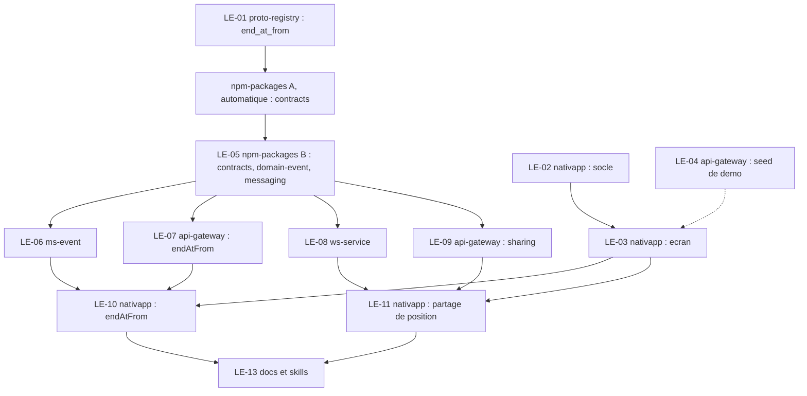

# 05 - Plan de PR et lots

Objectif : un ordre de PR propre, peu de PR dans `npm-packages`, et des lots assez précis pour être confiés à des sous-agents qui travaillent en parallèle. Les estimations d'heures sont des estimations de l'assistant, à valider. Un lot tient en 3 heures au plus ; une PR peut regrouper plusieurs lots.

## 1. Règles qui s'appliquent à tout

1. **Règle du STOP** (`AGENTS.md` section 1) : après `proto-registry` ou `npm-packages` : build, tests, changeset, arrêt, PR poussée, publication par la CI, puis seulement les consommateurs. Pas de `any`, pas de cast de contournement.
2. **Le verrou est posé par session.** Dès qu'un fichier de `proto-registry` ou `npm-packages` est édité dans une session, les éditions de `ms-*`, `api-gateway`, `ws-service`, `nativapp` sont refusées pour le reste de cette session (`.claude/hooks/stop-rule-guard.sh`). **Conséquence pour le parallélisme :** les lots LE-01 et LE-05 se font dans une session "contrats" ; les lots `nativapp` et `api-gateway` de la vague 0 se font dans **d'autres sessions**. Qu'un sous-agent hérite ou non du verrou de la session parente n'a pas été vérifié : lancer les sous-agents consommateurs depuis une session qui n'a touché ni `proto-registry` ni `npm-packages`.
3. **Levée du verrou** : après la publication par la CI, par le Lead Dev (`! .claude/hooks/stop-rule-guard.sh release`) ou par l'orchestrateur mandaté, aux trois conditions de `AGENTS.md` section 1 (PR `npm-packages` fusionnée et job `Definitive Release` vert ; `npm view @volontariapp/<paquet>@<version> version --prefer-online` répond pour **chaque** paquet bumpé ; levée rapportée avec les versions vérifiées).
4. **Un worktree par lot** (`.worktrees/<nom>/`, déjà ignoré par git). Le dépôt d'un fichier se lit sur son remote `origin`.
5. **Tests d'abord** (skill `tdd`), mocks et factories dans des fichiers séparés.
6. **Pas d'E2E en local** : pousser et lire le job CI `e2e`.
7. **Avant de terminer un lot** : `python3 .agents/skills/volontariapp-skill-evolution/scripts/evolve.py plan`, puis relire les skills listées.
8. **Webhook Discord** : un seul message par PR, seulement quand la PR est sans conflit et la CI verte (`AGENTS.md` section 7).
9. **Pas de grep à la racine de `meta`** : `mesh-mcp` (`smart_search` avec `scope`, `find_dependents`, `analyze_impact`, `analyze_grpc`).

## 2. Vagues et dépendances



| Vague | Lots | Sessions | Remarque |
| :--- | :--- | :--- | :--- |
| 0 (maintenant) | LE-01 ; LE-02 puis LE-03 ; LE-04 | 3 sessions : contrats, front, gateway | LE-01 attend la fusion (G1). **La démo P1 + P2 est utilisable à la fin de LE-02, LE-03 et LE-04** |
| 1 | PR automatique `npm-packages` A, puis LE-05 | session contrats | A d'abord, B rebasée sur A |
| 2 (après levée du verrou) | LE-06, LE-07, LE-08, LE-09 en parallèle | 4 worktrees | LE-07 et LE-09 touchent le même dépôt : deux branches, deux PR |
| 3 | LE-10, LE-11 | 2 worktrees | Après **déploiement** des services concernés (voir risque R6, [06](06-risques-et-verifications.md)) |
| 4 | LE-13 | une session | Documentation d'état et skills |

## 3. Ordre des PR

| # | PR | Dépôt | Lot | Dépend de | Porte humaine |
| :--- | :--- | :--- | :--- | :--- | :--- |
| 1 | `proto-registry` : `end_at_from` | `proto-registry` | LE-01 | : | G1 : fusion, ouvre la PR automatique |
| 2 | Socle trajet et sélection | `nativapp` | LE-02 | : | : |
| 3 | Seed d'événements en cours | `api-gateway` | LE-04 | : | : |
| 4 | Écran "Événement en direct" (empilée sur la PR 2) | `nativapp` | LE-03 | PR 2 | : |
| 5 | **`npm-packages` A** : régénération `contracts` (automatique) | `npm-packages` | : | PR 1 fusionnée | G2a : publication |
| 6 | **`npm-packages` B** : `contracts`, `domain-event`, `messaging` | `npm-packages` | LE-05 | PR 5 fusionnée | G2b : publication, levée du verrou |
| 7 | `endAtFrom` | `ms-event` | LE-06 | PR 6 publiée | : |
| 8 | `endAtFrom` (DTO) | `api-gateway` | LE-07 | PR 6 publiée | : |
| 9 | Handler `live.position`, endpoint interne | `ws-service` | LE-08 | PR 6 publiée | : |
| 10 | Autorisation du partage | `api-gateway` | LE-09 | PR 6 publiée | : |
| 11 | Utiliser `endAtFrom` | `nativapp` | LE-10 | PR 4, 7, 8 (déployées) | : |
| 12 | Partage de position et carte organisateur | `nativapp` | LE-11 | PR 4, 9, 10 (déployées) | : |
| 13 | (optionnel) Capacité à la participation | `api-gateway` | LE-12 | décision Q3 | : |
| 14 | Documentation d'état et skills | `docs`, `meta` | LE-13 | PR 11, 12 | : |

**Bilan** : `npm-packages` : **2 PR** (dont une automatique), un seul cycle de contrats. Douze PR obligatoires, une optionnelle, plus la PR `docs` et la PR `meta`.

## 4. Lots

Format : dépôt, skill, contenu, "fait quand", exécutant conseillé, estimation. Exécutant : **agy** pour un lot précis et vérifiable, **Claude** (sous-agent) pour un lot qui demande du jugement ou touche à la sécurité ([voir 5](#5-consignes-aux-sous-agents)).

### LE-01 : champ proto `end_at_from`
- **Dépôt** : `proto-registry`. **Skill** : `volontariapp-proto-contract-evolution`.
- **Contenu** : [04](04-contrats-et-backend.md) section 2.
- **Fait quand** : `buf lint` et `buf breaking --against '.git#branch=main'` verts ; aucun champ renuméroté ; PR poussée, **arrêt**.
- **Exécutant** : Claude (règle du STOP et hook). **Estimation** : 1 h.

### LE-02 : socle de sélection et de trajet
- **Dépôt** : `nativapp`. **Skills** : les huit `rn-*` et `react-doctor`, `tdd`.
- **Contenu** : `live-events.utils.ts`, `routing.service.ts`, `use-current-position.ts` et leurs tests ([03](03-nativapp.md) sections 2, 3, 5, 7). Aucune interface graphique.
- **Fait quand** : tests verts pour chaque étape de la règle de sélection et pour le service (parsing, cadence, cache, repli) ; lint, `tsc` sans erreur ; couverture des cas limites listés en [03](03-nativapp.md) section 9. Les appels OSRM de test sont **simulés** (aucune requête réseau dans les tests).
- **Exécutant** : agy. **Estimation** : 3 h.

### LE-03 : écran et navigation
- **Dépôt** : `nativapp`. **Skills** : idem.
- **Contenu** : `use-nearest-live-events`, `LiveEventScreen`, composants `live/`, troisième action de `QuickActionsModal`, route `LiveEvent` dans `MainStack`, libellé dynamique ([03](03-nativapp.md) sections 2, 4, 6).
- **Fait quand** : critères d'acceptation de [03](03-nativapp.md) section 10 ; un test par état d'écran ; la barre d'onglets et le bouton central se comportent comme avant ; vérifié à la main sur simulateur avec une position simulée.
- **Exécutant** : Claude (interface, jugement visuel, système de design). **Estimation** : 3 h plus 3 h (deux tickets, une PR).

### LE-04 : seed d'événements en cours
- **Dépôt** : `api-gateway`. **Skill** : `volontariapp-api-gateway`.
- **Contenu** : [04](04-contrats-et-backend.md) section 6.1. Lire d'abord `system-seed.service.ts` pour le point d'entrée.
- **Fait quand** : le seed produit N événements en cours (N configurable, 0 par défaut hors démo) avec des adresses géocodables ; test du service ; aucun changement de contrat.
- **Exécutant** : agy. **Estimation** : 2 h.

### LE-05 : `npm-packages` B
- **Dépôt** : `npm-packages`, **une seule branche, un seul changeset**. **Skill** : `volontariapp-shared-npm-package-change`.
- **Contenu** : [04](04-contrats-et-backend.md) sections 3 et 5 : `contracts` (`endAtFrom`), `domain-event` (VO, filtre, tests), `messaging` (groupe `live`).
- **Fait quand** : `yarn build` et `yarn test` verts ; `yarn changeset add` puis `yarn changeset version` faits une fois ; PR poussée, **arrêt** ; rebasée sur la PR automatique A après sa fusion.
- **Exécutant** : Claude. **Estimation** : 3 h.

### LE-06 : `ms-event`
- **Dépôt** : `ms-event`. **Skill** : `volontariapp-grpc-microservice`.
- **Contenu** : `yarn up` des paquets publiés ; DTO et contrôleur ([04](04-contrats-et-backend.md) section 4) ; tests.
- **Fait quand** : une recherche avec `endAtFrom` n'inclut que les événements dont la fin est postérieure ; une recherche sans le champ est inchangée ; tests contrôleur et DTO verts.
- **Exécutant** : agy. **Estimation** : 2 h.

### LE-07 : `api-gateway` : `endAtFrom`
- **Dépôt** : `api-gateway`. **Skill** : `volontariapp-api-gateway`.
- **Contenu** : `yarn up` ; DTO et `toQuery()` ([04](04-contrats-et-backend.md) section 4) ; Swagger ; tests.
- **Fait quand** : `GET /events?endAtFrom=...` transmet le champ ; sans lui le comportement est inchangé.
- **Exécutant** : agy. **Estimation** : 2 h.

### LE-08 : `ws-service`
- **Dépôt** : `ws-service`. **Skills** : `tdd`, `volontariapp-logger`.
- **Contenu** : [04](04-contrats-et-backend.md) section 7 : garde d'authentification interne, contrôleur d'autorisation, handler `live.position`, arrondi, cadence, arrivée à 50 m, Redis avec TTL, notifications.
- **Fait quand** : tests pour chaque branche du handler (autorisation absente, cadence, arrondi, arrivée, envoi à l'organisateur) ; aucune coordonnée dans les journaux (test ou lecture) ; l'endpoint interne refuse tout appel sans jeton interne valide.
- **Exécutant** : Claude (sécurité et vie privée). **Estimation** : 3 h.

### LE-09 : `api-gateway` : autorisation du partage
- **Dépôt** : `api-gateway`. **Skill** : `volontariapp-api-gateway`.
- **Contenu** : [04](04-contrats-et-backend.md) section 6.2 : `PUT` et `DELETE`, contrôles dans l'ordre, client HTTP vers `ws-service` avec jeton interne, erreurs métier.
- **Fait quand** : un test par refus (état, fenêtre, organisateur, non participant) et un test de succès ; le corps envoyé à `ws-service` correspond à `ILiveGrantRequest` ; aucun journal de coordonnées.
- **Exécutant** : Claude (contrôles d'autorisation). **Estimation** : 3 h. Peut se construire en parallèle de LE-08 : la forme de l'appel est figée dans [04](04-contrats-et-backend.md) sections 5 et 7.

### LE-10 : `nativapp` : utiliser `endAtFrom`
- **Dépôt** : `nativapp`. **Contenu** : ajouter `endAtFrom` à la requête ; le filtre client de fin reste comme garde-fou.
- **Fait quand** : test de la requête ; aucune régression sur la liste.
- **Exécutant** : agy. **Estimation** : 1 h. **À fusionner après le déploiement de LE-06 et LE-07.**

### LE-11 : `nativapp` : partage de position
- **Dépôt** : `nativapp`. **Skills** : idem LE-02.
- **Contenu** : [03](03-nativapp.md) section 8 : `live.api.ts`, `use-live-sharing`, `use-live-organizer-positions`, bascule avec texte de consentement, carte de l'organisateur.
- **Fait quand** : désactivé par défaut ; arrondi côté client ; arrêt sur `live.sharing_stopped`, sur arrière-plan et au démontage ; aucune permission d'arrière-plan ajoutée ; tests des hooks.
- **Exécutant** : Claude. **Estimation** : 3 h plus 3 h. **À fusionner après le déploiement de LE-08 et LE-09.**

### LE-12 : capacité à la participation (optionnel)
- **Dépôt** : `api-gateway`. **Contenu** : [04](04-contrats-et-backend.md) section 6.3. **Seulement si Q3 passe à B.**
- **Exécutant** : agy. **Estimation** : 2 h.

### LE-13 : documentation d'état et skills
- **Dépôts** : `docs`, `meta`. **Contenu** : mettre à jour le statut du README de ce dossier ; lancer `evolve.py plan` et relire les skills listées ; consigner les leçons (`evolve.py learn`).
- **Exécutant** : Claude. **Estimation** : 1 h.

## 5. Consignes aux sous-agents

Répartition (d'après ta consigne : agy pour les tâches précises et vérifiables, Claude pour le jugement) : **agy** LE-02, LE-04, LE-06, LE-07, LE-10, LE-12 ; **Claude** LE-01, LE-03, LE-05, LE-08, LE-09, LE-11, LE-13.

Rappels propres à agy : il n'a **aucun hook du dépôt** (ni règle du STOP, ni garde `AGENTS.md`, ni règle zéro emoji). L'orchestrateur écrit ces règles dans le prompt, **lance lui-même** `tsc`, `eslint`, `prettier` et `jest`, relit le diff, puis commit et pousse. Après chaque lot : chercher les fichiers frères oubliés (un DTO du même dossier qui utilise encore un type brut du contrat, par exemple). Pas de `--dangerously-skip-permissions` sans accord explicite.

Gabarit de prompt :

```text
Contexte : dossier docs/live-events (README, 02-decisions, 03 ou 04 selon le lot).
Lot : LE-xx, dépôt <dépôt>, dans le worktree <chemin>.
À faire : <liste précise tirée du lot>.
Fichiers à lire d'abord : <fichiers frères dont copier le motif>.
À ne pas toucher : <ce qui est hors lot>.
Règles : kebab-case, aucun any ni cast "as unknown as", aucun emoji, aucun tiret cadratin,
  mocks dans *.mock.ts, factories dans *.factory.ts, jest.spyOn avec restoreAllMocks().
  Ne jamais écrire une latitude ou une longitude dans un journal.
  Si le lot touche npm-packages ou proto-registry : arrêt après le changeset, ne rien
  modifier chez les consommateurs.
Tests à écrire : <liste>.
Vérifications à lancer : lint, tsc ou build, jest (pas d'E2E en local).
Livrable : branche depuis origin/main, diff relu, rapport de ce qui reste.
```

Un lot qui peut se faire sans réseau (tests avec OSRM, Redis ou gRPC simulés) se confie sans accès Internet. Pour les lots de la vague 2, vérifier qu'aucune session ne porte le verrou STOP avant de lancer les agents.

## 6. Portes humaines

| Porte | Moment | Qui |
| :--- | :--- | :--- |
| G1 | Fusion de la PR `proto-registry` | Lead Dev, ou l'agent autorisé par la mémoire du 2026-11-05 |
| G2a, G2b | Publication des deux PR `npm-packages` par la CI | CI ; levée du verrou après vérification `npm view` |
| Déploiement | Mise en production de `ms-event`, `api-gateway`, `ws-service` avant LE-10 et LE-11 | Lead Dev (GitOps, ArgoCD) |

## 7. Définition de fini (pour chaque lot)

- Tests écrits et verts, lint et types sans erreur.
- `evolve.py plan` lancé, skills concernées relues.
- PR ouverte (une par dépôt touché) avec contexte, changements, vérifications et ce qui est laissé de côté ; webhook Discord seulement quand elle est verte et sans conflit.
- Aucune coordonnée dans les journaux, aucun `any`, aucun cast de contournement.
