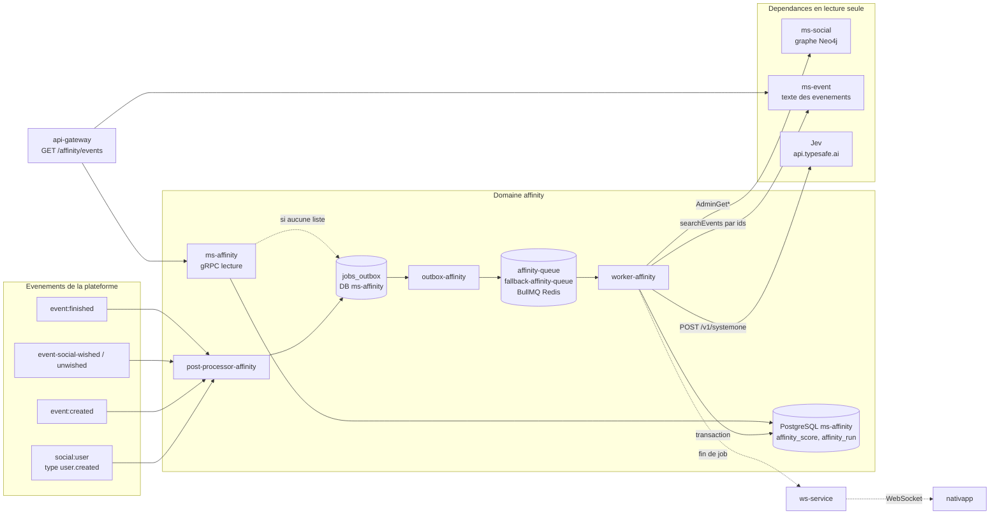
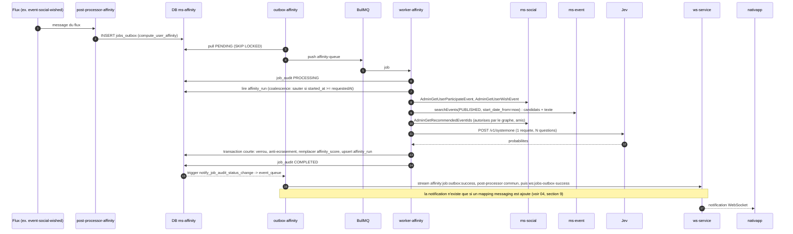

# 02 - Architecture cible

## 1. Vue d'ensemble

Deux chemins séparés : **écriture asynchrone** (calcul) et **lecture synchrone** (consultation). Ils ne communiquent que par la base de `ms-affinity`.



## 2. Déployables du nouveau domaine

| Déployable | Emplacement | Rôle | Pattern copié de |
| :--- | :--- | :--- | :--- |
| `ms-affinity` | `ms-affinity/` | API gRPC de lecture (`GetAffinityEvents`), commande `RequestAffinityRefresh`, écriture du job à la demande, propriétaire de la base | `ms-social/` |
| `outbox-affinity` | `outbox-runners/outbox-affinity/` | Pousse `jobs_outbox` vers BullMQ et `event_queue` vers les streams | `outbox-runners/outbox-social/` |
| `worker-affinity` | `workers-runners/worker-affinity/` | Exécute les handlers de calcul et de fan-out | `workers-runners/worker-social/` |
| `post-processor-affinity` | `post-processors-runner/post-processor-affinity/` | Écoute les flux de la plateforme et crée les jobs | `post-processors-runner/post-processor-social/` |
| `@volontariapp/domain-affinity` | `npm-packages/packages/domain-affinity/` | Entités, repositories TypeORM, services de score structurel, port `AffinityScorer`, migrations | `packages/domain-social/` |
| contrats gRPC | `proto-registry/proto/volontariapp/affinity/` | `affinity.{proto,command,query,responses,services}.proto` | dossier `social/` |
| manifestes | `deploy/apps/base/ms-affinity/`, `deploy/infrastructure/databases/ms-affinity/` | Déploiements, service, base | `ms-social` |

Le partage de code reste **vertical** : `ms-affinity`, `worker-affinity` et `post-processor-affinity` importent `domain-affinity`, conformément à `docs/Monorepo-Structure.md`. **`outbox-affinity` n'en a pas besoin** (`outbox-runners/outbox-social/package.json` ne dépend pas de `domain-social`) : il n'utilise que les paquets techniques (`outbox`, `database`, `messaging`). Aucun autre domaine n'importe `domain-affinity`.

Détail de dépôts (vérifié) : `outbox-runners/`, `workers-runners/` et `post-processors-runner/` sont **chacun un seul dépôt git** (avec `.gitmodules`, `.github/workflows/ci.yml` et un `command.sh` qui détecte dynamiquement `outbox-*`, `worker-*`, `post-processor-*`). `outbox-affinity`, `worker-affinity` et `post-processor-affinity` sont donc de **nouveaux dossiers dans des dépôts existants**. Seul `ms-affinity` est un nouveau dépôt.

## 3. Propriété des données

| Donnée | Propriétaire | Copie dans `ms-affinity` ? |
| :--- | :--- | :--- |
| Nom, description, date, tags, état, places d'un événement | `ms-event` | **Non.** Lu à l'écriture du score, jamais conservé. Relu par la gateway à chaque lecture. |
| Participations, souhaits, amis, blocages | `ms-social` (Neo4j) | **Non.** Lu à l'écriture du score. |
| Pseudo, email, bio, rôle d'un utilisateur | `ms-user` | **Non.** Jamais lu. |
| `(userId, eventId, score)` et métadonnées du calcul | `ms-affinity` | Oui, c'est la donnée propre du service. |

Règle de conception : **la table d'affinité décide de l'ordre et des candidats, jamais du contenu.** Un événement supprimé, terminé ou modifié ne peut pas produire une donnée fausse à l'écran, seulement une recommandation légèrement périmée.

## 4. Graphe de dépendances

```text
api-gateway --gRPC--> ms-affinity --(lit)--> sa propre base
api-gateway --gRPC--> ms-event                      (contenu des evenements)

worker-affinity --gRPC (Admin*)--> ms-social         (candidats, historique, amis)
worker-affinity --gRPC----------> ms-event           (texte des evenements)
worker-affinity --gRPC----------> ms-post            (feed : posts, commentaires ; voir 10 a 12)
api-gateway     --gRPC----------> ms-post            (feed : contenu des posts)
worker-affinity --HTTPS---------> api.typesafe.ai    (Jev)
worker-affinity --SQL-----------> base ms-affinity
```

Sens unique : `ms-social` et `ms-event` ne connaissent pas `ms-affinity`. Seule la gateway l'appelle. Aucun cycle.

## 5. Responsabilités des composants

| Composant | Fait | Ne fait pas |
| :--- | :--- | :--- |
| `post-processor-affinity` | Convertit un événement de flux en demande de calcul (`affinity_request` + `jobs_outbox`) ; héberge aussi les **post-processors communs** `JobOutboxSuccess` et `JobOutboxFailed` (suppression de la ligne `jobs_outbox`, feedback WebSocket) | N'appelle ni Jev, ni `ms-social`, ni `ms-event` |
| `outbox-affinity` | Dispatch des jobs et événements | Aucune logique métier |
| `worker-affinity` | Candidats, texte, score, écriture transactionnelle | N'expose aucune API |
| `ms-affinity` | Lecture d'une liste, écriture du job à la demande, rafraîchissement manuel | N'appelle ni Jev, ni `ms-social`, ni `ms-event` (jamais dans le chemin de lecture) |
| `api-gateway` | Orchestre : ordre de `ms-affinity`, contenu de `ms-event`, réordonnancement, filtrage | Ne calcule aucun score |

## 6. Cycle complet d'un calcul (séquence)


