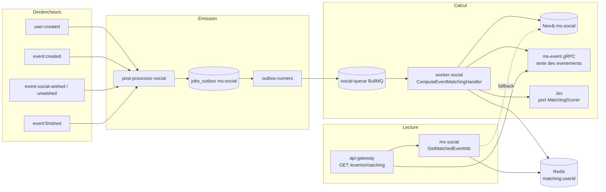

# 02 - Architecture cible

## Vue d'ensemble

Deux chemins totalement séparés : **écriture asynchrone** (calcul) et **lecture synchrone** (consultation). Ils ne communiquent que par Redis.

## Responsabilités

| Composant | Rôle | Statut |
| :--- | :--- | :--- |
| `post-processor-social` | Écoute les flux, écrit un job `social.compute_event_matching` dans `jobs_outbox` | Existe, à étendre |
| `outbox-runners` | Pousse le job vers `social-queue` (aucun code à écrire, voir `volontariapp-implement-async-job-flow`) | Existe |
| `worker-social` | Exécute le handler : candidats, texte, score, écriture Redis | Existe, handler à créer |
| `domain-social` | Fournit `ParticipationService` (candidats et historique) ; hébergera le port `MatchingScorer` | Existe, à étendre |
| Adaptateur Jev | Implémente `MatchingScorer` (appel HTTP vers l'API TypeSafe AI) | À créer |
| `ms-social` | Nouvelle RPC de lecture `GetMatchedEventIds` (Redis, repli Neo4j) | À créer |
| `api-gateway` | Route `GET /events/matching` : ordre de `ms-social`, contenu de `ms-event` | À créer |

## Pourquoi `ms-social` est propriétaire du matching

Le graphe, les filtres de blocage et la reco structurelle sont déjà dans `ms-social`. Faire porter le matching par `ms-event` l'obligerait à lire Neo4j (interdit par l'isolation des bases) ou à rappeler `ms-social` en gRPC à chaque calcul. Le texte des événements, lui, est lu en gRPC depuis `ms-event` : c'est la seule dépendance sortante du worker, et elle est en lecture seule.

## Stockage Redis

| Clé | Type | Contenu | TTL |
| :--- | :--- | :--- | :--- |
| `matching:{userId}` | sorted set | membre = `eventId`, score = score final (0 à 1) | 24 h |
| `matching:meta:{userId}` | hash | `computedAt` (ISO), `source` (`MATCHING` ou `STRUCTURAL_ONLY`), `version` (entier de formule), `candidateCount` | 24 h |
| `matching:active` | set | `userId` ayant une liste (sert au fan-out d'un nouvel événement) | aucun, nettoyé par le handler |

Règles :

- **Écriture atomique** : le handler construit `matching:{userId}:tmp`, puis fait `RENAME` vers `matching:{userId}`. Un lecteur ne voit jamais une liste à moitié écrite.
- **Pas de nettoyage par événement** : un événement supprimé ou terminé reste dans les listes jusqu'à expiration. C'est acceptable car la route gateway recharge les événements depuis `ms-event` et **ignore les identifiants qui n'existent plus ou ne sont plus publiés**.
- **Tout est recalculable** : vider Redis ne perd aucune donnée métier.

## Choix de conception notable

Le stockage Redis impose d'ajouter un client Redis à `ms-social` (aucun aujourd'hui). `@volontariapp/bridge` fournit déjà `RedisProvider` (utilisé par `worker-social`). Une alternative sans Redis côté lecture serait de stocker le score dans Neo4j sur une relation `(:SocialUser)-[:MATCHES {score, computedAt}]->(:SocialEvent)` : `ms-social` la lirait nativement, sans nouvelle infrastructure, et le mode « Redis indisponible » disparaîtrait. Elle est écartée par défaut car le Lead Dev a retenu Redis, mais le point reste ouvert (voir [06](06-contrats-et-plan.md)).
