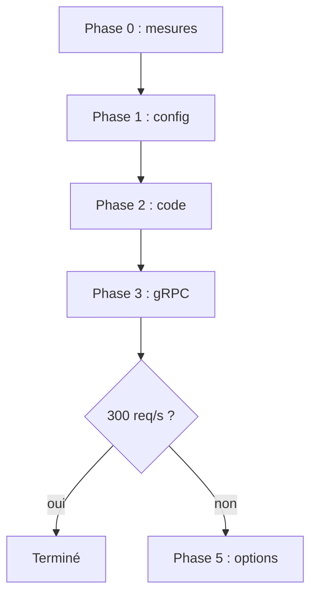

# 03 - Plan d'implémentation

Ce chapitre dit quoi faire, dans quel ordre, avec quelle preuve de réussite à chaque étape. Il repose sur les [mesures](01-mesures-et-methode.md) et les [analyses](02-analyses.md). Les gains annoncés sont des **INFERENCES** : des ordres de grandeur, jamais mesurés avant d'être implémentés. C'est la raison d'être des portes de décision.

## 1. Le budget de CPU

**Point de départ (FAIT)** : à 200 req/s les pods consomment 10,36 vCPU, soit **52m par req/s**. Le nœud ajoute 1,09 vCPU de système.

**Cible (calcul)** : tenir 300 req/s avec 15 % de marge sur 14 vCPU.

```text
14 vCPU x 0,85                    = 11,9 vCPU utilisables
11,9 - 1,1 (système)              = 10,8 vCPU pour les pods
10,8 vCPU / 300 req/s             = 36m par req/s
(52 - 36) / 52                    = -31 % de CPU par requête
```

Il faut donc gagner **3,2 vCPU à débit égal** (31 % de 10,36). Et il faut qu'aucun pod ne sature seul avant le nœud.

### Gains estimés (à 200 req/s équivalent)

| Levier | Phase | Gain estimé | Confiance |
| :--- | :---: | ---: | :--- |
| Niveau de log branché (aujourd'hui ignoré) | 1 | 0,6 à 1,1 vCPU | moyenne : gateway mesurée, `ms-*` non |
| Échantillonnage OpenTelemetry à 10 % | 1 | 0,5 à 0,8 vCPU | moyenne : gateway mesurée |
| Cache borné des compteurs de participants et des événements par identifiant | 2 | 0,4 à 0,9 vCPU | faible : taux de réussite réel inconnu |
| Réutilisation du jeton interne par utilisateur | 2 | 0,2 à 0,35 vCPU | faible : coût de signature non mesuré |
| Cache du comptage des posts | 2 | environ 0,3 vCPU | faible |
| **Total** (le ramasse-miettes baisse avec les allocations des journaux et des spans : non ajouté pour ne pas compter deux fois) | | **2,0 à 3,5 vCPU** | |
| Répartition gRPC et réplicas | 3 | 0 en CPU total ; repousse la saturation du pod le plus chargé | haute sur le mécanisme |

**Lecture** : 2,0 à 3,5 vCPU pour 3,2 nécessaires. L'objectif est **plausible mais pas acquis**. Il se jouera sur les journaux, OpenTelemetry et ce que révèlera la phase 0.

## 2. Règles de conduite

1. **Une phase, une mesure.** Après chaque phase on rejoue la même rampe avec les mêmes enregistreurs. On ne cumule pas deux phases avant d'avoir mesuré la première.
2. **Une porte par phase.** Si le coût par requête n'a pas baissé comme prévu, on s'arrête et on comprend avant de continuer.
3. **La règle du STOP** de `npm-packages` et de `proto-registry` s'applique : une modification amont, un arrêt, une PR, une publication vérifiée par `npm view`, puis seulement les consommateurs (`AGENTS.md`, section 1).
4. **Pas de rampe quand beaucoup d'utilisateurs réels sont connectés**, et jamais d'E2E en local : l'E2E tourne dans la CI.



## 3. Phase 0 : lever les incertitudes (une demi-journée, aucun changement applicatif)

### 0.1 Mesurer la fréquence et la température de l'hôte pendant un palier

Sur `root@pve`, avant le palier :

```bash
# limites de puissance du processeur (long terme, court terme) et durée de la fenêtre
grep -H . /sys/class/powercap/intel-rapl:0/constraint_*_name /sys/class/powercap/intel-rapl:0/constraint_*_power_limit_uw /sys/class/powercap/intel-rapl:0/constraint_*_time_window_us 2>/dev/null
```

Puis pendant un palier à 150 req/s (en arrière-plan, relever aussi 2 minutes avant et après) :

```bash
while true; do f=$(awk '/cpu MHz/{s+=$4;n++} END{printf "%.0f",s/n}' /proc/cpuinfo); t=$(cat /sys/class/thermal/thermal_zone*/temp 2>/dev/null | sort -n | tail -1); echo "$(date -u +%H:%M:%S) mhz_moyen=$f temp_max_milliC=$t"; sleep 2; done | tee /tmp/cpufreq.log
```

**Porte** : si la fréquence moyenne chute d'au moins 25 % après 30 secondes de charge, le plafond dépend de la limite de puissance et du refroidissement de l'hôte autant que du logiciel (chapitre 02, section 9). Il faut alors traiter le matériel en parallèle (limite de puissance dans le BIOS si disponible, refroidissement, seconde machine) et fixer l'objectif de 300 req/s sur la **fréquence soutenue**, pas sur celle des premières secondes.

### 0.2 Isoler l'effet des pods froids de la gateway

PR `deploy` temporaire : `minReplicas: 6` (égal à `maxReplicas`) dans `apps/base/api-gateway/hpa.yaml`, ArgoCD synchronise en moins de 3 minutes. Rejouer deux fois le palier à 150 req/s à quelques minutes d'intervalle.

- **Si les deux tiennent** : les pods froids sont le déclencheur. La correction durable est de la phase 1 (point 1.1).
- **Si l'un s'effondre** : la cause est ailleurs (0.1, 0.3). Revenir à `minReplicas: 3` ou garder 5 selon les coûts mémoire.

### 0.3 Enregistrer la pression de la VM

L'enregistreur PSI (skill `volontariapp-load-ramp`) a été relancé le 2026-11-08 sur la VM. Pendant les paliers, relever les secondes où `io_full_ms` dépasse 300 (gel disque) ou `cpu_some_ms` dépasse 500 (saturation du CPU). Il n'existe aucune donnée PSI pour les incidents de 23:23, 23:33 et 23:38.

### 0.4 Profil CPU des services métiers

Même procédure que pour la gateway (skill `volontariapp-load-ramp`, section "Profil CPU d'un pod Node") sur un pod de `ms-social` et un de `ms-event` pendant 150 à 200 req/s. Cela chiffre la part des journaux et d'OpenTelemetry dans les `ms-*`, aujourd'hui NON VERIFIEE.

### 0.5 `pg_stat_statements` sur `ms-post-db` et `ms-event-db`

- Les bases sont des PostgreSQL Bitnami configurées par `valuesInline` dans `deploy/apps/overlays/prod/<service>/db-postgres/`. Il faut `shared_preload_libraries = 'pg_stat_statements'`, ce qui **redémarre le pod de la base** : 10 à 30 secondes d'erreurs pour `ms-post` ou `ms-event`. À faire à un moment calme.
- Puis `CREATE EXTENSION pg_stat_statements` dans chaque base : c'est une écriture en production, qui demande un accord explicite.
- Surcoût attendu de l'ordre de 1 à 2 % (INFERENCE). Remettre les compteurs à zéro avant une rampe (`pg_stat_statements_reset()`), lire les requêtes les plus coûteuses après.
- Neo4j (0,62 vCPU à 200 req/s) n'a pas été regardé : échantillonner `SHOW TRANSACTIONS` pendant une rampe.

**Livrable de la phase 0** : mettre à jour le tableau des analyses ouvertes (chapitre 02, sections 4 et 9) avec les résultats.

## 4. Phase 1 : configuration (un jour, risque faible, réversible)

### 1.1 Gateway : ne plus créer de pods froids en rafale

Fichier : `deploy/apps/base/api-gateway/hpa.yaml`.

- `minReplicas: 5` (ou 6 si la phase 0.2 le justifie). Coût : 128Mi de requests par pod, le nœud est à 78 % de requests mémoire : vérifier.
- `scaleUp` : une politique de 1 pod par 60 s au lieu de 2, pour éviter l'arrivée simultanée de pods froids.
- Validation : `kustomize build` de la base, puis la CI de la PR `deploy`.

### 1.2 Brancher le niveau de log

Le champ `logger.level` existe déjà dans la configuration de tous les services (chapitre 02, section 6) mais n'est transmis nulle part. Points d'entrée à modifier :

| Dépôt | Fichier |
| :--- | :--- |
| `api-gateway` | `src/main.ts:44` |
| `ms-user`, `ms-social`, `ms-event`, `ms-post`, `ms-ranking`, `ms-storage` | `src/main.ts` (lignes 31, 27, 30, 27, 28, 28) et `ms-storage/src/commands/request-file-purge.ts:8` |
| `ws-service` | `src/main.ts:32` (passe déjà `masking`) |
| `workers-runners` | `worker-*/src/app.module.ts` |
| `post-processors-runner` | `post-processor-*/src/config/config.module.ts` |
| `outbox-runners` | `outbox-*/src/index.ts` |

**Deux façons de le faire.**

- **A. Dans chaque `main.ts`** : rapide, mais la même ligne se répète dans une dizaine de dépôts.
- **B (recommandée). Une fonction partagée** `configureLogger(config.logger)` dans `@volontariapp/config` (cascade du STOP) qui applique `format` **et** `minLevel`, en validant que le niveau est l'un de `debug`, `info`, `warn`, `error`, `fatal` (le champ de configuration est aujourd'hui une simple `string`). Chaque point d'entrée remplace son appel par cette fonction. Le logger lui-même ne doit pas lire `process.env` (règle de la skill `volontariapp-logger`).

**Décision à prendre** : le niveau de production. Les fichiers `production.config.json` déclarent `warn` pour la gateway et les `ms-*` métiers : brancher sans les modifier supprimerait aussi toutes les lignes `info`. Choix de Victor à confirmer : `info`. Avant `warn`, vérifier qu'aucun moniteur Datadog ne s'appuie sur des lignes `info` (`deploy/infrastructure/monitoring/monitors/`, NON VERIFIE).

### 1.3 Échantillonnage OpenTelemetry

`monitoring/src/sampling.ts` lit déjà `OTEL_TRACES_SAMPLER_ARG` (échantillonnage par la racine, 1 par défaut). Ajouter `OTEL_TRACES_SAMPLER_ARG=0.1` aux déploiements de la gateway et des `ms-*` métiers dans `deploy`.

**Décision à prendre** : le ratio. Vérifier l'effet sur `apm-error-rate-grpc.json` et les tableaux de bord construits sur les traces.

### Porte de la phase 1

Rejouer 150 puis 200 req/s. Pour continuer : le CPU du nœud à 150 req/s est inférieur d'au moins 10 % à celui de 22:41 (5,9 vCPU), soit 5,3 vCPU ou moins, avec le nombre de pods figé comme à la phase 0.2. Sinon, comprendre avant d'avancer : profil de la gateway et des `ms-*` après changement.

## 5. Phase 2 : code (deux à quatre jours)

### 2.1 Cache borné des lectures identiques pour tous les utilisateurs (`api-gateway`)

**Ce qu'on met en cache** : le nombre de participants par événement (`EventParticipantsService.enrichAll`, `event-participants.service.ts:39-69`) et les événements lus par identifiants dans la liste des posts (`post.query-controller.ts:94`, à extraire dans un `EventLookupService` exporté par `EventModule`).

**Ce qu'on ne met pas en cache** : les listes d'exclusions et de blocages, `me`, `is-following`.

**Pourquoi c'est sûr (FAIT)** : `getEventsByIds` n'utilise l'utilisateur que dans un message de journal (`ms-event/src/modules/event/controllers/queries/event.query.controller.ts:54-63`) et `countEventParticipants` n'a aucun paramètre utilisateur (`ms-social/src/modules/participation/controllers/participation.query.controller.ts:219-227`). NON VERIFIE : l'absence de contexte implicite dans `findEventsInOrder` et le transformateur.

**Conception** : une table `TtlLruCache` (`src/common/cache/ttl-lru-cache.ts`) avec capacité maximale, durée de vie de 30 s, éviction du moins récemment utilisé, une instance par processus. On ne demande à `ms-social` ou `ms-event` que les identifiants absents du cache. Un lot en échec n'est pas mis en cache.

**Budget mémoire (FAIT)** : la gateway consomme 127 à 137Mi sur sa limite de 256Mi. Capacités proposées : 5 000 compteurs (moins de 1 Mo) et 500 événements (1 à 3 Mo, à 2-5 Ko l'un : INFERENCE). Total sous 5 Mo.

**Limites** : une copie par pod, donc jusqu'à 30 s de retard sur un compteur. Le taux de réussite de la rampe (200 acteurs sur 3 pages) est trop bon : celui du trafic réel sera plus bas.

**État** : la classe `TtlLruCache`, ses tests et les tests du compteur ont été rédigés en local le 2026-11-09 dans un worktree et ne sont pas commités.

### 2.2 Cache du comptage de `posts-list` (`ms-post`)

Le gestionnaire `listPosts` de `ms-post` (`ms-post/src/modules/post/controllers/post.query.controller.ts:68-84`) appelle `PostService.listPosts(page, limit, authorId, user?.id)` du paquet `domain-post`. Le **lecteur** (`user?.id`) fait partie de l'appel : le comptage peut dépendre de lui ("posts visibles plus les miens cachés"). La clé de cache doit donc contenir le lecteur, ou on ne met en cache que la partie commune. **Avant d'écrire**, lire `PostService.listPosts` (`domain-post/src/services/post.service.ts:65`) et `listPaginated` (`postgres-post.repository.ts:113`). Durée de vie : 10 s. Gain estimé : environ 0,3 vCPU, à confirmer avec `pg_stat_statements` (phase 0.5).

### 2.3 Réutiliser le jeton interne (`@volontariapp/auth`)

À chaque requête, la gateway signe un jeton RS256 (chapitre 02, section 8). Option : conserver le jeton d'un utilisateur dans un cache à durée de vie courte (la moitié de `internalExpiresIn`, valeur à relire), indexé par l'identité complète (identifiant et rôle). **À ne faire que si la phase 0.4 ou un profil montre un coût mesurable**, avec une revue de sécurité (cascade du STOP, jetons réutilisables dans leur fenêtre de validité).

### 2.4 Passer les lignes `info` "gRPC: ..." par requête en `debug`

Chaque RPC écrit une ligne `info` dans les `ms-*`. À ne faire que si, après la phase 1, elles pèsent encore dans un profil.

### Porte de la phase 2

Rejouer 150, 200 et 250 req/s. Pour continuer : le CPU par req/s au-delà de 150 req/s est repassé sous 45m (il était de 52m), et la gateway n'est plus le premier poste.

## 6. Phase 3 : répartition des connexions gRPC et réplicas (deux à trois jours)

### 3.1 Client : répartir au lieu de se fixer sur un réplica

`npm-packages/packages/contracts-nest/src/grpc.helpers.ts:87-101` crée les clients sans option de canal. Ajouter des `channelOptions` avec une configuration de service `round_robin` et une URL de la forme `dns:///<service>-headless:80`. **NON VERIFIE** : que `@nestjs/microservices` transmette ces options à `grpc-js` et que la résolution DNS multi-adresses fonctionne avec la version utilisée ; à prouver par un test local avant de publier.

### 3.2 Cluster : des `Service` headless

Dans `deploy`, pour `ms-social`, `ms-event`, `ms-post` et `ms-user`, un `Service` avec `clusterIP: None` en plus du `Service` actuel. Les NetworkPolicies filtrent sur des sélecteurs de pods : inchangées.

### 3.3 Ordre

Publier `contracts-nest` (règle du STOP), puis migrer d'abord la gateway (le plus gros client), puis les services qui appellent d'autres services, puis les workers. Retour arrière : remettre l'URL du `Service` actuel.

### 3.4 Réplicas

Une fois la répartition prouvée : `ms-social` à 3 réplicas, puis `ms-event` selon la mesure. Chaque réplica ajoute 128Mi de requests mémoire : vérifier le nœud avant.

### Porte de la phase 3

À 200 req/s, l'écart de CPU entre les pods d'une même paire est inférieur à 20 % (aujourd'hui environ 2 contre 1).

## 7. Phase 4 : la mesure finale

- **Rampe** : 150, 200, 250, 300 req/s avec `events-list-app`, paliers de 90 s, enregistreurs du cluster, de la VM (PSI) et de l'hôte (fréquence).
- **Nombre de pods de la gateway** relevé à chaque palier. Rejouer la rampe **deux fois à 15 minutes d'intervalle** pour écarter l'effet de la chaleur.
- **Critères de réussite à 300 req/s pendant 90 s** : p95 inférieur à 500 ms, 0 % d'erreur, CPU du nœud inférieur à 85 %, aucun pod à plus de 85 % de sa limite de CPU, mémoire de la gateway inférieure à 70 %.

## 8. Phase 5 : si 300 req/s n'est pas atteint

Par ordre de probabilité d'utilité et de coût croissant :

1. **Limite matérielle** (si la phase 0.1 l'a révélée) : limite de puissance, refroidissement.
2. **Service Go limité aux quatre routes chaudes** (liste d'événements, liste de posts, `me`, `is-following`), derrière Traefik, les autres routes restant sur Nest. À étudier seulement si, après les phases 1 à 3, la gateway pèse encore plus de 25 % du CPU et que le profil montre plus de 50 % de coût inhérent à Node. Prérequis : génération Go dans `proto-registry`, vérification RS256, formes JSON identiques, adaptation du harnais E2E pour viser une URL.
3. **Seconde machine** : les services sans état (gateway, `ms-*`) sur un second nœud k3s, les bases restant épinglées au premier. Coût matériel et réseau, hors du périmètre logiciel.

## 9. Les PR à ouvrir, dans l'ordre

| # | Dépôt | Objet | Phase | Cascade du STOP |
| ---: | :--- | :--- | :---: | :---: |
| 1 | `deploy` | `minReplicas: 6` temporaire pour le test d'isolement | 0 | non |
| 2 | `deploy` | HPA : `minReplicas: 5`, `scaleUp` à 1 pod par 60 s | 1 | non |
| 3 | `deploy` | `OTEL_TRACES_SAMPLER_ARG` | 1 | non |
| 4 | `npm-packages` (`config`) | fonction `configureLogger` | 1 | oui |
| 5 | les 9 à 12 dépôts de services | utiliser `configureLogger` (`yarn up`) | 1 | après la 4 |
| 6 | `deploy` | niveau de log de production si différent des fichiers | 1 | non |
| 7 | `api-gateway` | cache borné des lectures identiques | 2 | non |
| 8 | `ms-post` | cache du comptage | 2 | non |
| 9 | `npm-packages` (`contracts-nest`) | options de canal `round_robin` | 3 | oui |
| 10 | `deploy` | `Service` headless puis réplicas | 3 | après la 9 |

## 10. Décisions ouvertes (à trancher par Victor)

| Décision | Recommandation |
| :--- | :--- |
| Niveau de log de production : `info` ou `warn` | `info` d'abord, `warn` après vérification des moniteurs Datadog |
| Ratio d'échantillonnage OpenTelemetry | 10 %, à confirmer avec les moniteurs de traces |
| Péremption de 30 s des compteurs de participants | acceptable |
| Cache des exclusions et des blocages | pas de cache : un blocage doit s'appliquer tout de suite |
| `kubectl exec` en production pour les profils | accord au cas par cas |
| `CREATE EXTENSION` et redémarrage des bases pour `pg_stat_statements` | accord explicite, à un moment calme |
| Investissement matériel si la phase 0.1 révèle une limite | à décider après la mesure |

## 11. Outils

La skill `volontariapp-load-ramp` (dépôt `meta`, `.agents/skills/volontariapp-load-ramp/`) contient la commande de la rampe, les enregistreurs (`scripts/record-ramp.sh`), l'analyse de la latence Traefik (`scripts/traefik-percentiles.py`), l'enregistreur de pression de la VM et le profil CPU d'un pod Node (`scripts/capture-cpu-profile.mjs`, `scripts/analyze-cpuprofile.mjs`). Le handoff de ce chantier est `handoffs/load-ramp.md` dans `meta`.
