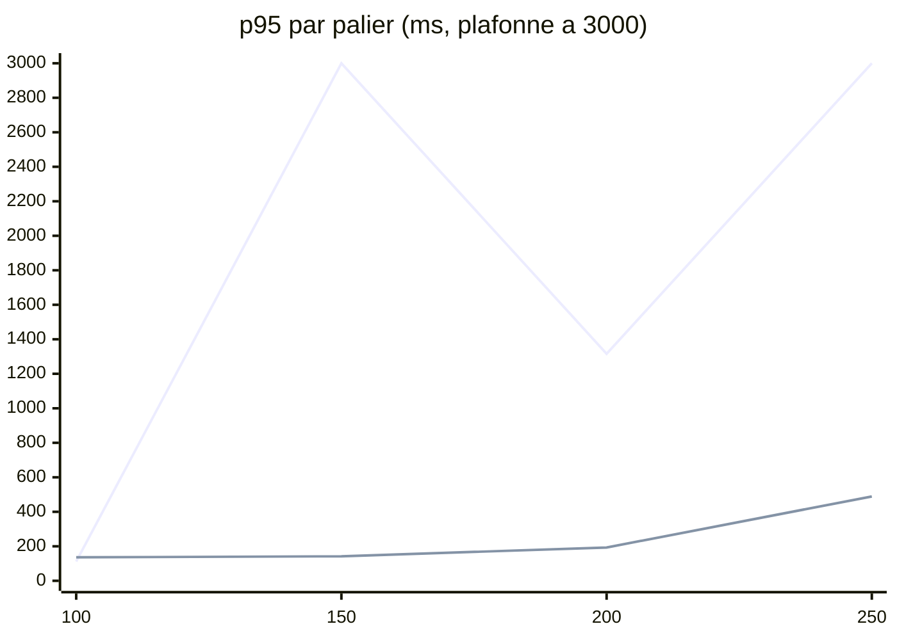

# 04 - Résultats après les phases 1 à 3

Mesures du 2026-11-09 (heures en UTC). Chaque chiffre est un **FAIT** (sortie de `yarn load`, `kubectl top` ou `kubectl describe` relevée pendant la rampe) sauf mention **INFERENCE**. Même méthode qu'au [chapitre 01](01-mesures-et-methode.md) : mélange de l'application (`events-list-app:40,posts-list:30,me:20,is-following:10`), 200 acteurs, simulateur de fond à 0, VM de 14 vCPU.

## 1. Le résumé

| | Avant (soir du 2026-11-08) | Après (matin du 2026-11-09) |
| :--- | :--- | :--- |
| Dernier palier sain | 200 req/s, p95 1 316 ms, sans marge | **250 req/s, p95 489 ms** |
| 250 req/s | 51,7 % d'erreurs, arrêt | 0 % d'erreur, palier complet |
| CPU du nœud à 200 req/s | 10,5 à 11,4 vCPU | 6,0 à 7,2 vCPU |
| Coût marginal au-delà de 150 req/s | environ 52m par req/s | environ 33m par req/s à 200, 40m au pic de 250 |
| Écart entre les deux réplicas d'un service | environ 2 contre 1 | moins de 10 % |
| CPU de l'agent Datadog au pic | 568 à 676m | 158 à 243m |

**300 req/s n'est pas atteint.** Le plafond se situe entre 250 et 275 req/s : 275 s'effondre en 30 s, sans erreur et sans pod froid, quand le nœud atteint 85 % de son CPU.

Sur le graphique, « avant » à 150 et 250 sont des arrêts de la rampe, ramenés au plafond de 3 000 ms. La valeur « avant » à 200 vient du soir du 2026-11-08, celle à 100 de la mesure de référence de la nuit. « Après » à 250 est le palier lancé après une pause (section 3).

## 2. Ce qui a été livré

| Phase du plan | Livraison | Dépôt et PR |
| :--- | :--- | :--- |
| 1.1 | HPA de la gateway : `minReplicas` 5, +1 pod par minute au plus | `deploy#68` |
| 1.2 | Niveau de log appliqué : `logger` 0.5.0 lit le niveau à chaque appel, `config` 3.5.0 expose `configureLogger`, branché dans 27 services ; production en `info` | `npm-packages#313`, puis `api-gateway#118`, `ms-user#90`, `ms-social#71`, `ms-event#93`, `ms-post#76`, `ms-ranking#36`, `ms-storage#50`, `ws-service#57`, `workers-runners#63`, `post-processors-runner#74`, `outbox-runners#47` |
| 1.3 | Traces OpenTelemetry à 10 % (`parentbased_traceidratio`, `OTEL_TRACES_SAMPLER_ARG=0.1`) sur 27 déploiements | `deploy#68` |
| 2.1 | Cache borné de 30 s à la gateway : compteurs de participants (5 000) et événements de la liste des posts (500) | `api-gateway#117` |
| 2.2 | Total de `posts-list` en cache 10 s dans `ms-post` (option `knownTotal` de `domain-post` 3.11.0) | `npm-packages#313`, `ms-post#76` |
| 3.1 | gRPC `round_robin` côté client et âge maximal de connexion de 5 min côté serveur (`contracts-nest` 3.5.0) | `npm-packages#313` |
| 3.2 | `Service` headless pour `ms-user`, `ms-social`, `ms-event`, `ms-post`, puis URL des clients vers `<service>-headless:3000` | `deploy#69`, `deploy#70` |

Non livrés : 2.3 (réutilisation du jeton interne) et 2.4 (lignes `info` "gRPC: ..." en `debug`), conditionnés par un profil ; 3.4 (réplicas supplémentaires), inutile tant que le nœud est la limite.

## 3. Les rampes

### Mesure de référence de la nuit (2026-11-08 23:57Z, avant tout changement)

| Palier | p50 | p95 | Erreurs | Nœud | Remarque |
| ---: | ---: | ---: | ---: | ---: | :--- |
| 100 | 49 ms | 112 ms | 0 % | 3,6 à 3,9 vCPU | |
| 150 | 281 ms | 8 436 ms | 1,6 % | 5,3 à 10,1 vCPU | arrêt ; l'HPA crée 2 pods froids à 00:00Z |

### Rampe continue après livraison (09:32Z)

Paliers enchaînés sans pause, gateway à 5 pods chauds.

| Palier | p50 | p95 | Erreurs | Nœud |
| ---: | ---: | ---: | ---: | ---: |
| 100 | 51 ms | 136 ms | 0 % | 2,9 à 3,6 vCPU |
| 150 | 53 ms | 142 ms | 0 % | 4,1 à 4,6 vCPU |
| 200 | 71 ms | 193 ms | 0 % | 6,0 à 7,2 vCPU |
| 250 | 285 ms | 2 984 ms | 0 % | 6,4 puis 11,8 vCPU, arrêt |

À 250, la latence monte dès la deuxième fenêtre (p95 440 ms, nœud à 8,5 vCPU), puis l'HPA crée un 6e pod de gateway à 09:38:05, au début de la fenêtre qui s'effondre (p95 2 968 ms). Même schéma qu'au [chapitre 02](02-analyses.md), section 4 : le pod froid amplifie une saturation déjà commencée.

### Paliers lancés à la main, avec pause entre les paliers (09:46Z et 09:52Z)

| Palier | p50 | p95 | p99 | Erreurs | Nœud | Pods de gateway |
| ---: | ---: | ---: | ---: | ---: | ---: | :--- |
| 225 | 92 ms | 265 ms | 404 ms | 0 % | 7,2 à 8,4 vCPU | 5 |
| 250 | 140 ms | 489 ms | 714 ms | 0 % | 7,9 à 11,2 vCPU | 5, puis 6 à 09:49:21 |
| 275 | 387 ms | 4 403 ms | 5 800 ms | 0 % | 7,1 puis 11,9 vCPU, arrêt | 6, aucun créé pendant le palier |

Par route (p95) :

| Route | 225 | 250 | 275 |
| :--- | ---: | ---: | ---: |
| `events-list-app` | 297 ms | 553 ms | 5 169 ms |
| `posts-list` | 292 ms | 489 ms | 2 932 ms |
| `is-following` | 187 ms | 353 ms | 4 751 ms |
| `me` | 163 ms | 303 ms | 691 ms |

À 250, le 6e pod froid fait monter le p95 des fenêtres 4 à 6 (677, 510 et 663 ms), puis il redescend vers 320 ms. Le système absorbe ce choc quand le palier ne suit pas directement un palier lourd.

## 4. Analyses

### 4.1 La répartition gRPC fonctionne

Moyenne de 35 relevés par pod sur les paliers 225 et 250 :

| Service | Réplica A | Réplica B | Écart |
| :--- | ---: | ---: | ---: |
| `ms-social` | 427m | 431m | 1 % |
| `ms-event` | 370m | 399m | 8 % |
| `ms-post` | 315m | 336m | 7 % |

La porte de la phase 3 (écart inférieur à 20 %) est franchie. Aucune ligne `UNAVAILABLE` dans les journaux de la gateway et des `ms-*` sur les 20 minutes suivant la bascule des URL, malgré la reconnexion toutes les 5 minutes.

### 4.2 Les journaux et les traces

Après déploiement, aucune ligne `debug` dans les journaux de la gateway, des `ms-*` et des runners relus. L'agent Datadog passe de 568 à 676m au pic à 158 à 243m. La part de chaque levier (journaux, traces, caches) n'est pas isolée : les livraisons ont été mesurées ensemble.

### 4.3 Ce qui limite à 275 req/s

- Aucun pod n'atteint sa limite de CPU : au pic, le plus chargé est `ms-event-db` à 587m, les `ms-*` à 550m au plus (limite 800m), les pods de gateway de 383 à 529m (limite 2 000m).
- Le nœud atteint 11,9 vCPU sur 14 (85 %) à 09:52:50.
- Aucun pod n'est créé pendant le palier : ce n'est pas l'effet des pods froids.
- **Conclusion** : la limite est le CPU de la machine entière, pas un composant. INFERENCE : au-delà de 80 à 85 % de CPU du nœud, l'attente du processeur fait monter la latence de tous les services en même temps.

### 4.4 Ce que dit le coût par requête

INFERENCE (calcul) : à 40m de CPU de nœud par req/s au pic de 250, 300 req/s demanderaient environ 12 vCPU, soit 86 % du nœud. Le plan visait 36m par req/s ; on est entre 33m (200 req/s) et 40m (250 req/s). Il manque environ 10 % de CPU par requête, ou plus de CPU.

## 5. Limites de ces mesures

| Limite | Conséquence |
| :--- | :--- |
| Les caches répondent mieux à la rampe (200 acteurs sur les pages 1 à 3) qu'au trafic réel | Le gain des caches est une borne haute |
| Aucun compteur de réussite des caches | On ne sait pas ce que chaque cache rapporte |
| Les livraisons des phases 1 à 3 ont été mesurées ensemble | La règle « une phase, une mesure » n'a pas été tenue ; la part de chaque levier est inconnue |
| L'HPA agit encore pendant les paliers (6e pod à 09:38 et 09:49) | Le premier 250 et le second ne sont pas comparables à l'identique |
| Fréquence et température de l'hôte non mesurées | L'hypothèse matérielle du chapitre 02, section 9, reste ouverte |
| Profils CPU des `ms-*` non faits (`kubectl exec` refusé à l'agent) | La part des journaux et des traces dans les `ms-*` reste NON VERIFIEE |

## 6. Prochaines étapes pour 300 req/s

| Ordre | Levier | Gain attendu (INFERENCE) | Prérequis |
| ---: | :--- | :--- | :--- |
| 1 | Un palier à 250 avec profils CPU (gateway, `ms-social`, `ms-event`) et fréquence de l'hôte | Savoir si 300 se gagne par le code ou si l'hôte ralentit sous charge | Lancé à la main par Victor (`kubectl exec`, ssh `pve`) |
| 2 | Compteurs de réussite des caches existants | Mesurer avant d'ajouter des caches | aucun |
| 3 | Cache des exclusions par utilisateur, 5 s, à la gateway | Le plus gros poste restant : `ms-social` et Neo4j, environ 1,5 vCPU au pic | Décision produit : un blocage visible jusqu'à 5 s de plus |
| 4 | Gateway : `minReplicas` 6, sonde de disponibilité HTTP | Plus de pod froid en plein pic | PR `deploy` |
| 5 | Réutilisation du jeton interne | Environ 1 ms de CPU par requête à la gateway | Profil, revue de sécurité |
| 6 | Seconde machine | Lève le plafond de 14 vCPU | Matériel |
