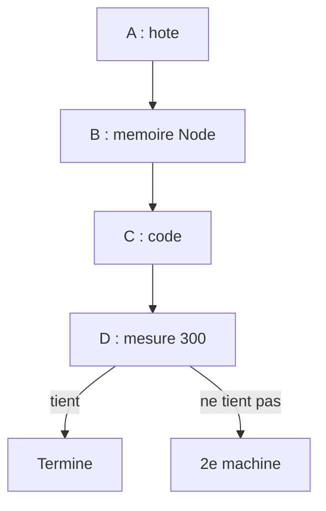

# 05 - Plan vers 300 req/s

Rédigé le 2026-11-09 à partir des [résultats du chapitre 04](04-resultats.md). Les gains annoncés sont des **INFERENCES** ; chaque phase a une porte mesurée, comme au [chapitre 03](03-plan-d-implementation.md) (règle : une phase, une mesure).

## 1. Le point de départ

| | Aujourd'hui (FAIT) | Cible pour 300 req/s |
| :--- | :--- | :--- |
| Dernier palier sain | 250 req/s, p95 489 ms | 300 req/s, p95 sous 500 ms |
| CPU de nœud par req/s | 33m à 200, 40m au pic de 250 | 36m au plus (85 % de 14 vCPU) |
| Fréquence de l'hôte sous charge | 3 400 puis 2 800 MHz, jusqu'à 93 °C | au moins 3 000 MHz en continu |
| Processus le plus chargé | `ms-social`, occupé à 70 % à 225 req/s | sous 60 % à 300 req/s |

Deux causes à traiter ensemble : environ **10 % de CPU par requête** de trop, et un hôte qui **réduit sa fréquence** quand il chauffe.

## 2. Phase A : l'hôte (Victor, environ 1 h, aucun code)

- Vérifier le refroidissement de la machine physique : poussière, ventilateur, pâte thermique, emplacement (air libre, pas d'armoire fermée).
- **Ne pas relever la limite de puissance continue (28 W)** tant que la température dépasse 90 °C : le processeur chaufferait plus sans gagner de fréquence.
- Mesure : un palier à 250 req/s pendant 90 s, avec la boucle de fréquence sur `pve` (commande au [chapitre 03](03-plan-d-implementation.md), phase 0.1).

**Porte** : fréquence au-dessus de 3 000 MHz et température sous 85 °C pendant tout le palier.

## 3. Phase B : la mémoire de Node (PR `deploy`, 15 min)

Le ramasse-miettes pèse 13 à 15 % du temps occupé de la gateway, de `ms-social` et de `ms-event` ([chapitre 04](04-resultats.md), section 4.5). Agrandir la zone des objets de courte durée réduit souvent ce coût sur un serveur qui alloue beaucoup.

| Déploiement | `NODE_OPTIONS` | Limite mémoire |
| :--- | :--- | :--- |
| `api-gateway` | `--max-semi-space-size=16` | 256Mi |
| `ms-social`, `ms-event`, `ms-post`, `ms-user` | `--max-semi-space-size=32` | à relire avant la PR |

- Risque : quelques dizaines de Mo de mémoire en plus par pod. Vérifier la consommation au repos et au pic (`kubectl top`) avant de fixer les valeurs.
- Retour arrière : retirer la variable.

**Porte** : profil à 225 req/s avec un ramasse-miettes sous 10 % du temps occupé, et CPU du nœud à 225 en baisse d'au moins 5 % (7,2 à 8,4 vCPU aujourd'hui). Sinon, retirer l'option.

## 4. Phase C : le code (1 à 2 jours, une étape à la fois)

| Étape | Quoi | Où | Gain attendu (INFERENCE) | Prérequis |
| :--- | :--- | :--- | :--- | :--- |
| C1 | Compteurs de réussite des caches existants (une ligne `info` par minute : hits, misses, taille) | `api-gateway`, `ms-post` | Savoir ce que chaque cache rapporte avant d'en ajouter | aucun |
| C2 | Cache des exclusions par utilisateur, 5 s, à la gateway ; le pod qui traite un blocage vide la clé de l'utilisateur | `api-gateway` | Le plus gros poste restant : moins d'appels à `ms-social` (70 % occupé) et à Neo4j | Décision produit, section 6 |
| C3 | Jeton interne réutilisé quelques secondes par la gateway, et jetons vérifiés gardés en cache dans les `ms-*` | `@volontariapp/auth` | Environ 5 % de `ms-social`, plus la signature à la gateway | Règle du STOP, revue de sécurité |
| C4 | Gateway : `minReplicas` 6 et sonde de disponibilité HTTP sur `/health` au lieu du port TCP | `deploy` | Plus de pod froid en plein pic ; un pod neuf ne reçoit du trafic qu'une fois prêt | aucun |

Ordre : C1, puis C2, puis C3. C4 peut partir à tout moment.

**Porte** : à 250 req/s, `ms-social` occupé à moins de 55 % et CPU du nœud à 36m par req/s au plus.

## 5. Phase D : la mesure finale

- Paliers à 250, 275 et 300 req/s, 90 s chacun, rejoués deux fois à 15 minutes d'intervalle, avec la boucle de fréquence sur l'hôte et les enregistreurs du cluster.
- **Réussite à 300 req/s** : p95 sous 500 ms, 0 % d'erreur, nœud sous 85 %, aucun pod au-dessus de 85 % de sa limite de CPU.

**Si 300 ne tient pas** : une seconde machine. Les services sans état (gateway, `ms-*`) sur un second nœud k3s, les bases restant sur le premier. C'est aussi le seul chemin réaliste vers 1 000 req/s.

## 6. Décisions ouvertes (Victor)

| Décision | Options | Recommandation |
| :--- | :--- | :--- |
| Cache des exclusions (C2) | **A** : un blocage peut mettre jusqu'à 5 s à s'appliquer dans la liste des événements, sur les pods qui n'ont pas traité le blocage. **B** : les blocages restent lus à chaque requête ; seuls les événements créés, participés et souhaités sont en cache | A |
| Limite de puissance de l'hôte | Garder 28 W, ou la relever si le refroidissement le permet | Garder tant que la température dépasse 85 °C |

## 7. Qui fait quoi

| Quand | Victor | Agent |
| :--- | :--- | :--- |
| Maintenant | Nettoyage des pods profilés, phase A | PR de la phase B, C1 |
| Après la mesure de B | Décision A ou B (section 6) | C2, puis C3 (PR `api-gateway` et `npm-packages`) |
| Fin | Rampe de la phase D, lancée à la main | Lecture, chapitre de résultats |
