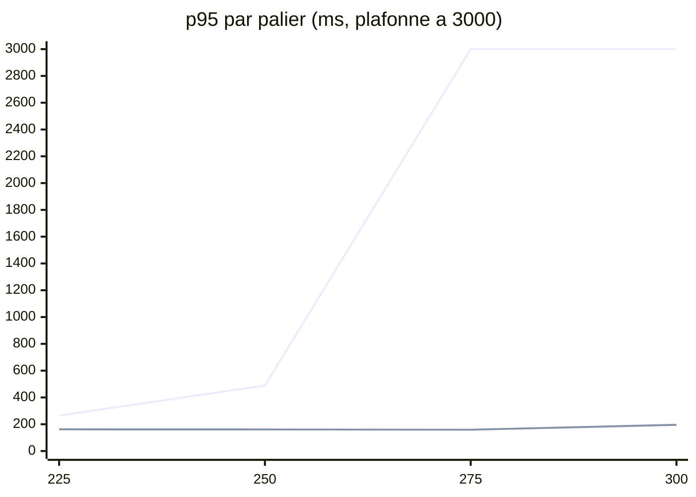

# 06 - Résultats de la vague 1 : 300 req/s tiennent

Mesures du 2026-11-09 entre 12:05 et 12:15 (UTC). Chaque chiffre est un **FAIT** (sortie de `yarn load`, `kubectl top` relevé toutes les 5 s par `record-ramp.sh`, lignes `cache stats` des journaux) sauf mention **INFERENCE**. Même méthode qu'au [chapitre 04](04-resultats.md) : mélange de l'application (`events-list-app:40,posts-list:30,me:20,is-following:10`), 200 acteurs, simulateur de fond à 0, VM de 14 vCPU, un palier de 90 s à la fois avec une pause d'environ 1 minute entre deux paliers.

## 1. Le résumé

| Palier | Avant la vague 1 (matin, [chapitre 04](04-resultats.md)) | Après la vague 1 |
| ---: | :--- | :--- |
| 225 | p95 265 ms, nœud 7,2 à 8,4 vCPU | **p95 162 ms**, nœud 5,2 à 6,3 vCPU |
| 250 | p95 489 ms, nœud 7,9 à 11,2 vCPU | **p95 161 ms**, nœud 6,0 à 7,0 vCPU |
| 275 | p95 4 403 ms, arrêt | **p95 159 ms**, nœud 5,9 à 7,9 vCPU |
| 300 | non tenté | **p95 196 ms**, nœud 7,8 à 7,9 vCPU (56 %) |

**300 req/s tiennent** : 0 % d'erreur sur les quatre paliers, aucun 429, aucun 504, aucun pod créé par l'HPA pendant la rampe.

Sur le graphique, « avant » à 275 est un arrêt ramené au plafond de 3 000 ms, et 300 n'avait pas été tenté.

**Coût par requête** (INFERENCE, calcul) : 7,9 vCPU pour 300 req/s, soit environ **26m de CPU de nœud par req/s**, contre 40m au pic de 250 ce matin et 36m visés par le [plan](05-plan-vers-300.md).

## 2. Ce qui a été livré

| # | Changement | PR |
| :--- | :--- | :--- |
| 1 | Instrumentations OpenTelemetry coupées (`express`, `router`, `nestjs-core`, `net`, `undici`, `generic-pool`) sur la gateway et les six `ms-*` ; mémoire de la gateway 256 Mi vers 320 Mi | `deploy#72` |
| 2 | Lignes `info` par appel des contrôleurs de lecture passées en `debug` | `api-gateway#122`, `ms-social#73`, `ms-event#94`, `ms-post#79`, `ms-user#93` |
| 3 | Gateway : ETag coupé, `keepAliveTimeout` 95 s (au-dessus des 90 s de Traefik), `RefreshTokenMiddleware` limité à sa route | `api-gateway#121` |
| 4 | Gateway : cache des exclusions de recherche, 5 s par utilisateur, vidé par le pod qui traite une participation, un souhait ou un blocage (décision D1) | `api-gateway#124` |
| 5 | ms-post : cache des liens post vers événement, 30 s si lien, 5 s sinon (décision D5) | `ms-post#80` |
| 6 | ms-event : une seule expression régulière pour toute la liste d'identifiants au lieu d'un `@IsUUID` par identifiant (décision D3) ; 5,3 ms contre 1,6 ms pour 2 000 identifiants au banc local | `ms-event#95` |
| 7 | Gateway : deadline gRPC de 2 s par appel de lecture sur les quatre routes chaudes, `DEADLINE_EXCEEDED` rendu en 504 | `api-gateway#123` |

Images en production pendant la rampe : `api-gateway:sha-1b947e4`, `ms-event:sha-10d69a5`, `ms-social:sha-a256ba9`, `ms-post:sha-86c3ba5`, `ms-user:sha-193b6e0`.

## 3. Les paliers

| Palier | p50 | p95 | p99 | Erreurs | Nœud |
| ---: | ---: | ---: | ---: | ---: | ---: |
| 225 | 58 ms | 162 ms | 235 ms | 0 % | 5,2 à 6,3 vCPU |
| 250 | 52 ms | 161 ms | 332 ms | 0 % (1 erreur sur 22 500) | 6,0 à 7,0 vCPU |
| 275 | 51 ms | 159 ms | 342 ms | 0 % | 5,9 à 7,9 vCPU |
| 300 | 55 ms | 196 ms | 314 ms | 0 % | 7,8 à 7,9 vCPU |

Par route (p95) :

| Route | 225 | 250 | 275 | 300 |
| :--- | ---: | ---: | ---: | ---: |
| `events-list-app` | 184 ms | 219 ms | 226 ms | 252 ms |
| `posts-list` | 148 ms | 136 ms | 108 ms | 124 ms |
| `is-following` | 131 ms | 128 ms | 109 ms | 147 ms |
| `me` | 139 ms | 119 ms | 86 ms | 106 ms |

`events-list-app` reste la route la plus lente : elle enchaîne jusqu'à trois appels gRPC en série (exclusions, recherche, compteurs).

## 4. Analyses

### 4.1 Où part le CPU à 300 req/s

Moyenne des relevés par pod entre 12:13:15 et 12:14:45 :

| Pod | Moyenne | Pic | Limite | Pic / limite |
| :--- | ---: | ---: | ---: | ---: |
| `ms-event-db` | 582m | 707m | 800m | **88 %** |
| `ms-post-db` | 432m | 524m | 1 500m | 35 % |
| `api-gateway` (par pod, 5 pods) | 382m | 541m | 2 000m | 27 % |
| `neo4j` | 373m | 534m | 1 000m | 53 % |
| `ms-event` | 345m | 438m | 800m | 55 % |
| `ms-user` | 326m | 515m | 800m | 64 % |
| `ms-social` | 322m | sous 438m | 800m | sous 55 % |
| `ms-post` | 239m | sous 438m | 800m | sous 55 % |

- **Le critère « aucun pod au-dessus de 85 % de sa limite » n'est pas tenu** : `ms-event-db` atteint 707m sur 800m. C'est le prochain goulot. INFERENCE, cohérente avec [l'analyse de ms-event](analyses-services/ms-event.md) : le `COUNT` sans `LIMIT` ajouté par `getManyAndCount` à chaque recherche.
- ms-social, le processus le plus chargé ce matin, n'est plus en tête : 322m en moyenne à 300 req/s.
- L'HPA de la gateway affichait 493m sur une cible de 500m à la fin du palier 300 : un palier plus long ou plus haut aurait créé un 6e pod, froid.

### 4.2 Les caches

Cumul des lignes `cache stats` de tous les pods sur les 12 minutes de la rampe :

| Cache | Où | Réussite | Lectures |
| :--- | :--- | ---: | ---: |
| `post-event-links` | ms-post | 99 % | 340 940 |
| `event-participant-counts` | gateway | 99 % | 211 060 |
| `event-lookup` | gateway | 99 % | 82 872 |
| `posts-total` | ms-post | 67 % | 17 047 |
| `search-exclusions` | gateway | **10 %** | 10 556 |

- Les caches à 99 % sont flattés par la rampe : 200 acteurs qui relisent les pages 1 à 3. En trafic réel, leur réussite sera plus basse (limite déjà notée au [chapitre 04](04-resultats.md), section 5).
- **Le cache des exclusions ne rapporte presque rien** : 10 % de réussite, en dessous des 35 % estimés avant la livraison. INFERENCE : chaque pod de la gateway (5) a son propre cache, un acteur revient sur le même pod environ toutes les 11 s, et le délai est de 5 s. Le gain de la vague 1 ne vient donc pas de ce cache.

### 4.3 Les deadlines

Aucune ligne `DEADLINE_EXCEEDED` ni « did not answer in time » dans les journaux de la gateway pendant la rampe : la deadline de 2 s n'a jamais coupé un appel.

## 5. Limites de ces mesures

| Limite | Conséquence |
| :--- | :--- |
| Un seul passage par palier ; la phase D du [plan](05-plan-vers-300.md) demande deux passages à 15 minutes d'intervalle | Le résultat à 300 reste à confirmer |
| Pas de relevé de fréquence ni de température de l'hôte cette fois | On ne sait pas si l'hôte a baissé sa fréquence ; le nœud à 56 % laisse penser qu'il a moins chauffé (INFERENCE) |
| Pas de profil CPU | La part de chaque levier n'est pas isolée |
| Les sept changements ont été mesurés ensemble | La règle « une phase, une mesure » n'a pas été tenue, comme au chapitre 04 |
| Caches flattés par la rampe | Le gain réel en production sera plus faible |
| ms-event a tourné sur `fd907aa` (sans #95) de 11:42 à 11:47, à cause d'un bump d'image dans le désordre dans `deploy`, corrigé avant la rampe | Aucun effet sur la mesure ; leçon consignée dans la skill `volontariapp-deploy-gitops` |

## 6. Prochaines étapes

1. **Phase D** : rejouer 275 et 300 deux fois à 15 minutes d'intervalle, avec la boucle de fréquence de l'hôte, pour confirmer. Fait à 12:31 : voir le [chapitre 07](07-ms-event-db-et-memoire.md).
2. **`ms-event-db`** : le prochain goulot. La vague 2 (`domain-event` : total en cache, listes en un seul paramètre tableau) vise exactement ce `COUNT`.
3. **Cache des exclusions** : à 10 %, le déplacer dans ms-social (2 pods, vidage là où les écritures arrivent) ou le retirer. Décision à prendre après la phase D.
4. **Gateway** : passer `minReplicas` à 6 (étape C4 du plan) pour éviter un pod froid à 300 req/s, puisque l'HPA est au bord de sa cible.
5. La vague 2 reste utile pour la marge et pour le trafic réel, moins flatteur pour les caches que la rampe.
