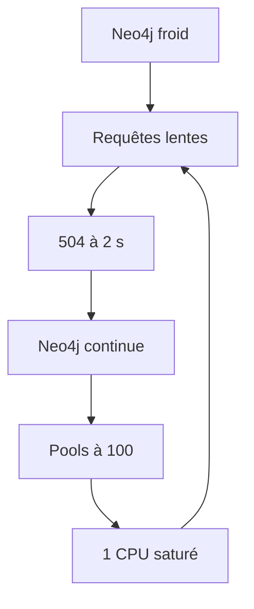

# 09 - Démarrage à froid : quand Neo4j casse la première rafale

Le 2026-11-09 de 21:01 à 22:00 (UTC). Chaque chiffre est un **FAIT** (rapport de `yarn load`, `kubectl`, API du kubelet, compteurs de connexions) sauf mention **INFERENCE**. Relevés bruts : `meta/profiles/cold-neo4j/` et `meta/profiles/cold-neo4j-restart/` (non versionnés).

## 1. Le résumé

1. **Un Neo4j froid ne tient pas une rafale.** Après un redémarrage de Neo4j, 100 req/s avec le mélange habituel donnent **80 % d'erreurs pendant toute la minute**, sans retour à la normale.
2. **La cause est une chaîne de quatre défauts** : Neo4j limité à 1 CPU par erreur de configuration, des lectures Cypher sans timeout, des pools de 100 connexions par pod, et des plans et un cache de pages froids.
3. **La reconstruction du pool de connexions n'est pas en cause** : des pods ms-social neufs, avec un pool vide, encaissent une rafale sans erreur quand Neo4j est chaud.
4. **Les correctifs sont prêts** : deploy#75, ms-social#75 et npm-packages#318. Le test du redémarrage, rejoué après eux, sert de critère d'acceptation.

## 2. Le symptôme (21:01)

- Rampe à 100 req/s après environ 4 h sans trafic : arrêt automatique en 30 s.
- Toutes les erreurs sont des 504 de la deadline de lecture de 2 s de la gateway (`GatewayTimeoutException`, `api-gateway/src/common/grpc/read-deadline.ts:13`). La première arrive à 21:01:16.7, 2 s après le départ.
- Échouent : `events-list-app` (413 sur 820), `posts-list` (257 sur 674), `is-following` (108 sur 221). Ce sont les trois routes qui passent par ms-social. `me` (ms-user seul) : 0 erreur.
- Pendant ce temps : ms-social à 28-47m de CPU, nœud à 1,5-3,5 vCPU sur 14, 6 Go de mémoire disponible, aucun défaut de page majeur. **Neo4j à 742m, contre 61 à 82m au même débit une fois chaud.**
- Deux minutes plus tard, la même rampe tient 400 req/s sans erreur.

## 3. Les hypothèses et les tests

### 3.1 Les hypothèses de départ

| # | Hypothèse | Statut final |
| :--- | :--- | :--- |
| H1 | Pool de connexions expiré (durée de vie d'une connexion : 1 h par défaut dans le driver 6.3.0), avalanche de connexions neuves sous la rafale | **écartée** par le test 1 |
| H2 | Neo4j froid de son côté : plans d'exécution, cache de pages, sur 1 CPU | **confirmée** par le test 2 |
| H3 | Connexions TCP mortes réutilisées | écartée : le pool écarte les connexions de plus d'une heure avant usage |
| H4 | Canaux gRPC inactifs (gateway vers ms-social) | peu probable : `me` passe par le même mécanisme sans erreur |

### 3.2 Test 1 (21:46) : pods ms-social neufs, Neo4j chaud

- 206 connexions Bolt ouvertes sur Neo4j avant le test : les pools des deux pods, pleins à 100 après les rampes de la soirée.
- Suppression des deux pods ms-social, attente des nouveaux, puis rafale immédiate : 100 req/s sur `is-following` seul, montée 0 s, échauffement 0 s, 30 s.
- **Résultat : 0 % d'erreur, p95 117 ms, pire seconde (s0) à 149 ms. 16 connexions Bolt après.**
- Conclusion : un pool vide qui se reconstruit sous une rafale ne casse rien. H1 est écartée.

### 3.3 Test 2 (21:55) : Neo4j redémarré, mélange complet

- 21:55:00 : suppression de `neo4j-0` ; prêt à 21:55:22 ; 30 s sans trafic ; 0 connexion Bolt.
- 21:56:03 : rafale de 100 req/s avec le mélange de 21:01, montée 0 s, échauffement 0 s, 60 s, arrêt automatique désactivé (`LOAD_ABORT_WINDOWS=99`).

| Fenêtre de 10 s | Requêtes | p50 | p95 | Erreurs |
| ---: | ---: | ---: | ---: | ---: |
| 1 | 836 | 2 039 ms | 2 159 ms | 75,0 % |
| 2 | 997 | 2 033 ms | 2 166 ms | 79,8 % |
| 3 | 998 | 2 031 ms | 2 167 ms | 80,5 % |
| 4 | 1 004 | 2 031 ms | 2 167 ms | 81,9 % |
| 5 | 1 002 | 2 031 ms | 2 159 ms | 79,3 % |
| 6 | 991 | 2 030 ms | 2 161 ms | 81,7 % |

| Heure | CPU de Neo4j | Connexions Bolt |
| :--- | ---: | ---: |
| 21:55:33 | 986m (démarrage) | 0 |
| 21:56:39 à 21:57:40 | 1000m, sa limite | jusqu'à 200 |
| 21:57:06 | fin de la rafale | 200 |
| 21:58:22 | 642m | 200 |
| 21:58:54 | 15m | 200 |

- **Neo4j reste saturé 1 min 45 après la fin de la rafale** : il termine des requêtes que la gateway a abandonnées depuis longtemps.
- En trafic réel, la panne aurait duré au moins 3 minutes.

## 4. La cause

1. **Neo4j tourne avec 1 CPU en prod**, en request comme en limit, alors que l'overlay en demande 2. `apps/overlays/prod/ms-social/db-neo4j/kustomization.yaml` écrit `resources:` à la racine des valeurs, alors que la chart Neo4j 5.20.0 lit `neo4j.resources.cpu` et `neo4j.resources.memory`, utilisés pour la request et la limit. La valeur de l'overlay était ignorée sans aucun avertissement.
2. **Les lectures Cypher n'ont pas de timeout** (`domain-social/src/repositories/base/neo4j-base.repository.ts`, `session.run(cypher, params)`). Quand la gateway abandonne à 2 s, Neo4j continue de travailler.
3. **Chaque pod ms-social peut ouvrir 100 connexions** (valeur par défaut du driver, `maxConnectionPoolSize`), et leur demande d'acquisition attend jusqu'à 60 s. Sous une rafale lente, jusqu'à 200 requêtes s'exécutent en même temps sur 1 CPU.
4. **Un Neo4j froid exécute lentement les requêtes chaudes** : plans d'exécution à compiler, en particulier la requête des exclusions dont le texte dépend des drapeaux (une combinaison, un plan), et pages de données hors mémoire. INFERENCE sur la part de chacun ; le fait mesuré est 742 à 1000m de CPU au lieu de 61 à 82m.

Ces quatre défauts se renforcent : des requêtes lentes déclenchent des 504, les requêtes abandonnées occupent Neo4j, de nouvelles connexions arrivent, et la saturation s'entretient.

Le cas de 21:01 n'était pas un redémarrage : Neo4j tournait depuis le 2026-11-02. Mais la nouvelle requête des exclusions (`domain-social` 0.19.3, déployée vers 17:00) n'avait jamais tourné avant 21:01, et Neo4j était resté environ 4 h sans travail. Même mécanisme, en plus court (30 s au lieu de plus d'une minute). INFERENCE pour le lien précis entre les deux.

## 5. Les correctifs

| # | Correctif | PR | STOP |
| :--- | :--- | :--- | :--- |
| C1 | Neo4j à `neo4j.resources` cpu 2000m, memory 2Gi ; retrait de la clé `resources:` ignorée | deploy#75 | non |
| C2 | Driver Neo4j : pool de 32 par pod, acquisition 1,5 s, connexion 1 s, vérification de vivacité après 30 s d'inactivité, durée de vie 6 h, journaux du driver au niveau warn vers `@volontariapp/logger` | ms-social#75 | non |
| C3 | Préchauffage au démarrage (15 s au plus, avant que gRPC et HTTP n'écoutent) puis toutes les 5 min : les 15 combinaisons de drapeaux d'exclusion, `countParticipantsByEventIds` et `getEventsRelatedToPosts` avec 1, 10, 20, 50 et 100 identifiants, `isFollowing`, puis 16 `RETURN 1` pour garder des connexions | ms-social#75 | non |
| C4 | Timeout de 1 800 ms sur les lectures Cypher (`read`, `readPaginated`, `readPaginatedCustom`) ; constante `NEO4J_READ_TRANSACTION_TIMEOUT_MS` exportée ; `domain-social` 0.20.0 | npm-packages#318 | **oui** |
| C5 | Readiness de ms-social sur `GET /health` (port http, période 10 s, timeout 2 s, seuil 3) ; l'endpoint teste Neo4j avec `verifyConnectivity` | deploy#75 | non |
| | Requests CPU : gateway 250m, ms-social 300m, ms-event 300m, ms-user 250m, ms-post 200m (au lieu de 100m et 50m) ; gateway fixée à 7 pods (HPA min 7, max 7) ; quota de `prod` à 10 CPU en requests et 64 en limits | deploy#75 | non |

Pourquoi un pool de 32 plutôt que 24 (INFERENCE, calcul) : à 400 req/s, le mélange ouvre environ 480 sessions Neo4j par seconde, soit 240 par pod. À 100 ms par session, la loi de Little donne 24 sessions en vol par pod ; pendant une montée, davantage.

Pourquoi le préchauffage joue de vraies requêtes : d'après la documentation Cypher (« Query caches »), la clé du cache des plans est le texte de la requête plus le type et la catégorie de taille de chaque paramètre. D'où des identifiants de longueur réelle et cinq tailles de liste. Les seuils exacts des catégories de taille ne sont pas vérifiés.

Pourquoi la gateway à 7 pods fixes : l'HPA ajoute un pod par minute au plus, et un pod neuf sert d'abord des p95 de plusieurs secondes (skill `volontariapp-load-ramp`). Il ne protège donc pas d'une rafale. À revoir quand la gateway aura une readiness qui préchauffe ses clients gRPC.

## 6. Critère d'acceptation

Rejouer le test 2 une fois les trois PR déployées : redémarrage de `neo4j-0`, 30 s sans trafic, rafale de 100 req/s avec le mélange de 21:01, montée et échauffement à 0, 60 s. Réussite : moins de 1 % d'erreurs, et Neo4j sous sa limite de CPU. L'ordre recommandé pour isoler les effets : d'abord C1 seul, puis C2 et C3, puis C4.

## 7. Points ouverts

- `neo4j-0` a aussi été redémarré à 21:49:07, en dehors des tests. Ce n'est pas l'agent chargé des correctifs (aucune écriture de sa part, révision du StatefulSet inchangée). Origine non déterminée.
- Les tests ont déclenché des alertes Datadog (redémarrages de Neo4j et de ms-social, 5xx de la gateway, CPU de Neo4j). Prévoir de mettre ces monitors en sourdine pendant les prochains tests.
- Après les tests : tous les pods de `prod` en `Running`, une seule DLQ dans les deux Redis (`stream:post-unliked-dlq`, vide), aucune ligne `error` en 25 minutes dans les pods `post-processor-*`, `worker-*`, `outbox-*` et `ws-service`. Files BullMQ en échec et pods `ms-*` non vérifiés.
- Les fichiers `neo4j-values.yaml` (overlay et `infrastructure/databases/neo4j`) ne sont référencés nulle part et portent la même mauvaise clé.
