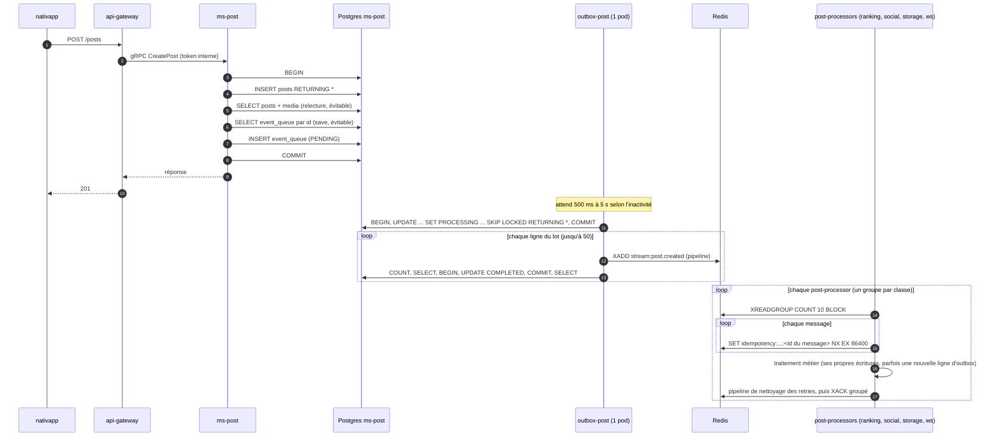

# 01 - Constats vérifiés

Chaque constat est relu sur `origin/main` (`git archive origin/main` de chaque dépôt, le 2026-11-10). Les chemins sont relatifs au dépôt cité. TypeORM est lu dans `typeorm@0.3.31` (tarball `npm pack`), la version de tous les `yarn.lock` (ms-event résout aussi 0.3.30 pour une autre dépendance).

Légende : **FAIT** (ligne lue ou sortie de commande), **INFERENCE** (raisonnement non mesuré), **NON VERIFIE**.

## 1. Comment TypeORM 0.3.31 compte les allers-retours

Ces quatre faits servent à tous les décomptes qui suivent.

| # | Fait | Source |
| :--- | :--- | :--- |
| T1 | `save()` charge d'abord la ligne existante par son id, en une requête, **seulement si l'entité porte un id** ; sans id, il ne charge rien | `persistence/SubjectDatabaseEntityLoader.js:37-44` (saut si pas d'identifiant), `:88-93` (requête `whereInIds`) ; appelé par `persistence/EntityPersistExecutor.js:93` |
| T2 | `save()` ouvre une transaction (`START TRANSACTION` puis `COMMIT`) s'il n'y en a pas déjà une, et ne fait rien du tout si aucune colonne n'a changé | `EntityPersistExecutor.js:120-122` (aucune opération : retour), `:129-136` (ouverture), `:145-146` (commit) ; `driver/postgres/PostgresQueryRunner.js:112-132` |
| T3 | Sur Postgres, l'INSERT et l'UPDATE de `save()` récupèrent les colonnes générées par `RETURNING`, sans SELECT de plus | `query-builder/ReturningResultsEntityUpdator.js:26-43` (update), `:115-118` (insert) |
| T4 | La taille du pool vient de `poolSize` (ou `extra.max`), pas d'un autre nom d'option | `driver/postgres/PostgresDriver.js:1205-1206` (`max: options.poolSize`, puis `options.extra`) |

## 2. Les 11 constats de la première analyse

| # | Constat d'origine | Verdict | Ce qui est vrai (FAIT) |
| :--- | :--- | :--- | :--- |
| 1 | `update()` fait COUNT, puis save, puis relecture : 6 allers-retours | **Confirmé** | `npm-packages/packages/database/src/core/base.repository.ts:149-166` : `exists()` (COUNT, `:229-232`), `repository.save({...data, id})` (SELECT T1, puis BEGIN, UPDATE, COMMIT T2), puis `findWithRelations` avec **toutes** les relations de l'entité (`:164-165`). 6 RT si une colonne change, 3 sinon (COUNT, SELECT, relecture) |
| 2 | `create()` passe par save, qui relit la ligne avant d'insérer et ouvre une transaction | **À nuancer** | Vrai seulement quand l'id est fixé dans le code (T1). C'est le cas d'`event_queue` (`database/src/outbox/entities/event-queue.entity.ts:42`, `entity.id = randomUUID()`), donc de toute l'outbox. Faux pour une entité dont l'id est généré par la base (`BaseModel`, `database/src/core/base.model.ts:4`) et non fourni. Hors transaction : 4 RT (SELECT, BEGIN, INSERT, COMMIT) ; dans une transaction : 2 RT (SELECT, INSERT) |
| 3 | L'outbox pousse et acquitte ligne par ligne, `pushBulkElement` existe sans être appelé | **Confirmé** | `database/src/outbox/consumers/outbox.consumer.ts:112-138` boucle sur `pushElement` puis `markAsCompleted`, qui appelle le `update()` du constat 1 (`database/src/outbox/dispatchers/outbox.dispatcher.ts:55-71`). `pushBulkElement` existe pour les événements (`outbox/src/pushers/event-queue.pusher.ts:144-165`) et les jobs (`outbox/src/pushers/jobs-outbox.pusher.ts:67-112`). Aucun appel trouvé dans `npm-packages/packages/database/src` ni dans `outbox-runners` (rg, fichiers TS hors tests) |
| 4 | Runner inactif : attente doublée jusqu'à 5 s | **Confirmé, mesuré** | `database/src/outbox/runners/outbox.runner.ts:84,94-98` : délai `batchIntervalMs × 2^(n-1)` plafonné à `maxIdleIntervalMs`. En prod : 500 ms, plafond 5 000 ms, lot de 50 (`deploy/apps/base/ms-post/deployment-outbox.yaml:87-92`, identique pour les sept runners). Mesure : voir chapitre 02 |
| 5 | Un `SET NX` attendu par message | **Confirmé** | `post-processors/src/core/processors/batch.post-processor.ts:22-24` (boucle `await` par entrée) et `:59-62` ; `single.post-processor.ts:58-68`. Commande : `core/helpers/redis-stream.helper.ts:116-125` |
| 6 | Statut de saga : `update()` complet par événement, en boucle | **Confirmé** | `post-processors-runner/post-processor-event/src/post-processors/event-creation-successfull.post-processor.ts:42-63` : `eventRepository.update(eventId, { saga_status: DONE })` par événement, donc 6 RT chacun, et chaque UPDATE de `events` déclenche le trigger `events_event_queue_trigger` qui insère un `event.changed` (voir constat N5) |
| 7 | Création d'événement et de post : relecture complète après l'insert, save en plus pour les tags | **Confirmé** | Post : `domain-post/src/repositories/postgres-post.repository.ts:227-241` (INSERT `RETURNING *`), puis `:277-280` (relecture avec `media`). Événement : `domain-event/src/repositories/postgres-event.repository.ts:87-94` (INSERT `RETURNING *`), `:112-119` (`manager.save` de tout le modèle quand il y a des tags ou des exigences), `:121-124` (relecture avec `tags` et `requirements`) |
| 8 | `EventService.update` : lecture avec relations, puis `update()` | **Confirmé** | `domain-event/src/services/event.service.ts:152-184` : `findById` avec `['requirements', 'tags']` (`:36-38`), `validateTags` si des tags sont passés (`:331-344`), puis `update()` (6 RT). 7 à 8 RT |
| 9 | Like, follow, participation : 2 à 5 sessions Neo4j | **Confirmé** | Like : `domain-social/src/services/interaction.service.ts:46` (`likeExists`, une session) puis `:49` (`createLike`, une session `executeWrite`). Follow : `relationship.service.ts:31,34` (2 sessions). Participation : `participation.service.ts:168-178` (`eventExists`, `participationExists`, `wishExists`, `deleteWish` éventuel, `createParticipation` : 4 ou 5 sessions). Chaque appel ouvre et ferme sa session (`repositories/base/neo4j-base.repository.ts:23-37` et `:58-67`) |
| 10 | Un job : GET Redis, lecture d'audit, upsert avec relecture, SET, UPDATE, trigger, post-processor avec COUNT et transaction | **À nuancer** | Tout est vrai sauf « upsert avec relecture » : `BaseRepository.upsert` ne relit que si l'id est dans les données (`base.repository.ts:186-193`), et `recordAuditStart` n'en passe pas (`workers/src/core/base.worker.ts:173-185`). Donc 1 RT, pas 2. Le reste : `base.worker.ts:102` (GET), `:126` (SELECT audit), `:155` (SET), `:208-215` (UPDATE, qui déclenche `notify_job_audit_status_change`), puis `post-processors/src/common/job-outbox-success.post-processor.ts:51` (COUNT par `exists`) et `:75-124` (transaction : DELETE, puis SELECT et INSERT du retour dans `event_queue`) |
| 11 | `maxPoolSize` validé mais jamais passé au pool ; ms-event ouvre deux DataSource | **Confirmé, à élargir** | `config/src/configs/db/postgres-config.ts:10` valide `maxPoolSize` ; `bridge/src/providers/postgres.provider.ts:13-18` le passe tel quel au `DataSource`, qui ne le lit pas (T4). Les **six** `ms-*` ouvrent deux DataSource, pas seulement ms-event : `PostgresBridgeModule.register` et `TypeOrmModule.forRoot` dans chaque `src/providers/database/database.module.ts` (par exemple `ms-event/.../database.module.ts:24-44`, `ms-social/.../database.module.ts:27-48`). Le premier ne sert qu'au health-check (`health-check-nest/src/health-check/health.controller.ts:38`). Taille réelle de chaque pool : 10, la valeur par défaut de `pg` 8.23.1 (INFERENCE sur la valeur par défaut, non relue dans `pg-pool`) |

Le point de cohérence d'origine (ms-social, Neo4j et `event_queue` non atomiques, erreur avalée en `warn`) est **confirmé**, avec une correction de lignes : l'erreur est avalée dans `domain-social/src/services/interaction.service.ts:70-74` (like) et `:114-118` (unlike), et dans `participation.service.ts:293-297` (souhait) et son équivalent pour le retrait du souhait. La référence d'origine « `interaction.service.ts:291-295` » ne correspond à aucune ligne de ce fichier (168 lignes).

Le risque d'origine sur le verrou d'idempotence (clé sur l'id du message Redis, `redis-stream.helper.ts:108-110`) est **confirmé** ; il est détaillé, avec un second défaut, au chapitre 04.

## 3. Constats nouveaux

| # | Constat | Preuve |
| :--- | :--- | :--- |
| N1 | **147 événements bloqués depuis le 2026-11-07 15:36-15:39, jamais livrés.** 107 lignes `PROCESSING` et 40 `FAILED` dans `ms-post` (`post.created`), `ms-event` (`event.changed`, `event.created`, `event.finished`), `ms-social` (`post.liked`), `ms-user` (`user.created`), `ms-ranking` (`ranking:job:outbox:success`). Erreur des `FAILED` : `Reached the max retries per request limit (which is 20)` (ioredis pendant l'incident Redis du 2026-11-07) | FAIT : requête en lecture seule sur `event_queue`, chapitre 02 |
| N2 | **Aucune reprise.** Rien ne remet une ligne `PROCESSING` ou `FAILED` en `PENDING` ; la purge ne touche que `COMPLETED` (`database/src/outbox/purgers/outbox.purger.ts:31`) | FAIT : rg de `OutboxStatus.PENDING`, `status = 'PENDING'`, `SET status`, `reaper`, `requeue` dans `npm-packages`, `outbox-runners`, les six `ms-*`, `ws-service`, `post-processors-runner`, `workers-runners` (TS hors tests) : seules les créations de lignes et les index sont trouvés |
| N3 | **Un échec de `markAsCompleted` laisse le reste du lot bloqué.** `markAsCompleted` passe le statut à `COMPLETED` en mémoire avant l'UPDATE (`outbox.dispatcher.ts:68-70`). Si l'UPDATE échoue, le `catch` appelle `markAsFailed`, qui refuse une entité qui n'est plus `PROCESSING` et lève (`:36-43`) ; l'exception sort de la boucle (`outbox.consumer.ts:130-136`), et toutes les lignes suivantes du lot restent `PROCESSING` | FAIT (lecture) ; que ce soit la cause exacte de N1 est une INFERENCE |
| N4 | **Les post-processors lisent 10 messages par lot en prod** (`POST_PROCESSOR_BATCH_SIZE=10`, `deploy/apps/base/*/deployment-post-processor.yaml:87`), alors que les configurations par défaut des runners disent 1 (`post-processor-*/config/default.config.json:25`) | FAIT |
| N5 | **Des triggers SQL écrivent dans `event_queue`** : `events` (tout UPDATE, `event.changed`), `event_tags` (INSERT et DELETE), `requirements` et `tags` (tout), `users` (INSERT), `job_audit` (UPDATE de `status`) | FAIT : `pg_get_triggerdef` en lecture seule dans ms-event, ms-post, ms-user, ms-social, ms-ranking |
| N6 | **Une lecture écrit dans ms-ranking.** `ranking-read.service.ts:46-48` (liste absente) et `:120-133` (liste périmée) appellent `RankingJobService.requestCompute` (`ranking-job.service.ts:31-72`) : une transaction, un upsert `ranking_request` (`domain-ranking/src/repositories/postgres-ranking-request.repository.ts:35-60`), et un job si besoin. Mesure : `ranking_request` a 67 435 insertions et 5 340 627 mises à jour | FAIT |
| N7 | **Les workers traitent un job à la fois.** `bullmq` 5.81.5 fixe `concurrency: 1` par défaut (`dist/cjs/classes/worker.js:38`) ; `@nestjs/bullmq` 11.0.5 ne passe que les options du décorateur. Seuls les trois workers de `worker-ranking` en donnent une (5, `worker-ranking/config/default.config.json:42`) ; `@Processor(...)` sans option dans `worker-event`, `worker-user`, `worker-social`, `worker-post`, `worker-storage` | FAIT |
| N8 | **Le compteur de badges lit puis écrit.** `post-processor-user/src/core/services/badge-evaluator.service.ts:408-429` (`incrementCounter`) : `findOneBy`, puis `save` (qui relit encore, T1), au lieu d'un `INSERT ... ON CONFLICT DO UPDATE SET value = value + 1`. 3 RT au lieu de 1, et une mise à jour perdue possible si deux traitements tournent en même temps (INFERENCE : aujourd'hui un seul pod, traitement séquentiel) | FAIT |
| N9 | **La création d'un post avec médias appelle ms-storage en synchrone** avant l'insert (`ms-post/src/modules/post/controllers/post.command.controller.ts:74`, `confirmPostAttachment`) | FAIT |
| N10 | **ws-service écrit déjà bien** : `gather-state.repository.ts:60-89` met à jour l'état d'un gather en une requête. Seule l'initialisation passe par le socle (`gather-state.service.ts:65-81` : `findOne`, puis `update()` ou `create()`) | FAIT |
| N11 | **ms-storage écrit peu** : 59 insertions dans `files` depuis la création de la base, et ses écritures sont en SQL écrit à la main (`domain-storage/src/repositories/postgres-file.repository.ts:276-646`), sauf l'outbox qui passe par `create()` | FAIT |
| N12 | **La couverture de `mesh-mcp` sur `post.created` est partielle** : `analyze_impact` liste ranking, social et ws-service, mais pas `post-processor-storage/src/post-processors/post-created.post-processor.ts:16`, trouvé par rg | FAIT (sortie d'outil et ligne lue) |

## 4. Allers-retours par opération

Comptés à partir du code et de T1 à T4. « SQL » compte les requêtes Postgres, BEGIN et COMMIT compris. Les décomptes « après » supposent les lots du chapitre 03 ; ils sont à confirmer par `pg_stat_statements` (chapitre 02).

### Création d'un post (`POST /posts`, sans média)

| Étape | Avant | Après | Où |
| :--- | :--- | :--- | :--- |
| Gateway vers ms-post | 1 gRPC | 1 gRPC | `api-gateway/src/modules/post/controllers/commands/post/post.command-controller.ts:48-59` |
| Ouverture de la transaction | 1 (BEGIN) | 1 | `base.repository.ts:300-319` |
| INSERT post `RETURNING *` | 1 | 1 | `postgres-post.repository.ts:227-241` |
| INSERT médias (si médias) | 1 | 1 | `:261-275` |
| Relecture du post et des médias | 1 | 0 | `:277-280` |
| SELECT `event_queue` par id (save) | 1 | 0 | T1 |
| INSERT `event_queue` | 1 | 1 | `:304` |
| COMMIT | 1 | 1 | |
| **Total ms-post (sans média / avec)** | **6 / 7 SQL** | **4 / 5 SQL** | |

Avec des médias, ajouter l'appel gRPC à ms-storage (N9) et ses écritures, NON VERIFIE en détail.

### Passage d'une ligne d'outbox (lot de 50 lignes `event_queue`)

| Étape | Avant | Après |
| :--- | :--- | :--- |
| Claim (BEGIN, UPDATE ... RETURNING, COMMIT) | 3 SQL par lot | 3 SQL par lot |
| Push Redis (un pipeline par ligne, un XADD par stream cible) | 1 Redis par ligne, 50 par lot | 1 Redis par lot |
| `markAsCompleted` (COUNT, SELECT, BEGIN, UPDATE, COMMIT, SELECT) | 6 SQL par ligne, 300 par lot | 1 SQL par lot (`UPDATE ... WHERE id = ANY($1)`) |
| **Total par lot de 50** | **303 SQL et 50 Redis** | **4 SQL et 1 Redis** |

Côté jobs (`jobs_outbox`), remplacer le XADD par un `queue.add` BullMQ (un script Lua, 1 RT, INFERENCE sur le nombre exact) : `addBulk` existe déjà (`jobs-outbox.pusher.ts:105`).

### Like (`POST /social/likes/:postId`)

| Étape | Avant | Après |
| :--- | :--- | :--- |
| Gateway vers ms-social | 1 gRPC | 1 gRPC |
| Neo4j : le like existe-t-il ? | 1 session | 0 |
| Neo4j : MERGE du like | 1 session (transaction d'écriture) | 1 session, qui dit si la relation a été créée |
| Postgres : SELECT `event_queue` par id | 1 | 0 |
| Postgres : BEGIN, INSERT, COMMIT | 3 | 3 (BEGIN, INSERT, COMMIT, la transaction englobant l'écriture Neo4j, voir chapitre 04) |
| **Total** | **2 Neo4j, 4 SQL** | **1 Neo4j, 3 SQL** |

Puis `post.liked` part vers ranking, badges (`post-processor-user`) et ws-service (sortie `analyze_impact`, 5 consommateurs). Le badge coûte au moins : un `SISMEMBER` Redis, un SELECT `user_badges`, un appel de résolution de l'auteur du post, et la transaction de comptage avec N8 (`badge-evaluator.service.ts:96-139`, `:578-599`).

### Participation (`POST /social/events/:eventId/participate`)

| Étape | Avant | Après |
| :--- | :--- | :--- |
| Neo4j | 4 sessions (5 si un souhait existe) | 1 session : une requête qui vérifie l'événement, supprime le souhait et crée la participation, et renvoie ce qu'elle a trouvé |
| Postgres | 0 (pas d'événement émis) | 0 |

### Création d'un événement (`POST /events`)

| Étape | Avant, sans tags ni exigences | Avant, avec tags | Après |
| :--- | :--- | :--- | :--- |
| `validateTags` (SELECT des tags) | 0 | 1 | 1 |
| BEGIN | 1 | 1 | 1 |
| INSERT `events` `RETURNING *` | 1 | 1 | 1 |
| `manager.save` du modèle complet | 0 | au moins 2 : SELECT de l'événement et des ids de relations (T1), INSERT des lignes de `event_tags` et `event_requirements` ; nombre exact NON VERIFIE (TypeORM peut aussi émettre un UPDATE de `events` s'il voit une différence, ce qui déclencherait `event.changed`) | 1 INSERT multi-lignes par table de jonction |
| Relecture avec `tags` et `requirements` | 1 | 1 | 0 (l'entité est construite depuis `RETURNING` et les tags validés) |
| SELECT et INSERT `event_queue` | 2 | 2 | 1 |
| COMMIT | 1 | 1 | 1 |
| **Total** | **6 SQL** | **au moins 9 SQL** | **4 SQL sans tags, 5 à 6 avec** |

Chaque ligne de `event_tags` insérée déclenche aussi un INSERT dans `event_queue` par trigger (N5), dans le même aller-retour.

### Mise à jour d'un événement (`PATCH /events/:id`)

| Étape | Avant | Après |
| :--- | :--- | :--- |
| `findById` avec relations | 1 | 1 si les dates changent (il faut l'ancienne date), sinon 0 |
| `validateTags` | 0 ou 1 | 0 ou 1 |
| `update()` | 6 | 1 (`UPDATE ... RETURNING *`) |
| Relecture des relations pour la réponse | comprise dans `update()` | 1 si la réponse les demande |
| **Total** | **7 à 8 SQL** | **2 à 4 SQL** |

L'UPDATE de `events` émet `event.changed` par trigger. Si les tags changent, `update()` passe par `save` avec relations : ce cas garde l'ancien chemin (voir L6).

### Un job de fond (exemple : calcul de classement demandé par une lecture)

| Étape | SQL | Redis |
| :--- | :--- | :--- |
| ms-ranking : BEGIN, upsert `ranking_request`, SELECT et INSERT `jobs_outbox`, COMMIT | 3 à 5 | 0 |
| outbox-ranking (jobs) : part du claim, `queue.add`, `markAsCompleted` | 6 par job (+3 par lot) | 1 |
| worker-ranking : GET `job:completed`, SELECT `job_audit`, INSERT ON CONFLICT `job_audit`, travail, SET, UPDATE `job_audit` (le trigger insère `ranking:job:outbox:success`) | 3 + travail | 2 |
| outbox-ranking (événements) : XADD, `markAsCompleted` | 6 | 1 |
| post-processor-ranking (succès de job) : SET NX, COUNT `jobs_outbox`, BEGIN, DELETE, SELECT et INSERT du retour, COMMIT ; puis nettoyage et XACK du lot | 6 | 1 + 2 par lot |
| outbox-ranking : XADD du retour vers ws-service, `markAsCompleted` | 6 | 1 |
| **Total hors travail métier** | **environ 30** | **environ 6** |

Après les lots L5, L6 et L8 : environ 12 SQL (INFERENCE).

## 5. Le chemin d'une écriture

Ce schéma ne montre pas les retours (`ws_post_created_feedback`) ni la purge des lignes `COMPLETED`.
