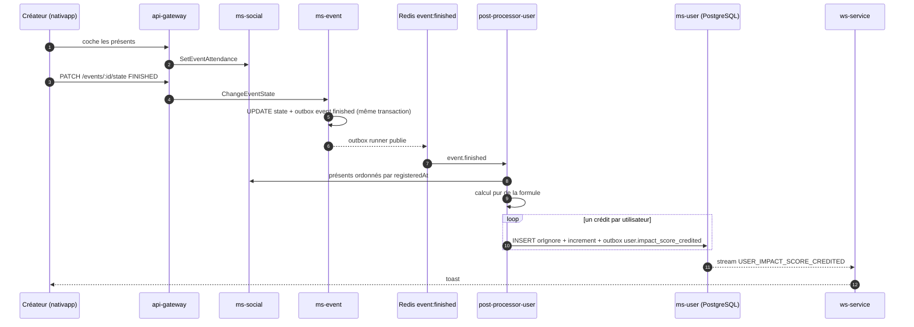

# 06 - Flux asynchrone

Le flux réutilise le pipeline existant des crédits (voir [01](01-etat-des-lieux.md)) et le patron de [C3](../architecture/C3-Async-Patterns-And-Flows.md) : outbox transactionnel, Redis Streams, post-processor, WebSocket.

## 1. Séquence

## 2. Étapes

1. **Check-in** : voir [05](05-modele-de-donnees-et-checkin.md). Il précède le passage à `FINISHED` et se verrouille avec lui.
2. **`event.finished` enrichi** : le payload actuel est `{eventId, eventType, awardedImpactScore}` (`postgres-event.repository.ts:300-304`). On y ajoute `startAt`, `endAt`, `maxParticipants`, `organizerId` pour que le consommateur calcule sans rappeler `ms-event`. Le champ `awardedImpactScore` reste, pour les anciens événements.
3. **Calcul** : fonction pure `computeEventScoring({ attendees, startAt, endAt, maxParticipants })` qui renvoie `{ formulaVersion, pool, organizerPoints, participants: [{ userId, rank, points }] }`. Aucune lecture ni écriture : testable en TDD. Elle est partagée avec `nativapp` pour l'estimation (voir [08](08-impacts-nativapp.md)).
4. **Crédit idempotent** : `ImpactScoreCrediter` (`impact-score-crediter.service.ts:42-123`) conserve son schéma : `INSERT ... orIgnore` dans `impact_score_credits`, `increment` de `total_impact_score`, ligne outbox `user.impact_score_credited`, tout dans une transaction par utilisateur. Il crédite maintenant des montants différents par utilisateur et ajoute le créateur.
5. **Notification** : inchangée côté `ws-service`. Le payload `{userId, eventId, scoreIncrement}` suffit pour le toast ; il pourra recevoir `role` et `rank` plus tard.

## 3. Idempotence et reprise

| Panne | Comportement |
| :--- | :--- |
| Rejeu de `event.finished` | Le registre ignore les couples déjà crédités. Mêmes calcul, mêmes montants, aucun doublon. |
| Crash au milieu de la boucle | Les crédits faits sont durables, le message est relivré, la boucle reprend sur les manquants. |
| Check-in modifié entre deux rejeux | Impossible : verrouillé à `FINISHED`. Les présents lus sont donc stables. |
| Poison pill | DLQ, voir `volontariapp-async-remediation`. |

> [!IMPORTANT]
> Le calcul doit lire les présents dans un ordre stable (`registeredAt` puis `userId`). Sinon un rejeu peut attribuer un autre rang et créditer un montant différent à un utilisateur resté à créditer.

## 4. Pagination des présents

`ImpactScoreCrediter` lit déjà les participants par pages via `getAllEventParticipantIds`. Le calcul a besoin de **tous** les présents d'abord (pour `N` et `S`). Pour un événement de 200 à 5 000 personnes cela reste en mémoire, mais la limite de capacité du formulaire (5 000) fixe le pire cas : à confirmer comme borne dure.

## 5. Anciens événements

Les événements sans `scoring_version` suivent l'ancien comportement : crédit uniforme de `awardedImpactScore` aux inscrits, sans prime du créateur. Un événement créé avant le déploiement mais terminé après est donc traité comme ancien. Cela évite de basculer en cours de route un événement dont le créateur avait promis un score visible.

## 6. Pourquoi pas dans `ms-event`

La formule a besoin de la présence et de l'ordre d'inscription, qui vivent dans `ms-social`. Le calcul dans `ms-event` obligerait un appel gRPC synchrone dans la transaction de changement d'état. Le consommateur asynchrone (`post-processor-user`) possède déjà le client vers `ms-social` et le registre de crédits.
