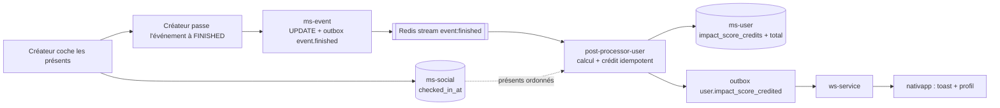

# Scoring - Points d'événement

Ce dossier décrit le système de points qui récompense la création et la participation aux événements : le problème, la formule, le modèle de données, le flux asynchrone et les impacts par dépôt.

> [!NOTE]
> **Statut au 2026-10-30 : conception validée sur les grandes lignes, rien n'est implémenté.**
> - Ce qui existe : un score d'impact figé par événement, saisi par le créateur, crédité à `FINISHED` à tous les inscrits ([01](01-etat-des-lieux.md)).
> - Ce qui est décidé : points calculés par formule, présence validée par le créateur, bonus décroissant selon l'ordre d'inscription, prime pour le créateur.
> - Ce qui est ouvert : le réglage de l'exposant (la formule actuelle donne +248 % de la moyenne au premier d'un événement de 200 personnes), voir [04](04-exemples-et-simulations.md).

## Principe en une phrase

Quand un événement passe à `FINISHED`, un post-processor calcule un prize pool selon la durée, le nombre de présents et le taux de remplissage, le répartit entre les présents selon leur ordre d'inscription (le premier inscrit touche le plus, mais l'écart reste borné), verse une prime au créateur, puis `ws-service` notifie chacun.

## Décisions actées

| # | Décision | Raison |
| :--- | :--- | :--- |
| 1 | Le rang `i` est l'ordre d'inscription (`registered_at`), recalculé à la clôture parmi les présents. Une désinscription fait remonter les suivants. | Pas de rang visible avant la fin, donc pas de contestation ni de trou à gérer. |
| 2 | Seuls les présents validés comptent, pour `N` comme pour le rang. | Sans présence, le bonus du premier inscrit se farme en s'inscrivant sans venir. |
| 3 | Le créateur valide la présence en cochant les participants dans l'app. | Un seul acteur de confiance, pas de QR ni de géolocalisation à sécuriser. |
| 4 | Le créateur ne saisit plus de points. Le score n'est plus une entrée du formulaire. | Évite qu'un créateur fixe 10 000 points pour attirer du monde. Précision d'implémentation dans [06](06-flux-asynchrone.md). |
| 5 | `alpha` (durée) est une table de paliers versionnée. | Les durées libres du formulaire (0,5 h à 720 h) tombent toujours dans un palier. |
| 6 | Une capacité `>= 1` est requise pour gagner des points. Anciens événements à `maxParticipants = 0` : bonus de remplissage à 0. | Évite la division par zéro et un bonus maximal garanti en mode illimité. |
| 7 | Aucun backfill. `impact_score_credits` n'est pas réécrite. Seuls les seuils de rangs du front sont recalibrés. | Les données manquent pour l'historique (ordre, présence, durée). |
| 8 | Le leaderboard est inclus dans la doc comme conception, sans existant. | Le backend n'a aucune requête top-N par points. |

## Décisions ouvertes

| Sujet | Proposition | Impact |
| :--- | :--- | :--- |
| Exposant `0,3` et écart du premier | Réduire l'exposant (0,15 donne +89 % à N=200) ou plafonner le bonus du premier, voir [04](04-exemples-et-simulations.md). | Valeurs de tous les tableaux et seuils de rangs. |
| Créateur si aucun présent (`N = 0`) | 0 point. | Règle de [03](03-formule.md). |
| Arrondi | Méthode du plus grand reste pour que la somme des `P_i` égale `P`. | Aujourd'hui l'arrondi simple dérive de 4 points à N=200. |
| Événement annulé | Aucun point, check-in verrouillé à `FINISHED`. | Cohérent avec `event.finished` seul émetteur. |
| Qui déclenche `FINISHED` | Question déjà ouverte dans [badges/07](../badges/07-evenement-event-finished.md). | Délai de crédit. |
| Bornes de `alpha` | `<= 2 h` : 1,0 ; `<= 4 h` : 1,5 ; `<= 24 h` : 2,5 ; au-delà : 4,0. À valider (8 h et 24 h donnent le même palier, 30 jours aussi que le week-end). | Équité entre durées, abus par événement très long. |
| Anti-Sybil | Seuil minimal de présents pour verser la prime du créateur. | Voir risques dans [10](10-plan-de-livraison-et-risques.md). |
| Lieu du calculateur pur | `@volontariapp/shared` (déjà importé par `nativapp`). | Partage backend et estimation front. |

## Glossaire

| Terme | Sens |
| :--- | :--- |
| Score d'impact (`total_impact_score`) | Total cumulé de points d'un utilisateur, dans `ms-user`. Dans la doc, "points". |
| Points d'événement | Part de prize pool créditée à un participant pour un événement. |
| Prize pool (`P`) | Total de points distribués aux participants d'un événement. |
| Prime du créateur | Points versés à l'organisateur, calculés séparément du prize pool. |
| Rang d'inscription | Position `i` d'un présent dans l'ordre d'inscription. Sans rapport avec le rang d'impact. |
| Rang d'impact | Palier de niveau affiché par `nativapp` (ROOKIE HELPER à ATLAS TITAN), dérivé du score d'impact. |
| Ranking | Réservé à `ms-ranking` (recommandation d'événements et de posts, [matching](../matching/README.md)). N'est jamais utilisé ici pour les points. |

## Navigation

| # | Document | Contenu |
| :--- | :--- | :--- |
| 01 | [État des lieux](01-etat-des-lieux.md) | Faits vérifiés, ce qui manque, points non vérifiés. |
| 02 | [Problème et principes](02-probleme-et-principes.md) | Pourquoi, objectifs, anti-dispersion. |
| 03 | [Formule](03-formule.md) | Paramètres, paliers, créateur et participants, cas limites. |
| 04 | [Exemples et simulations](04-exemples-et-simulations.md) | Tableaux générés par script, écart avec les maquettes. |
| 05 | [Modèle de données et check-in](05-modele-de-donnees-et-checkin.md) | Colonnes, arêtes, ledger. |
| 06 | [Flux asynchrone](06-flux-asynchrone.md) | De `FINISHED` à la notification. |
| 07 | [Contrats et impacts par dépôt](07-contrats-et-impacts-par-repo.md) | proto, packages, services, règle du STOP. |
| 08 | [Impacts nativapp](08-impacts-nativapp.md) | Formulaire, check-in, rangs. |
| 09 | [Leaderboard](09-leaderboard.md) | Conception du classement des utilisateurs. |
| 10 | [Plan de livraison et risques](10-plan-de-livraison-et-risques.md) | Tranches et risques. |

## Vue d'ensemble du flux

